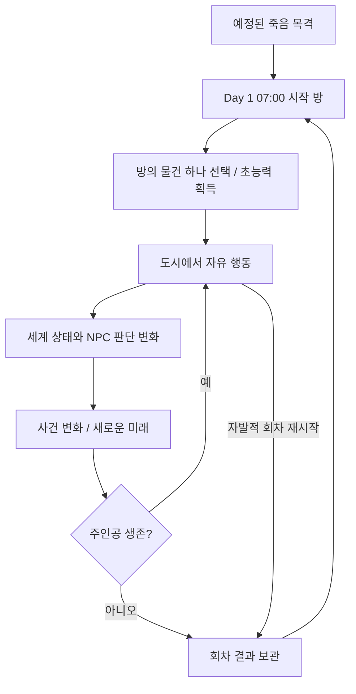
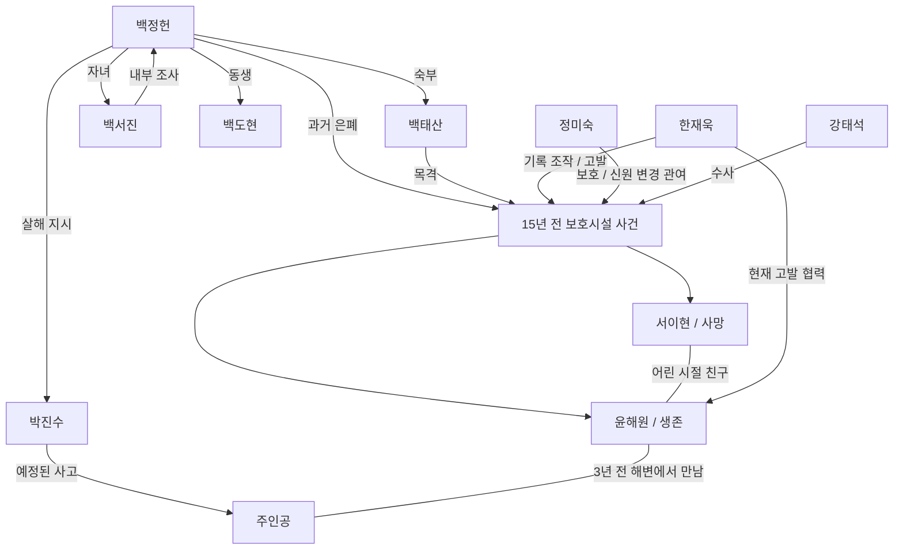
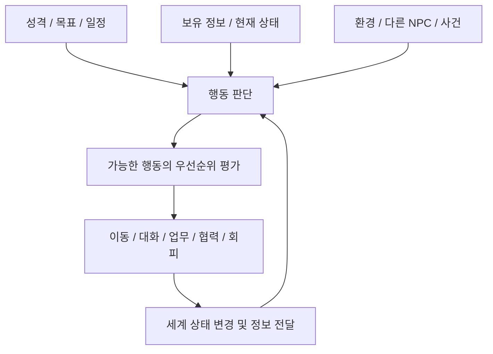
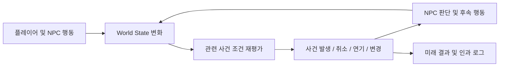

# Past, Future — 최종 설계 통합 및 개발 인수인계

- 기준일: 2026-11-24 (KST)
- 통합 문서 버전: v0.3 (아키텍처 통합 인수인계 초안)
- 시나리오 01: **바다는 죽은 자를 기억한다 (The Sea Remembers)**
- 다음 단계: **로드맵 17. 핵심 게임플레이 프로토타입 — M0 개발 환경 검증부터**
- 로드맵 기본 설계 작성: 16/18 (88.9%); 15단계 재미 설계 12/12, 16단계 아키텍처 설계 18/18 작성 및 기본 방향 채택.
- 실제 Unity 프로젝트, GitHub 저장소, 코드, 빌드, 테스트, 플레이 테스트 및 성능 실측 완료는 확인되지 않음. 위 퍼센트는 개발 진척률이 아니다.
- 개발자 전용 / 스포일러 포함. 실제 사용자에게 개발용 진실·조건·디버거를 노출하지 않는다.

## 0. 사용법, 출처 및 한계 (반드시 먼저 읽기)

본 문서는 원본 `PastFuture_GDD_v0.2_2026-11-24(1).md` 전체를 부록 A에 변경 없이 첨부하고, 현재 대화에서 채택된 기술 방향을 구현 관점에서 정리한 단일 Markdown 인수인계본이다. **원본 부록에 남아 있는 과거의 진행 상태(16단계 미착수, 다음 채팅 시작 문구)는 역사적 기록이다. 현재 진행 상태 및 다음 작업은 본문이 우선한다.** 스토리·콘텐츠의 원래 ID와 명칭, 확정 규칙은 GDD 원문을 우선하며, 기술 정책은 후속 채택 방향을 우선한다. 서로 충돌하면 임의 변경하지 말고 미결정 목록에 기록한다.

### 0.1 상태 표기

| 상태 | 의미 |
|---|---|
| 확정 | 사용자와 합의한 게임 규칙/스토리 핵심. 변경 시 승인 필요 |
| 기본 방향 채택 | 16-1~16-18의 단계별 채택. 모든 임시 수치와 구현 후보의 최종 승인까지 뜻하지 않음 |
| 기술 제안 | 구현 계약의 후보. 기술 실험 및 검증 필요 |
| 미결정 | 규칙·수치·콘텐츠가 아직 확정되지 않음 |
| 원문 복원 미완료 | 실제 과거 답변의 상세 문구 또는 ID별 매핑을 확인할 수 없음. 가짜 원문 생성 금지 |
| 미구현/미검증 | 코드·테스트·빌드가 성공했다는 근거 없음. 테스트는 기본 NotRun, 조건 미확정은 Blocked |

### 0.2 출처 대조 및 복원 범위

| 출처 | 포함 및 제약 |
|---|---|
| 첨부 GDD v0.2 | 원본 파일 전체 보존 (부록 A); NPC, 9개 능력, 35개 증거, 7개 미스터리, 10개 메인 이벤트, 8개 서브 스토리, 22개 엔딩, 46개 Steam 업적 후보 등 원래 데이터 유지 |
| 16-1~16-7 | 확인 가능한 상세 이전 설계 요약을 바탕으로 복원. ADR-001~141은 요약 제목/의미이며 원문 문장 대조본은 아님 |
| 16-8~16-13 | 과거 답변 전문을 확보하지 못함. GDD 및 확인 가능한 앞뒤 단계 계약으로 작성한 구현 참고용 재구성. 신규 확정 사항이나 원본의 정확한 클래스/테스트 ID로 취급 금지 |
| 16-14 | 확인 가능한 기존 답변 후반부 및 GDD로 엔딩·보상 설계 통합. 일부 앞부분은 재구성 |
| 16-15~16-18 | 현재 확인 가능한 답변 기반 통합. 예시 UI 및 중복 설명은 텍스트로 축약 |
| ADR-142~357 | 216개 ID의 정확한 제목과 상세 내용 원문 미확보. 부록 B에 개별 ID를 예약하고 미확인으로 표시. 추정 매핑 금지 |
| ADR-358~562 | 확인 가능한 기존 표의 제목 보존. 단계별 채택 상태와 미검증 상태 구분 |
| 전체 테스트 | 확인 가능한 테스트와 범위, 원래 GDD T_001~018 / FUN_LONG_01~09 보존. 16-1~13 개별 ID/기대 결과 전문은 복원 미완료; 원문 대조 후 보강 필요 |

**따라서 이 파일은 가능한 범위의 통합 인수인계본이지, 18개 답변과 562개 ADR의 누락 없는 원문 합본이라고 주장하지 않는다.** 정확한 원문 합본을 만들려면 누락 단계의 대화 전문(특히 16-8~16-13) 및 초기 테스트/ADR 표를 추가 확보해야 한다. 원문을 확인하지 못한 곳에 새 번호나 사실을 부여하지 않는다. 부록의 GDD는 온전하게 보존되므로 콘텐츠 자체의 상세 수량·명칭은 그곳에서 확인한다.

### 0.3 문서 목차

1. 핵심 게임 계약과 상태 경계
2. 16-1 전체 아키텍처 ~ 16-18 테스트/개발 파이프라인 (18개 절)
3. 전체 설계 충돌 및 미결정 사항
4. 실제 구현 로드맵 M0~M9, Vertical Slice, MVP, 품질 게이트
5. AI 개발 지침 및 새 채팅 시작 프롬프트
6. 부록 B: ADR-001~562 추적표 및 테스트 목록
7. 부록 A: 기존 GDD v0.2 원본 전문

## 1. 절대 변경하지 않을 게임 계약

- 1인칭 3D 싱글플레이. 해림시(가칭)의 자유 탐험, 현실적 미스터리, 타임루프, 샌드박스. 주인공 28세 해운 사무직, 성별 미정. 윤해원 및 백림 가문 관련 실제 진실은 GDD 2~4절 유지. 과거 사건과 범인(백정헌, 박진수의 역할)을 무작위 변경하지 않는다.
- 최초 미래에서 사고 사망 경험 후 Day 1 07:00 시작. 예정 사고 Day 2 19:00(36시간; 129,600,000ms), 조건부 사건이며 살아 있으면 Day 3 이후 계속 진행. 20배는 조정 가능한 기본 시간 배율. 사망 및 명시적 재시작은 새 회차, 프로그램 종료/로드는 동일 회차.
- 시작 방 물건 9개 중 한 능력만 선택. 새 회차마다 재선택, 선택 자체의 초기 미래 변화, 같은 능력으로도 행동에 따라 다른 결과. 침대 제외. 능력 사용 없이 일반 조사로 해결할 수 있어야 함(능력 자체를 선택하지 않는 루트 미정).
- 실제 세계는 플레이어를 기다리지 않는다. NPC는 독립적인 목표, 일정, 기억, 지식과 관계에 따라 행동. 숨겨진 실제 진실이 NPC 판단/지도/뉴스/엔딩 UI로 자동 유출되지 않음.
- 실제로 연결된 원인과 결과만 변화. 실패, 부재, 사망, 소실, 오인 수사 가능. 모든 미래의 완전 해결 보장 없음. 고정된 과거의 증거를 발견하는 것과 과거 자체를 바꾸는 것은 다름.
- 엔딩은 의미 있는 결과 기록. 하나의 회차에서 복수 엔딩 획득 가능. 엔딩, 구금, 입원 및 예정 시각 경과만으로 강제 종료하지 않음. 영구 도시 이탈 이후 정책은 미정.
- 회차 초기화: 지식, 노트, 발견한 장소, 경험한 미래와 허용된 성취 기록을 보존; 실제 소지품, 증거, 관계, NPC 기억, 자산, 범죄·수사, 시설과 도시 변화는 초기 상태로 복원. 영구 돈/스탯 보너스 지양.
- 원본 GDD의 이름·콘텐츠 ID 유지: NPC_001~016, AB_001~009, E_001~035, M_001~007, EVT_001~010, SUB_001~008, END_001~012, LIFE_001~010, Steam 업적 후보 46개. 자세한 내용은 부록 A의 표를 참조. 정식 ID에 테스트 콘텐츠를 덮어쓰지 않음.

## 2. 시스템 아키텍처 16-1~16-18

### 16-1. 전체 프로젝트 아키텍처

채택 기본안: Modular Monolith, Pure C# Domain, 명시적인 상태 소유권, 중앙 SimulationCoordinator 및 Single Writer. 상시 게임 서버 불필요. 모듈은 논리적 경계이지 각각 독립 프로세스나 수백 개의 Assembly를 뜻하지 않는다.

```text
Bootstrap (Composition Root)
  | creates / injects
  +-- Application -> Domain (pure C#, no UnityEngine)
  +-- Infrastructure -> Application / Domain contracts
  +-- UnityAdapters -> Application / Domain contracts
  +-- Presentation -> Application queries, commands, adapter contracts
```

| 경계 | 책임 |
|---|---|
| Domain | 불변 Definition, Runtime State, 실제 규칙, 검증, 변경 계획, 도메인 이벤트 |
| Application | Command Dispatcher, SimulationCoordinator, lifecycle, use case, query projection |
| Infrastructure | 파일/직렬화, 플랫폼, 저장·로드, 진단 구현 |
| UnityAdapters | Physics, Navigation, Input, Scene, Asset loading; 실제 관측 제출 |
| Presentation | 1인칭 화면, UI, 애니메이션, Audio, 읽기 전용 ViewModel |
| Bootstrap | 수동 DI, scope 구성, 종료·해제 |

Application/Profile/Session/Loop/Scene/Prediction Scope 분리. Session은 프로그램 재실행과 무관하게 이어지는 타임루프 경험; Loop는 실제 현재 세계; Scene은 표현 수명; Prediction은 분리된 임시 계산. Scope 종료 시 구독과 비동기 작업을 해제/취소. Domain은 Unity/파일 구현에 의존하지 않는다. 정적 ScriptableObject 제작 데이터는 불변 C# Definition으로 변환. Application은 모든 명령을 중앙 큐에 제출; Query는 읽기 전용이며 관찰자 범위에 맞춘다. Domain Event는 완료된 실제 사실, Scheduled Event는 미래 작업. 외부 구독자의 재귀적 직접 상태 변경 금지.

### 16-2. World State 및 데이터 모델

정적/역사적 진실/초기 세계/현재 가변 상태/영구 상태/기록/예측을 분리. 상태 소유자만 변경 계획을 제출한다. 모든 실체는 안정적인 ID 사용. 고정 인물·시설은 콘텐츠에 정해진 EntityId, 동적 개체는 Loop별 할당기와 고유 ID 사용. 과거 참조는 `(SessionId, LoopId, EntityId)`; 기록의 참조를 현재 실제 대상에 사용하지 않는다.

```text
RuntimeWorldState
  Metadata(SessionId, LoopId, WorldRevision, ContentVersion)
  EntityRegistry, Actor/Health/Location/Movement
  Item/Ownership/Containment, Facility/Device/Vehicle
  NPC/Goal/Schedule/Action, Knowledge/Belief/Memory/Relationship
  Communication, Ability/TimeModifier, Investigation/Evidence/Proof
  Event/Scheduler, Causality, Economy/Employment/Business/Property
  Crime/LawEnforcement/Judicial/Custody, Organization/Environment/Traffic
  Ending/Reward/Progression
  ClockState, SimulationState, RandomState, IdAllocator
```

위 이름은 논리적 Store 목록이며 같은 값을 중복 저장하지 않는다. Inventory는 실제 점유·배치·포함 관계로부터 파생, 법적 소유자와 현재 점유자/관리자 구분, 컨테이너 순환 금지. Location은 World/District/Site/Space/Anchor/Position; 이동 origin/destination/departure/ETA/mode/progress/status. EvidenceDefinition과 실제 Instance, 관찰/주장/가설/제출을 분리.

`WorldChangeSet`: TransactionId, CommandId, LoopId, ExpectedRevision/관련 버전, GameTime, operations, domain events, causes. 사전 검증 → 관련 상태 및 RNG/중복방지 원장 원자적 Commit → revision 증가 → 확정 Domain Event/후속 큐. 실패·읽기·의미 없는 재평가로 revision을 불필요하게 증가시키지 않는다. 여러 인과 단계는 독립 트랜잭션이 될 수 있으나 필수 불변 조건은 즉시 유지. 외부는 안정적인 처리 경계의 읽기 전용 snapshot을 조회. Single Writer가 상태 변경, 병렬 계산은 읽기 전용 후 재검증. Snapshot 종류: 초기, 실행 중 읽기, 저장, 예측, 디버그, 엔딩 결과. Save와 Load는 초기 세계 재생성이 아님. 새 회차는 후보 세계 검증 후 교체. 실제 사망 이후 정상 행동 불가, Scene Unload는 삭제 아님, 예측 부작용 없음, Archive는 현재 증거 아님.

### 16-3. Game Clock 및 Simulation

`GameTime` = Day 1 07:00으로부터 long ms; `GameDuration` 별도. Unity real/presentation/physics clock과 논리 시간 독립. 20배 기본 후보: 36h = 실제 108분, 24h = 72분 (정지·건너뛰기 제외). 1 게임초 heartbeat 후보 + 이벤트의 정확한 경계에서 실행하는 hybrid. 실제 게임 시간은 처리 완료 상태와 함께 공개한다.

`ClockState`: CommittedTime, ProcessingTime, RequestedTargetTime, PendingTimeBudget, FractionalRemainder. `SimulationState`: TickIndex, ExecutionSequence, PendingWork, phase cursor; TimeModifierState, TimeSkipState, RandomState는 각각 소유자가 관리. 모드 Initializing/Running/Skipping/Paused/Transition/Closing/Faulted. Pause token은 중첩 가능; 스마트폰/대화 기본 시간 진행, 노트/메뉴 정지 후보, critical loading에만 정지 가능. Offline progression 미적용 기본안. Unity Time.timeScale=20 사용 금지.

| Phase | 순서 |
|---:|---|
| 0 | 생명주기·무결성 |
| 1 | 이미 진행 중인 Action 완료, 유효한 관측 |
| 2 | 현재 경계에 접수된 Command |
| 3 | 필요한 상태 반응 |
| 4 | 예정 이벤트 |
| 5 | NPC 신규 판단 |
| 6 | 일반 후속 처리 |
| 7 | 엔딩·기록 |

정렬 `(EffectiveGameTime, ExecutionPhase, DefinedPriority, SequenceNumber)`; 같은 시각에서 이전 phase로 무한 역삽입 금지. 이미 시작된 이동 도착과 새 이동 요청 구분; 플레이어에게 무조건 우선권 부여하지 않음. 각 시스템 실행 주기/다음 시각을 관리하고 최소 경계로 전진. CPU 예산 초과 시 cursor를 보존하여 다음 프레임에서 처리, 필수 사건 생략 금지. 시간 건너뛰기는 실제 활동/조건에 따라 중단되고 숨은 사건을 스포일러로 노출하지 않는다. Event Jump/Batch는 직접 진행과 동등성을 검증한 영역만. 시간 정지 능력은 Time Domain/Modifier(대상, 영역, scale, duration clock), 세계 시간이 멈춰도 종료를 위한 별도 clock 후보. RNG 독립 stream, 알고리즘 버전 및 내부 상태 저장, draw commit 원자화. 예측 Sandbox는 mutable state·RNG·Queue 격리.

### 16-4. Command 및 Event System

```text
CommandEnvelope = CommandId, CommandType, LoopId, ExecutionGeneration,
  SourceType, ActorId?, RequestedTime, EffectiveGameTime, SequenceNumber,
  CorrelationId, CauseReferences[], ExpectedStateVersions?, Payload
CommandReceipt = CommandId, LoopId, PayloadFingerprint, Result, TxnRef, ProcessedTime
ActionInstance = Id, Type, ActorId, Targets, SourceCommandId, StartedTime,
  ExpectedCompletionTime, Progress, Status, ResourceClaims, Interruption, Completion
EventDefinition = Id/Version, ScenarioId, Category, Trigger, Schedule/Window,
  Participants/Location, Preconditions, Cancel/Defer/Replace, ExecutionPlan,
  Completion/Recurrence/DependencyKeys/Followup/Visibility/Priority
EventInstance = Id, DefinitionId/Version, LoopId, Status, Original/CurrentScheduledTime,
  Created/Started/CompletedTime, Bindings, ScheduleVersion, Attempts/Deferrals,
  ActiveActionRefs, EffectKeys, Causes, Outcome, ReplacementRefs, LastEvaluation
```

Command source Player/NPC/PhysicsAdapter/ScheduledEvent/System/Debug (신뢰 가능한 범위). 포맷, loop/generation, actor/target, spatial/temporal/resource, rule 및 dedup 검증. 동일 ID+같은 payload는 이전 receipt, 다른 payload면 충돌. 무효 요청은 상태 변경 없음; 실제로 수행된 실패 시도(연락 실패 등)는 유효한 결과로 기록 가능. Queue 접수와 최종 완료 구분. Action: Pending/Running/Completed/Interrupted/Failed, 실제 이동·완료 검증, 자원 해제 원자화. 명령·효과·outbox·receipt 및 RNG를 같은 변경 단위로.

Event Trigger: AtGameTime, OnStateChanged, OnDomainEvent, AfterEventResult, Periodic, ManualScenarioTrigger. 상태 Created/Waiting/Scheduled/Evaluating/Executing/Deferred/Completed/Cancelled/Expired/Replaced/Interrupted/Faulted. Terminal 부활 금지; defer 동일 ID + ScheduleVersion 증가; replace 새 ID를 원자 등록. 조건은 pure read, `Satisfied/Unsatisfied/Unavailable/Error` 및 이유/ReadStateKeys/Revision 반환. 실제 필요 조건과 NPC의 믿음 분리. 기본 평가 순서 영구 취소→대체→전제조건→연기/대기→만료, window 준수. 조건 미확인/오류를 충족 처리하지 않음. EffectDefinition: Id/Type/Target/Parameters/Conditions/AtomicGroup/Failure/Idempotency; 실제 담당 모듈의 ChangeSet을 사용; 이전 완료 단계는 임의 rollback하지 않는다.

Scheduler min-heap 정렬 키(16-3), 실제 인스턴스 dict, scheduleVersion으로 stale entry 무효화, dependency index 재사용. `EventOccurrenceKey=LoopId+DefinitionId+OccurrenceIdentity`; `EffectExecutionKey=EventInstanceId+StepId+EffectOccurrenceIdentity`. 완료 효과 원장과 변경을 함께 저장. DomainEvent: Id, Type, LoopId, Time, Sequence, TransactionId, Revision, source/cause refs, affected entities, changed StateKeys, correlation, payload. 발생 사실과 내부 진실/공개 view 분리. NPC schedule은 기본 의도, Action이 실제 행동, Event는 조율·결과 추적; 동일 활동 두 번 실행 금지. GDD EVT_001~010은 원래 정의 유지. 종료 후의 같은 시각/늦은 명령이 과거를 되돌리지 않는다.

### 16-5. Causality System

상태 변화 및 실제 사실에 연결된 공통 세계 규칙 + 저작 시나리오 규칙. 모든 영향에 임의의 전역 ButterflyScore 부여 금지. 원인-결과 실제 연결이 없으면 메인 사건 변화 없음.

```text
CausalRuleDefinition = RuleId/Version, OwnerModuleId, Category, Trigger,
  SubjectBindings, Condition, ConsequenceDefinitions, ReadDependencies,
  DeclaredWriteTargets, ExecutionPolicy, ConflictPolicy, RepeatPolicy, Priority, TracePolicy
StateKey = StoreType, EntityId/RecordId, FieldId, SubKey?
ConsequenceRequest = Id, LoopId, RuleId, TriggerOccurrence, SourceNodes,
  Target, Type, CreatedTime, EffectiveTime, Phase, Priority,
  ExpectedStateVersions, DedupKey, ConflictKey, Payload
DelayedConsequence = WorkId, LoopId, SourceRefs, DueTime, Target,
  Revalidation/CancelPolicy, Status, Payload
```

Trigger OnStateChanged/OnDomainEvent/OnThresholdCrossed/OnConditionEntered/Exited/OnScheduledReevaluation. Consequence RequestCommand, RequestNpcDecision, RequestEventReevaluation, InvalidateAction/Schedule, ScheduleDelayedWork, RegisterOpportunity, UpdateDerivedState. DependencyIndex 역인덱스 StateKey→DependentIds, DomainEventType→RuleIds, dependent→keys; 정적 선언 + 동적 관측 read, collection/missing key 포함. 실제 상태 변경 → 후보 검색 → pure 조건 평가 → 안정 정렬 → 관련 요청 병합(서로 다른 실제 원인 유지) → 담당 모듈 재검증 및 확정 → trace. 평가 중복 키(관련 버전), 효과 중복 키(발생 단위)를 분리. 상태 소유자가 conflict 해결(예: 아이템 Single Writer, 목표 NPC utility, 서로 모순된 증언 유지). 지연 효과는 실행 시 재검증. 동일 시각 무의미 반복 감지, ledger, phase 제한, semantic fingerprint, cycle fault 기록; 처리 예산 초과와 cycle fault 구별. 전체 회차의 인과 깊이를 임의 제한하지 않는다.

실제 trace DAG `CausalityNode` Id/LoopId/GameTime/ExecutionSequence/NodeSequence/WorldRevision/Type/Subjects/Txn/Result/Summary; Edge Cause/Effect/Rule/Type/Condition/Explanation. Triggered/Contributed/Enabled/Prevented/Invalidated/Delayed/Informed/Resolved. Prevented는 실제 취소 결정에 연결, 존재하지 않는 미래를 확정 사실처럼 기록하지 않는다. 구조적 dependency graph는 순환 가능, 실제 trace는 시간/순서 DAG. 원인 추적은 반사실적 유일 원인을 증명하지 않는다. CausalState에는 필요한 provenance, pending work, delayed work, ledger, condition tracking, 동적 dependency; static index 재구성. 실제 NPC/지식/물리/시설/범죄/경제/추리·엔딩 담당 모듈에 후속 요청. Debug backward/forward trace, 조건/충돌/cycle/비교. 첫 프로토타입: 화분→부상/구조→일정→약속→자료 전달, 목격자 여부에 따른 별도 관계 변화.

### 16-6. NPC System

Goal + Schedule + Utility AI + FSM. 고정된 Definition과 Runtime 분리, 각 모듈의 실제 건강/위치/관계/경제 등 참조만 사용. NPC_004 실제 서이현은 과거 사망 인물이며 현재 살아 있는 NPC로 생성하지 않는다. 주요 인물의 초기 지식·일정·목표는 GDD 4, 9절을 따른다.

```text
NPCDefinition = EntityId, Version, Identity/Demographic, PersonalityProfileId,
  InitialGoals, ScheduleTemplateId, InitialKnowledge/RelationshipRefs,
  Occupation/Home/Capability/DecisionProfile/PersistencePolicy/PresentationAsset
NPCRuntimeState = EntityId, DefinitionId, PublicIdentityState,
  PersonalityAdjustment, Emotion, Need, GoalRefs, DecisionState,
  ScheduleState, ActiveActionRefs, LogicalSimulationState
GoalDefinition = Id, Category, Activation/Completion/Failure/Suspension,
  BasePriority, RelatedGoals, ActionProviders, Repeat
GoalInstance = Id, DefinitionId, Owner, Priority, Status, Progress, Refs,
  ActivatedTime, LastEvaluation, Deadline, Causes, Failure
NPCDecisionContext = ActorId, LoopId, Time, OwnHealth/Location/Capabilities,
  Personality/Emotion/Need, Goals/Schedule/Actions, KnownInformation,
  PerceivedEnvironment, KnownRelationships, Opportunities, ContextVersion
ScheduleEntry = Id, Actor, Activity, Start/End/Earliest/Latest, Destination,
  Priority, Conditions, RelatedEvent, Flexibility, Interruption, Recurrence
Appointment = Id, Participants, Location, Time, Grace, Commitments,
  ActualStatus, CommunicationRefs
MovementState = Actor/Action, Origin/Destination, Route/Revision/Segment/Progress,
  Departure/ETA/Mode/Status/Reason
```

Goal 상태 Inactive/Available/Active/Suspended/Blocked/Completed/Abandoned/Failed. NPC의 주관적 목표 완료와 실제 입증은 다름. 후보 provider: schedule/goal/need/safety/social/employment/opportunity/scenario. candidate에는 goal, target, duration/cost, hard constraints, utility considerations, interruptibility/resource claims/source. 자신의 상태와 실제 관찰된 정보만 조회; 숨은 잠금/경로 차단은 시도 시 발견 가능. Hard constraints + utility weighted average 0~100 후보(정확한 가중치 미결정). GDD 해원 예시 협력 Trust*.8+(100-Fear)*.2, 독자 행동 (100-Trust)*.6+(100-Stress)*.4, 안전 Fear*.65+Stress*.35, 외부 도움 Stress*.5+Fear*.25+Trust*.25. 공식 확정 아님. 최소 commitment/hysteresis/전환 임계값(10 후보)/cooldown, 안정적인 tie-break, 관련 사건 발생 시 재평가. 가까운 5~15 게임초, 원거리 주요 30~60초, 일반 개별 1~5분 후보. Phase 5 판단→허용된 후속 phase/다음 경계에서 Command. Shared Action FSM: 준비/실행/완료/중단/실패, 선택적 일시중지; Locomotion, Hands, Attention, Speech, CommunicationDevice, VehicleControl, ExclusiveActivity 자원 충돌 관리. 일정 template 불변 + override Delay/Cancel/Replace/Insert/Suspend/ChangeDestination. 실제 이동 및 약속, 참여 의사와 정보 전달 구분. 연락 두절 ≠ 사망.

Global route graph + Local NavMesh, 비용/도착 시각과 실제 경로 검증. SLOD0 상세 물리, 1 간소화 개별, 2 원거리 논리, 3 비개별 집계. Persistence A 주요, B 이름 있는 생활 NPC, C 지속 일반 시민, D 배경 인구 별도. Rendering LOD 독립. 시민 승격 시 ID 및 이미 관찰한 사실 보존, 없는 과거 생성 금지, 인구 중복 집계 금지. 이동 권한 handoff는 단일 소유자, 위치/Action/route/progress 인계, stale adapter 거부. 씬 해제 및 LOD가 사망/삭제/순간이동을 의미하지 않음. 장기 일정은 실제 직업/주거/건강/약속을 기반으로 재생성; 메인 사건 강제 반복 금지. Save는 decision/cooldown/commitment/goal/schedule override/action/route/knowledge/relations 및 시민 ID 포함.

### 16-7. Knowledge 및 Relationship System

TruthCatalog(저작용 실제 역사), runtime 사실, Proposition, Observation, Claim, Knowledge, Belief, Memory 분리. 플레이어와 NPC는 자기 관측·전달·믿음만 사용. 실제 인물 ID와 관찰자가 인식한 이름/신원 분리. 법적 입증은 다른 모듈의 별도 판단.

```text
PropositionDefinition = Id, Subject/Predicate/Object, TemporalScope, Topics, ContradictionGroup
ObservationRecord = Id, Observer, Time, Channel, PerceivedSubject/Content,
  Quality, Location, IdentityConfidence, Causes, Context
ClaimRecord = Id, Proposition, AssertedValue, Speaker, Time, ClaimedOccurrence,
  Channel, ParentClaims, RootProvenance, Support, Disclosure
KnowledgeRecord = Id, Owner, Claim/ObservationRef, AcquiredTime/Channel,
  PerceivedSource, Credibility, Verification, Accessibility, LastReviewed, Freshness, Provenance
BeliefRecord = Owner, Proposition, Stance, Confidence, Supporting/OpposingRefs,
  Time, Revision, Causes
MemoryRecord = Owner, Type, Experience/AcquisitionTime, PerceivedParticipants,
  Location, KnowledgeRefs, Emotion, Salience, RecallAccessibility, Confidence, LastRecall, Provenance
PerceivedIdentityRecord = Observer, LocalId, KnownNames/Features,
  LastKnownLocation, CandidateIdentityRefs, Confidence, KnowledgeRefs, Resolution
CommunicationInstance = Id, LoopId, Sender, Recipients, Channel, Claims/Content,
  Created/Send/DeliveryTime, RecipientStatus, AcquiredRefs, Action, Causes
RelationshipRecord = Observer, PerceivedTarget, Tags, Familiarity, Trust,
  Suspicion, Affection, Respect, Hostility, FearOfTarget, Reciprocity,
  LastInteraction, MemoryRefs, Revision, CauseRefs
```

Belief: Unknown/Undecided/Suspected/Accepted/Disputed/Rejected. Claim immutable; 정정은 새 주장, 서로 다른 시각의 사실은 무조건 모순 아님. Observation 후보는 공간/시야/음향/주의/조건; 보지 못한 것은 알지 못함. Communication Created→Sent→Delivered→Perceived/Read→Acquired; 읽지 않은 메시지와 수신 실패 처리, 믿음은 별개. Claim credibility와 belief confidence 구분, 출처 직접성/신뢰/독립성/인지 품질/일관성/동기/신선도는 후보. 객관적 공통 출처와 관찰자가 아는 공통 출처 분리; hidden truth로 신빙성 조정 금지. 거짓말은 발화자 믿음과 충돌 + 의도, 오해/오류/생략과 별도. DisclosurePolicy 주제/지식/청자/관계/위험/목표/거절; NPC 기억은 실제 경험 기반, AB_004는 진실 전체 접근 아님.

관계는 방향성(나→상대), 가족·고용 등 실제 구조 관계와 인지된 감정 분리. Fear/Stress는 NPC 일반 상태, FearOfTarget은 개인 관계. 관계 변화는 실제 인지된 책임·행동·상황으로 발생; 안 본 구조에 자동 신뢰 금지, 오인 가능. `RelationshipChangeRequest` observer/target/interaction/perceived responsibility/knowledge/memory/delta/causes/effect key; 0~100과 가중치/반복 감쇠 후보. 대화 `DialogueTopicDefinition` topic/propositions/speaker/discovery/intents/disclosure/context/interruption/presentation. 이전 회차 지식을 활용한 질문 가능, 현재 NPC는 실제로 전달받아야 인지. `CooperationRequest` initiator/recipient/activity/goal/terms/status/commitments/expiry/causes, Proposed/Received/Accepted/Conditional/Refused/Withdrawn/InProgress/Completed/Failed; 동의≠실제 행동. Reputation은 subject/audience/topic/claims/sentiment/provenance/reach/time/freshness, 단일 선악 점수 금지. Rumor는 claim/parent/root/speaker/topic/relevance/novelty/history/expiry; 실제 통신을 통해 전달, 중복/반복 제한. 능력 목격은 현상·행위자·능력 규칙을 구분. `PersistentKnowledgeRecord` source session/loop/time/content snapshot/classification/verification at acquisition/current confirmation. 새 회차 NPC 기억·관계 초기화, 플레이어의 주장/노트/기억 유지; 과거 실제 증거/동적 ID의 현재 참조 금지. Sparse stores, observer-scoped reader, 개발자 truth inspector 및 leak detector.

### 16-8. Player 및 Interaction System

> 복원 상태: 원문 미확보. 아래는 GDD 5~7, 11, 13절 및 16-1~7, 16-16~18의 확인된 계약에 맞춘 구현용 재구성이다. 실제 16-8의 클래스명, 수치, ADR/테스트 ID 대조 필요.

Player는 Actor의 특수한 제어 주체이며 다른 Actor와 건강·위치·소유·행동·지식의 공통 Store를 이용한다. PlayerDefinition: ActorDefinitionId, InitialLocation, CapabilityProfile, MovementProfile, InteractionProfile, ControlProfile, PresentationAssetRef. PlayerRuntimeState: ActorId, control context, ActiveActionRefs, pose/orientation, movement mode, selected target(임시 UI), 실제 점유/장비 참조. Health, Inventory, Ownership, Knowledge 등의 권위 데이터 복제 금지. 카메라 방향/마우스 감도 및 입력 버퍼는 표현 계층; 실제 시야·이동의 관측으로 필요한 값만 제출. CharacterController 초기 후보, 차량/Rigidbody 별도 Adapter. Unity 물리/렌더 시간은 Game Clock 20배와 분리. InputMap Gameplay/Interaction/Ability/Vehicle/Smartphone/Investigation/UI/Cinematic/Debug. 지속 이동은 병합된 입력/관측, 구매·줍기·대화·능력 발동은 개별 Command. Modal UI별 입력 우선순위 및 PauseToken 정책.

`InteractionDefinition` 후보: Id, Verb, TargetCapabilities, Reach/Anchor, Conditions, Duration, RequiredResources, EffectPlan, InterruptPolicy, ObservableStimuli, OwnerModule. `InteractionRequest` Actor/Target/Verb/Loop/Generation/Observation/ExpectedVersions/CommandId. `InteractionResult` Valid/Rejected/AttemptedFailure/Started/Completed, reason, action/txn refs. Query는 지각한 affordance만 보여 주고 숨은 잠금·증거·NPC 속마음 유출 금지. 실제 실행은 거리·시야·물리·상태·권한/자원 재검증. 물리적 가능성과 법적 허가를 분리; 허가 없는 행동은 불가능한 UI로 무조건 제거하지 않고 게임의 실제 범죄 규칙에 연결한다.

물건: ItemDefinition과 ItemInstance(개별 ID, definition/version, 상태/내구도, 위치·배치/컨테이너/held/equipped 참조); 법적 owner, custodian, possessor 분리. Inventory는 포함/점유의 projection. 동일 물건 동시 점유/순환 포함 방지; 줍기/놓기/양도/판매/압수는 담당 모듈에서 원자적으로 처리. Evidence 소유·내용 인지·법적 제출 별개. NPC 대화는 지식·DisclosurePolicy·협력 및 Action 자원, 연락은 실제 전달 상태. 시설은 영업·물리 출입·잠금·법적 접근 별개, 차량 좌석 점유/운전자/승객/이동 권한 분리. 이동·상호작용 중단 전 완료 효과 취소 금지, 부분 결과 유지. 건강의 부상·치료·의식 불명·사망 구분; 사망은 Health가 확정하고 Loop lifecycle이 처리. 배고픔/수면을 생존 강제 요소로 확정하지 않음.

검증: 상호작용 경계값/동시 소지/컨테이너 순환/차량 좌석 경합/잠금 숨김/중단과 재개/동일 접촉 피해 중복/이전 콜백/사망 및 실제 물리 결과/저장·복원. Debugger는 실제 Action, 자원, 지각 가능한 대상, 실제 물건 배치, 권한 및 Causality trace. 실제 게임 규칙과 테스트 내용의 정확한 원문 ID는 미확인.

### 16-9. Ability System

> 원문 미확보, GDD 5절 및 16-15/17/18의 능력별 검증 계약으로 재구성. 정확한 활성화 수치와 초기 효과는 확정하지 않는다.

공통 기술 계약 후보:

```text
AbilityDefinition = AbilityId/Version, SelectionItemRef, TargetPolicy,
  ActivationConditions, DurationPolicy, DurationClock, CostPolicy, CooldownPolicy,
  EffectSteps, InterruptPolicy, Observation/DisclosurePolicy, InitialEffectDefinition,
  PresentationRefs
AbilityRuntimeState = LoopId, ActorId, SelectedAbilityId, SelectionStatus,
  InitialEffectStatus/OccurrenceKey, ActiveEffectRefs, CooldownState,
  CostState, UseHistory, UsageCounters
AbilityActivation = ActivationId, AbilityId, ActorId, TargetRefs, StartTime,
  DomainClock, EffectRefs, RemainingDuration, Status, CauseRefs, EffectKeys
```

선택→승인→초기 효과 등록→실제 완료→인과 처리. 발동은 대상·자원·상태·거리·쿨다운을 검증하고 실제 모듈에 효과 제출. 능력 발동 승인과 실제 충돌·관측·정보 획득 분리. 비용/효과/기록을 가능한 범위에서 원자화. 지속·취소·중단·종료 시 실제 자원/제약 정리. 초기 선택 효과와 자발적 사용 카운트 분리(능력 미사용 해결). 능력별 초기 효과는 GDD 예시 범위에서 실제 공간/정보/물리 연결만 발생. 자동 전역 변화 금지.

| ID / 선택 물건 | 능력 | 상세 기술 연결 및 경계 |
|---|---|---|
| AB_001 시계 | 시간 조작 | TimeModifier(대상/영역/scale/clock/종료), 게임·물리·애니메이션 영역 분리. 정지 중 남은 시간의 만료 기준 별도 후보. 정지 중 충돌·힘 축적·전역/국소 규칙 미정. 임의 과거 복원 없음 |
| AB_002 안경 | 투시 | 대상의 유효한 관측 영역, 제한된 시각 정보, Perception/Knowledge; 실제 문 잠금·증거 소유·법적 접근 변경 없음 |
| AB_003 거울 | 과거 관찰 | 고정 과거의 허용된 장소/시점/관찰 잔상. 실제 과거 변경 및 숨은 전체 진실 조회 금지; 표현 재현과 현재 증거 분리 |
| AB_004 책 | 기억 탐색 | 실제 기억/인식에 대한 제한 접근, 부정확한 기억 포함, TruthCatalog 직접 읽기 금지. 대상/동의/자기 기억 범위 미정 |
| AB_005 모니터 | 전자기기 제어 | 실제 Device ID, 기능·전원·연결 관계, 승인된 효과/관측, 장치 상태 담당 모듈. 모든 시스템에 무제한 접근 권한 부여 금지 |
| AB_006 커튼 | 투명화 | 시각 가시성/인지 정책과 Shader, 실제 물리·발소리·흔적 유지. 다른 인지 채널 및 CCTV 조건은 별도 검증 |
| AB_007 종이 | 미래 예지 | 현재 일관된 Snapshot의 격리 Sandbox, 동일 규칙·별도 RNG·queue·실행 세대. 가정/예측 범위/원본 revision·time 기록. 제한 관찰 정보만 실제 지식으로, 예측 자산/사망/업적/시간/RNG 병합 금지 |
| AB_008 선풍기 | 바람 조작 | 실제 범위·방향의 힘/환경 효과 요청, 물리 관측 결과를 Health/Item/Perception/Causality로 전달. 힘 적용≠실제 피해·구조 |
| AB_009 연필꽂이 | 염력 | 실제 물건 ID, 힘/이동 제약/자원, Physics Adapter 결과, 실제 점유와 소유권 분리. 대표 첫 구현 능력 |

능력 선택의 초기 세계 영향은 실제 가능한 초기 환경/지식/목격 변화로만 전파. 선택이 완료된 후 16-15에서 정의한 초기 효과 적용 및 필수 반응을 처리하고 자유 플레이. 효과 ID·잔여 시간·쿨다운·실제 사용 기록 저장, 같은 회차 로드 시 재부여하지 않음. 새 회차에서 이전 선택/효과 폐기. Prediction은 mutable state를 공유하지 않으며 결과가 늦으면 source revision/time/generation 검증. 비용·쿨다운·범위·성장 및 구체적 시간 조작, 예지 알고리즘은 미결정. Debug 능력 대상/승인/효과/시간/관측/인과/예측 격리. 모든 9개 공통 contract test + 개별 표현·효과·목격·save/reset 테스트(16-18 참조). AB_001,007 조기 기술 실험 필요.

### 16-10. Investigation System

> 원문 미확보. GDD 8절의 E_001~035, M_001~007 및 이후 확인된 입증·엔딩·저장 계약 기반 재구성. 개별 명칭과 대표 입증 조합은 부록 A의 원문을 그대로 사용한다.

```text
EvidenceDefinition = EvidenceId/Version, Type, Contents/Propositions,
  Origin/Source, InitialLocation/Custodian, Acquisition/AccessConditions,
  Copy/Destroy/DisclosurePolicies, RelatedMysteryRefs
EvidenceInstance = InstanceId, DefinitionId, LoopId, OriginRef, CurrentItem/MediaRef,
  Existence/Condition, ParentCopyRef, CustodyHistory, VerificationRefs
EvidenceDiscovery = ObserverId, InstanceRef/ObservationRef, AcquiredTime,
  KnowledgeRefs, Source/Channel, Verification
Testimony = ClaimRef, Witness, OccurrenceTime, Acquisition/Delivery, Provenance,
  Credibility, ContradictionRefs, Disclosure
MysteryDefinition = MysteryId, RelatedPropositions, ProofRequirements,
  Evidence/ClaimCategories, AlternativePaths, Dependencies
Hypothesis = Id, Owner, PropositionRefs, Support/Opposition, Status, Notes
ProofAssessment = CaseId, Assessor, Scope, RequiredClaims, Accepted/Rejected/UnknownSupport,
  SourceIndependence, Contradictions, AssessmentVersion, Outcome
SubmissionRecord = Id, CaseId, Submitter, Recipient, EvidenceInstanceRefs,
  ActualTransfer/ReceiptTime, Custody, Status, AssessmentRefs
```

실제 문서/물건의 존재·위치·소유, 플레이어가 읽은 내용, NPC가 한 주장, 플레이어 가설, 수사기관의 입증은 각각 다른 상태. 복제본은 새 InstanceId 및 원출처/복제 계보 보존, 같은 자료를 독립 증거 두 개처럼 집계 금지. 소실된 원본의 실제 접근은 불가, 기존 기억·복제본·유효한 제출 기록이 자동 소실되는 것은 아님. EvidenceDefinition만으로 실제 보유 증거가 생기지 않는다. 증거 획득·인식·소유 이전·경찰 제출 모두 실제 Action/권한/전달 조건을 통해 수행. 경찰은 전달받고 확인한 자료만 사용. 정확한 신빙성 점수/입증 조건은 콘텐츠 단계에서 결정.

Investigation Board: 관찰자 Knowledge projection + 실제 확인된 evidence refs + personal hypotheses/links + 과거 기록. 플레이어가 두 카드를 연결했다고 정답 판정/실제 법적 증거가 생기지 않는다. 모순은 주장/시간 범위/대상/출처를 비교; 같은 원천의 복제 및 소문 전파를 독립 검증으로 오해하지 않는다. 실제 진실이 알려지지 않은 상태에서는 정답 색상/UI 힌트로 유출 금지. 능력 정보는 조사 단서가 될 수 있지만 법적 증거와 별개. 실제 일반 조사 루트(능력 선택 후 미사용) 존재 검증. 중요한 인물 사망/증거 소실 시 GDD에 존재하는 대체 경로만 가능, 모든 경우 완전 해결 보장하지 않음. 틀린 가설 자체는 END_006 아님; 잘못된 행동으로 무고한 사람에게 실제 피해가 있어야 함. 16-13의 수사/재판과 16-14 엔딩에 ProofAssessment 결과 제공. 입증과 최종 처벌 별개. 저장 시 instance/custody/provenance/claims/hypotheses/assessments/submissions 저장, 노트 및 과거 관찰은 회차 간 계승, 현재 실제 증거는 초기화. Debug source/chain of custody/contradictions/proof tree/alternative route/spoiler. 테스트 E_001~035 각 계약 및 M_001~007 대체 경로, 일반 조사, 소실, 과거 기억 제출 거절, 오인 수사, 엔딩 연결.

### 16-11. World 및 City Simulation

> 원문 미확보. GDD 7절 및 16-6/15/16/17의 도시·Streaming 계약으로 재구성.

세계관상 해림시 약 18만 인구, 약 20km² 목표는 실측 조정 가능. 기존 구역 9개는 GDD 원문 명칭 우선. 중심 시가지, 주거, 구시가지, 의료, 항구, 백림 가문 거주, 북쪽 산악, 해안, 외곽의 실제 위치/교통/시설을 연결. 모든 인구를 GameObject 또는 상세 AI로 처리하지 않음.

```text
WorldDefinition = WorldId/Version, DistrictRefs, LocationGraph, RoadGraph,
  TransitGraph, Facility/Organization/Population/EnvironmentDefinitions
LocationRef = WorldId, DistrictId, SiteId, SpaceId, AnchorId, Position
FacilityDefinition = Id, LocationRefs, Entrances, OperatingSchedule, Services,
  AccessPolicies, Device/Business/OrganizationRefs
FacilityRuntimeState = FacilityId, OperatingStatus, Access/LockState,
  Damage, Occupancy, ServiceAvailability, ActiveEvents
TransportGraph = Nodes, DirectedEdges, Modes, Cost/Restrictions, Revision
EnvironmentState = TimeOfDay, WeatherState, Visibility, Wind, Road/FacilityEffects
PopulationState = DistrictAggregates, PersistentActorRefs, PromotionLedger
OrganizationState = OrganizationId, Roles/Members, Facilities, Policies, ActualOutcomes
```

District(논리)와 Region/Chunk(표현)를 분리. LocationId는 Scene 이름/Unity instance ID와 분리. 구역 사이의 이동은 실제 거리/교통/출입 조건, 20배 시간과 물리 이동의 실제 부담을 함께 검증. 실내·외부는 Entrance link 및 AccessState에 따라 연결. 건물의 영업, 물리 잠금, 법적 권한, 시설 운영 및 사업체 실제 상태 독립. 도로망의 사고·공사·통제·날씨에 따른 이동 비용과 우회; 대중교통은 실제 운행과 탑승, ETA 및 지연. 차량 고유 ID와 좌석/운전자/소유 및 차량 이동. Weather는 실제 상태와 시각 효과 구분; 기상 변화가 실제 교통 및 관측에 영향을 줄 때만 연결. 일반 인구 집계·지속 시민 승격 및 NPC LOD는 16-6 계약.

뉴스/스마트폰 지도/연락처는 실제 공개된 기사·플레이어가 알게 된 장소/인물 및 위치 관측만 표시. 지도에 모든 NPC 위치 실시간 공개 금지. 뉴스 생성은 실제 사건+보도/공개 조건, 플레이어 수신은 별도. 저작 SUB_001~008과 동적 사건(사고/화재/분쟁/실종/시설 문제 등 GDD 11절)을 구분. 발생 조건/발생 단위/참여자/장소/재발 정책/결과를 정의하며 주인공 부재 중에도 실제 조건대로 진행. 탐험 및 비밀 공간은 실제 Location/접근/발견 상태로 관리. 이전 회차 발견 장소 지식 계승, 현재 접근 가능성 재확인. 도시 외부 일시적 이동은 회차 종료 아님. 영구 이탈 및 외부 월드 범위 미결정. 장기 도시 변화는 사업, 인구, 조직, 시설, 치안, 교통의 실제 변화로 지속; 임의 메인 사건 재실행 금지.

Debug: Location/Facility/Navigation/Traffic/Population/Organization/Weather/News/Streaming/City changes. 테스트 논리·표현 분리, 구역 이동, 잠금/운행, 폐업/사고·교통 인과, 시민 ID 승격, 실제 관측·뉴스 유출, Day 30/100/365 도시 변화 및 복원. 상세 도로 및 축척·동적 사건 빈도·실내 범위 미확정.

### 16-12. Life 및 Economy System

> 원문 미확보. GDD 11, 15-8, 15-12절 및 확인된 Save/Ending/Causality 계약을 바탕으로 재구성. 아래 식별자는 구현 후보.

생활은 선택형 활동; 필수 생존 노동 강제하지 않는다. 실제 일상 활동은 Action과 자원, 장소, 운영 시간, 필요 조건, 비용·보상을 통해 실행. 직업·거래·주거·사업은 플레이어뿐 아니라 NPC가 독립적으로 수행 가능. 게임 내부 가상 경제이며 실제 금융과 무관. 메인 사건 해결에 일정 재산을 필수로 강제하지 않음.

```text
LifeActivityDefinition = Id, Target/Location, RequiredCapabilities/Resources,
  Conditions, Duration, Interruption, Cost/Reward, ActualEffects
EmploymentContract = Id, Employee, Employer, Role, Workplace, Schedule,
  WagePolicy, Start/End, Status
WorkRecord = ContractId, ActualWorkIntervals, Attendance, Completion, PayableRefs
PayrollObligation = Id, EmployerAccount, EmployeeAccount, DueTime, Amount,
  Status, SettlementTxnRef, OccurrenceKey
Account = Id, Owner, Currency, Balance/DerivedLedgerPosition, Restrictions
LedgerTransaction = TxnId, LoopId, Cause, Entries[], EffectiveTime,
  IdempotencyKey, Status, RelatedItem/ContractRefs
ProductDefinition = Id, ItemDefinitionRef, PricingPolicy, StockPolicy
BusinessState = Id, Operator/Owner, Accounts, Facilities, Stock, EmployeeRefs,
  Obligations, OperatingStatus, ActualRevenue/Costs
PropertyRecord = Id, Location, LegalOwner, Occupancy, Lease/ContractRefs, Condition
VehicleRecord = Id, Definition, LegalOwner, Custodian, Location/SeatRefs, Condition
InvestmentPosition = Id, Account/Owner, InstrumentDefinition, Quantity,
  CostBasis, Settlement/ValuationPolicy, RiskState
```

화폐는 명시적 정밀도를 갖는 정수 단위 등 사용 후보, float 오차로 잔액 결정 금지. 실제 거래 원장과 잔액 일관성. 구매/판매: 상품·가격 버전·재고·소유·계좌·의무 검증→금액 이동+물건 점유/소유 이전+원장+효과 key 같은 ChangeSet. 원장이 허용한 생성/소멸/수수료를 별도 표현; 전역 총액 고정으로 단순화 금지. 실패 원자성, 중복 command/정산 키, 예약 자원 해제. 직장 일정과 실제 근무 시간/결근/퇴사, 미지급 급여·사업 의무는 실제 기록. 상점 운영과 사업 소유 구분, 재고/공급/판매/인건비/수익/폐업을 실제 상태로 계산. 부동산 법적 소유·실제 주거·임대·점유를 분리. 차량 구매 및 이용은 실제 이동/운전/소유권 계약 연동. 금융·가상 투자 가격 모델과 위험·빈도·수익 기준 미결정, 실제 확정되지 않은 복리 수치 도입 금지.

여가·건강: 실제 활동/건강 효과 및 시간 건너뛰기 중단. NPC 고용·거래·생활은 해당 NPC의 목표와 지식/자원·실제 행동에 연결. 장기 정산은 날짜만 바꿔 보상을 생성하지 않고 유효한 의무/원장/재고를 유지; batch 동등성 검사. 반복 구매·재판매·정산·보상·저장/로드로 자산 중복 생성 방지. Crime의 벌금·압수·불법 자산, 시설 폐업, 고용 변화, 관계, Ending, LifeArchiveProjector와 연동. 저장은 계좌·원장·재고·미지급 의무·계약·사업·부동산·차량·정산키. 새 회차 실제 초기 경제 복원, 인생 기록만 유지. 장기 원장 압축은 현재 잔액/의무/필요한 증거 및 dedup 키 유지. Debug 원장 대조, 거래 추적, 계약/급여, 재고/사업/자산, 장기 시장. 정확한 화폐/가격/생활/사업/투자 정책 미확정. 테스트 원자 거래, 중복 급여/보상, 재고 부족, 계약·폐업, 수감 중 의무, 새 회차 초기화, 장기 저장.

### 16-13. Crime 및 Law Enforcement System

> 원문 미확보. GDD 8.8, 11.3, 12절 및 16-14/16/18의 확인된 후속 계약으로 재구성. 게임용 추상 법적 모델이며 실제 법률/범죄 절차 설명이 아니다.

실제 범죄와 실제 책임, 관찰된 사건, 신고, 수사기관의 혐의·믿음, 증거 기반 입증, 판결 및 형벌 집행을 분리. 경찰도 NPC Knowledge 범위 내에서 독립적으로 행동. 자동 전역 수배나 선악 점수 금지. 기존 게임 자유 행동과 그 실제 결과의 방향 유지.

```text
CrimeDefinition = Id/Version, OffenseCategory, ActualConditions,
  Harm/VictimPolicy, ObservableStimuli, LegalConsequencePolicy
CrimeInstance = Id, LoopId, DefinitionId, ActualActor/Victim/TargetRefs,
  OccurrenceTime/Location, ActualEffects, CauseRefs, ActualResponsibility
WitnessObservation = ObservationRef, WitnessId, PerceivedActor/Action,
  Confidence, Time/Location, StatementRefs
Report = Id, Reporter, Recipient, Claim/EvidenceRefs, Created/DeliveredTime, Status
Recording = Id, DeviceRef, CapturedTime/Scope, Media/ObservationRef,
  Retention/Access/Integrity, EvidenceRefs
InvestigationCase = Id, AssignedInvestigators, ReportRefs, KnownClaims,
  EvidenceRefs, SuspectAssessments, Status, ProofAssessments
SuspectAssessment = Investigator/Case, PerceivedIdentity, Basis,
  Confidence, LastKnownLocation, Status
ResponseAssignment = Id, Incident/CaseRef, UnitRefs, TargetLocation,
  DispatchTime, Movement/ActionRefs, Status
CustodyRecord = Id, Actor, Authority, LegalBasisRef, Facility, StartTime,
  Restrictions, Status, ReleaseConditions
JudicialCase = Id, CaseRef, Parties, Evidence/ProofRefs, Hearing/Decision,
  Verdict, SentenceRefs
Sentence = Id, Actor, SanctionPolicy, Fine/Seizure/CustodyRefs,
  EffectiveTime, Duration/ReleaseConditions, ExecutionStatus
```

실제 사건 → 가능한 목격/장치 기록 → 전달된 신고 → 배정/출동(실제 이동) → 확인한 단서/용의자 인식 → 유효한 수사/추격/체포 → 구금/재판 → 판결/집행/석방. 오인 신고/잘못된 용의자/무고한 실제 피해 가능. 실제 책임을 경찰의 추정으로 덮어쓰지 않음. CCTV는 실제 관측 범위·보존·접근/소유·신빙성 정책; 모든 장치가 전지적 기록을 보유한다고 가정하지 않음. 수배/추적은 실제 알려진 신원·위치 및 대응 자원/조건, 관측되지 않은 이동을 자동으로 알지 못함. 경찰 NPC는 개별 일정/목표/위험·수사상 Knowledge 사용. 법적 결과는 게임용 조건에 따라 담당 모듈에서 처리, 벌금 및 압수는 경제/소유권 원장과 원자 연결. 체포는 강제 Loop reset 아님; 구금·재판·형기·수감 시설의 이동 및 생활을 같은 실제 세계에서 처리. 석방은 유효 조건과 실제 행위; 수감 중 도시 계속 진행. 능력 자체와 실제 위법 행위/피해/목격·소문 구분. 구조/긴급 대응은 실제 피해·신고·치료·구조 결과로 연동. NPC도 범죄·신고·수사·구조에 참여할 수 있다.

Investigation과 실제 제출·입증/법적 판결을 분리; Causality는 Health/Perception/Communication/Traffic/Economy/Facility/Organization/Ending에 실제 변화 전달. END_006의 잘못된 정의는 실제 피해 발생, END_007/008은 GDD 조건의 실제 가담/행위, LIFE_005/006은 실제 생활 성취 조건. 저장 신고/증거/수사/수배/배정/이동/법적 상태/원장/형벌/중복키. 회차 초기화는 실제 초기 범죄/수사/법적 상태로 복원, 기록 및 지식만 보존. Debug 실제 범죄 vs 경찰 지식/사건/관측/대응/구금/형벌/원장/인과. 테스트 무목격 범죄·실패 신고·오인·실제 이동·범죄와 실제 책임·압수/벌금·수감/석방·새 회차/장기 진행. 체포·재판·수감 세부 규칙, 범죄 모델 범위, 교도소 콘텐츠 미결정.

### 16-14. Ending 및 Reward System

기존 END_001~012, LIFE_001~010, 업적 후보 46개의 원래 명칭/조건 방향은 부록 A 12절, 15-10절 유지. 동적 엔딩 및 의미 있는 결과 기록, 복수 엔딩, 엔딩 이후 생활. 조건 수치와 대표 연출 우선순위는 제안/미정.

```text
EndingDefinition = EndingId/Version, Category, ConditionTree, EvaluationTriggers,
  TemporalScope, ConflictGroup/Policy, Priority, OccurrencePolicy,
  DisclosurePolicy, PresentationRefs, RewardRefs, EpilogueRefs
EndingRecord = RecordId, DefinitionId/Version, LoopId, AchievedTime,
  WorldRevision, OccurrenceKey, OutcomeSnapshotRef, CauseRefs, DisclosureStatus
OutcomeSnapshot = Time/Revision, CharacterOutcomes, InvestigationProof,
  Organization/City/Life/LegalOutcomes, SourceRefs
EndingDisclosurePolicy = PolicyId, RequiredKnowledge/ObservationRefs,
  AllowedFactCategories, HiddenContentRefs, PartialTemplate, FullConditions
EndingPresentationRequest = Id, EndingRecordRef, Type, Priority,
  SafeConditions, TimePolicy, DisclosurePolicy, Status
RewardGrantRecord = GrantId, RewardDefinitionId, Scope, OriginOccurrenceKey,
  Recipient, Status, TransactionRef
AchievementUnlockRecord = AchievementId, Scope, AchievementOccurrence,
  EarnedTime/Loop, SupportingOutcomeRefs, Disclosure, SyncState
```

ConditionTree pure, Satisfied/Unsatisfied/Unavailable/Error, 시간/기간/현재 또는 누적 범위. StateKey 기반 재평가, 안정 Phase 7에서 확정. 평가와 기록, 공개, 연출, 보상 지급을 분리. 서로 양립 가능하면 동시에 기록하고 대표 연출만 우선순위로 선정. 동일 `EndingOccurrenceKey` 중복 금지. 이미 성취한 과거 결과를 현재 상태 변화로 삭제하지 않음. 연출은 실제 행동·시간을 대체하지 않고 다시 보기에서 실제 효과 재실행 금지. 후일담은 기존 Event/Action, 상호 동의 및 실제 장소/시간/관계/안전 조건. 높은 호감만으로 연애 강제 금지. 명확한 과거 달성과 현재 안전 상태 구분.

| ID | 조건 모델 (GDD 조건 방향; 정확한 판정식은 콘텐츠 검증 필요) |
|---|---|
| END_001 | 실제 기본 예정 사고에 의한 주인공 사망, 단순히 시각 도달/다른 사망 아님 |
| END_002 | 예정 죽음 회피 + 사건 미해결 + 조사하지 않는 삶 선택. 적극 조사 상태에서 무조건 지급 금지 |
| END_003 | 실제 영구 이탈, 일시적 외출 제외; 이후 외부 진행 미정 |
| END_004 | 실제 개입이 해원 생존에 기여 + 주인공 사망; 무관 사망 제외 |
| END_005 | 전체 사건 입증 + 주인공 생존 + 해원 사망 |
| END_006 | 잘못된 추리·부실한 근거에 의한 무고한 실제 피해; 가설만 작성 제외 |
| END_007 | 범죄 인지 + 이익을 위한 실제 은폐 가담; 단순 거래 제외 |
| END_008 | 주인공이 백정헌 직접 살해; 다른 NPC의 행위 제외 |
| END_009 | 조직적 범죄 입증 + 관련 사업 유지 불가 |
| END_010 | 백정헌 책임 규명 + 백서진 개혁 성공 + 정상 사업 분리 |
| END_011 | 주인공 생존 + 해원 안전 확보 + 신원 조작/과거 범죄/현재 계획/백정헌 책임 입증. 단순 생존은 안전이 아님 |
| END_012 | END_011 이후 해원과 해변의 실제 후일담; 친구·연인 등 상호 의사별 분기 |
| LIFE_001 | 안정 직장/일상 유지 |
| LIFE_002 | 경제 활동으로 충분한 재산 |
| LIFE_003 | 지속적인 시민 구조 |
| LIFE_004 | 여러 사건 해결 및 시민 신뢰 |
| LIFE_005 | 반복 범죄 및 해당 평판 |
| LIFE_006 | 재판 이후 수감 시작 |
| LIFE_007 | 기존 직장/메인 사건에 얽매이지 않는 삶 |
| LIFE_008 | 상호 동의 기반 깊은 유대 |
| LIFE_009 | 사회적으로 능력 존재가 알려짐 |
| LIFE_010 | 주요 장소/외곽 탐험 |

라이프 엔딩의 자산·기간·횟수·관계 임계값은 미정. 동적 엔딩은 실제 의미 있는 세계/생활 결과; 일반 성취와 구분 기준 검토. Reward는 실제 모듈이 지급; 금전/물건/접근 등의 loop-local 효과, 영구 지식·기록·프로필 업적 구분. 같은 보상 요청 중복 지급 금지. 이전 회차 재산을 영구 보상으로 새 회차에 지급 금지. 무한 일일 보상/영구 스탯 성장 지양. Achievement 46개 후보는 GDD의 분류(8+9+12+7+10)와 명칭 유지, 중복 명칭은 별도 안정 ID·조건. 실제 구체 ID 일부 미확인(확인된 예 ACH_R003 동일 능력의 의미 있는 다른 결과); 임의 전체 ID 부여 금지. Scope loop/profile 구분, 실제 사건 dedup으로 진행률. 미래 예지·debug 성취 제외. 프로필 업적과 Steam Sync 분리, 저장에 실제 근거가 Commit되고 공개 가능할 때만 전송. 외부 실패에도 내부 업적 보존.

Runtime EndingState: current records, pending evaluations/presentations/rewards, achievement loop progress, personal goal/life milestone. SessionPersistent: ExperiencedEndingIndex/Timeline/Life Archive/Knowledge. ProfilePersistent: unlock records, cross-loop progress, external sync outbox. 공개되지 않은 실제 사망/범행/소실/엔딩을 UI·Steam 알림으로 유출 금지. `IOutcomeProjector`, `IEndingConditionEvaluator`, `IEndingConflictResolver`, `IRewardGrantPlanner`, `IAchievementEvaluator`, `IAchievementPlatformGateway`는 계획/조회·외부 동기화 계약; 실제 Commit은 Single Writer. CR_END_001~011 후보: 생존, 입증, 무고 피해, 조직·사업, 장기 생활, 엔딩 기록, 후일담 조건 및 완료, 성취, 공개, 회차 종료에 의한 재평가. 사건 해결을 엔딩 기록이 자동 발생시키지 않음. Debug condition tree/outcome/conflict/record/disclosure/epilogue/reward/achievement/platform/archive/termination/leak. 주요 검증: 사고 회피→END_002 조건 충족→추가 조사→END_011→동일 회차 계속 생활. END_T001~050은 부록 B. 정확한 조건·연출·프로필/세션 공유·사진 보존 및 과거 복원 미정.

### 16-15. TimeLoop 및 Timeline System

```text
SessionDefinition = ScenarioId/Version, HistoricalTruthRef, InitialWorldRef,
  LoopDefinitionRef, PrologueDefinitionRef, Persistence/Randomization/ArchivePolicyRefs
SessionRuntimeState = SessionId/ProfileId, ScenarioId/Version, SessionSeed,
  CreatedTimestamp, SessionStatus, ActiveLoopRef, NextLoopSequence,
  PersistentKnowledge/Journal/Discovery, TimelineArchive, ExperiencedEndingIndex,
  PrologueProgress, PendingLoopTransition
LoopDefinition = Id, InitialGameTime, ScheduledAccidentTime, InitialPlayerLocation,
  AbilitySelectionPolicy, InitialSnapshotRef, Termination/Reset/RandomizationPolicies,
  InitialEventRefs
LoopRuntimeState = LoopId/Sequence/SessionId, LoopDefinitionId,
  Content/InitialSnapshotVersion, LoopSeed, ExecutionGeneration, LifecycleState,
  AbilitySelectionState, WorldState/SimulationState, Ending/LifeMilestoneRefs,
  TerminationContext, LoopRevision
```

최초 미래는 PrologueRecord 별도 기본안; 오프닝 Day2 18:55~19:00의 연출 실제 시간은 별도 clock 후보. 실제 첫 선택 가능한 회차는 Loop 001. 프롤로그 사망을 실제 플레이 사망/END_001에 자동 집계하지 않는 제안. 실제 경험만 영구 지식으로 연결; 과거 전체 진실 공개 금지. `PrologueDefinition`: Id, NarrativeStart/EndTime, TutorialActions, AllowedInteractions, ScriptedEvents, AcquiredKnowledge, PresentationTimePolicy, CompletionCondition. 자유 행동 범위 및 Loop 000 표기 미정.

Lifecycle Preparing → Awakening → AwaitingAbilitySelection → ApplyingInitialAbilityEffect → Running → TerminationRequested → Finalizing → Archived → Next Loop Preparing. 오류 TransitionFaulted. Paused/Skipping은 SimulationMode. InitialWorldFactory는 Static Content + HistoricalTruth + Initial Snapshot + 허용된 deterministic initial randomization에서 새 후보 세계 생성, 이전 가변 세계 clone/reset 방식 금지. 초기 Entity, 건강/일과/목표/Knowledge/관계, 증거, 직업·소지금·주거, 도시/교통/경제/경찰, 초기 Event/Clock/RNG, 영구 지식 projection 검증. 시작 방 선택 중 Day 1 07:00 동결 기본안; 실제 자유 행동 전에 초기 효과 및 필수 인과 처리. `AbilitySelectionState`: LoopId, AvailableRefs, SelectedAbilityId?, SelectionCommandId/Time, InitialEffectOccurrenceKey/Status, SelectionStatus. 선택/초기 효과 등록 원자화, 중복 선택 및 재실행 금지.

`LoopTerminationReason` PlayerDeath/VoluntaryRestart/PermanentDeparture(후보). 실제 사망과 자발적 재시작만 확정, 영구 이탈 처리 미정. Health의 확정 사망→필수 피해/인과→종료 요청→엔딩/기록. 사망과 재시작이 같은 경계에서 충돌하면 실제 사망 우선 후보. 자발적 재시작은 확인/취소 가능, 확정 전 최신 상태 검증. `TerminationContext`: Reason, EffectiveTime, FinalRevision/Sequence, SourceAction, DeathCauseRefs, FinalEndingRefs, FinalOutcomeRef. 같은 시각 필수 결과는 정산, 사망 이후 미래 시간으로 진행하지 않음.

```text
LoopTransitionRecord = TransitionId, SessionId, SourceLoopId, TargetLoopId,
  TerminationReason, SourceFinalRevision, FinalizationRef, PersistentMergeRef,
  TargetInitializationRef, Phase, RecoveryState
Quiesce → Finalize → Project → Prepare candidate → Validate → Commit → Activate → Awaken
```

이전 최종 기록/계승 병합/새 ID/ActiveLoopReference를 동일 복구 단위로 확정. 새 후보 세계 검증 전 기존 기록 삭제 금지. 전환 실패 시 동일 TransitionId/TargetLoopId로 재시도. 확정된 사망을 부활시키지 않음. Scene 로딩 실패는 논리 세계 기준 재시도. 새 회차는 이전 scope 권한 제거, 취소, 구독 해제, 콜백 거부.

PersistencePolicyRegistry 및 `LoopModuleResetContract`: ModuleId, InitDependencies, PersistentProjectionTypes, InitialStateBuilder, RuntimeValidator, DerivedIndexRebuilder, DisposalPolicy. PreserveDefinition/Session/Profile, ResetFromInitialState, RebuildDerivedState, DiscardTransientState, ArchiveThenReset. 초기 데이터(기존 예금/직장/역사/관계)를 0으로 지우지 않고 복원. NPC 상태·관계·실제 재산/증거/범죄/시설/일정/Queue 초기화; 지식/노트/지도/관계도 기억/인생 기록 유지. `PersistentKnowledgeRecord` OriginSession/Loop/Time, claim/information refs, channel, provenance, temporal scope, verification at acquisition/classification, archive. Historical/InitialWorld/LoopSpecific/Conditional/Predictive/Hypothesis/Procedural 구분. 이전 미래의 확인은 현재 확인이 아님. 중복 주장에 출처 병합, 서로 다른 시간/회차의 주장 보존. `PersistentJournalEntry` 작성자 노트/loop/time/claim/knowledge/archivedEvidence/visibility/revision. `PersistentMapDiscovery` LocationId/first discovered loop/source/known public data/markers/historical access observations. 관계도는 과거 관계 정보 보존, 실제 현재 NPC 신뢰/약속 초기화.

참조 `LoopEntityRef(SessionId,LoopId,EntityId)`, Content/Live/Archived refs 별도. 동적 시민/차량에 회차 간 동명이인 매핑 금지. RNG 혼합 정책 후보: 핵심 초기 조건/과거 고정, 허용된 일반 생활의 stream만 회차별 변동. 어떤 stream을 바꿀지 미정. `RandomStreamState` StreamId/AlgorithmVersion/Seed/InternalState/DrawSequence. `ExecutionScopeToken`: SessionId, LoopId, ExecutionGeneration, WorldRevision, OperationId. 동일 회차 로드도 새로운 generation, Scene 전환은 유지, prediction 독립; profile sync는 별도 범위. Cancellation만으로 충분하지 않음, stale token과 관련 버전 검증.

TimelineArchive: PrologueRecord, LoopArchiveRecords, Ending/Life/Knowledge indexes, ComparisonMetadata. `LoopArchiveRecord`: LoopId/Sequence, Scenario/InitialSnapshotVersion, SelectedAbility, RNG policy, Start/FinalGameTime, ActualPlayDuration, TerminationReason, Milestones, Endings, LifeArchive, KnowledgeAtFinalization, OutcomeSnapshotRef, ArchiveStatus Active/Finalizing/Finalized. `TimelineMilestone`: Id, loop, time, revision, type, subjects/outcomes/causes, disclosure, summary. 최종 기록 불변, 이후 해석은 별도 주석. `LifeArchiveRecord`: loop, survival duration, employment/residence history, asset/business/relationship/rescue/legal/exploration/personal goal/ending/photo refs. 세부 모든 로그 영구 복제 금지. 최종 상태 비교 vs 동일 시각 비교(기록 없으면 비교 불가); 실제 인과 추적은 단일 원인 증명 아님. 단일 최고 미래 점수 강제 금지. 정보 공개 정책 적용.

PredictionTimelineContext: PredictionId, SourceSession/Loop/Revision/Time, Horizon, assumptions, isolated world/RNG/queue, budget, status. Historical/Prologue/Active/Archived/Prediction 구별. 허용된 예측 관찰만 전달, 실제 상태 병합 금지. 장기 사망의 실제 손실과 기술 오류 구분, 위험 전달·정상 저장·기록·반복 연출 생략·지식 활용·time skip으로 완화. 과거 회차 Archive 전용 기본안, 실제 복원 B안/분기형 C안은 미정. 100일 20배 단순 환산 120시간. 과거 회차 전체 복원 및 사망 취소 기능을 임의 추가하지 않음. Debug lifecycle, reset diff, persistence, refs, RNG, generation, archive, prediction, recovery. LOOP_T001~060 부록 B.

### 16-16. Save / Load System

채택 기본안: 버전 있는 순수 C# DTO + JSON Full Snapshot 우선, 세대별 Commit 및 백업. Delta/압축/Binary/SQLite는 실측 후 검토. 실제 파일 포맷 및 라이브러리 미정.

```text
SaveDefinition = SavePolicyId, FormatVersion, Serialization/Compression,
  Manual/AutoSave/Slot/Backup/DeathRecovery/Archive/CloudPolicy, ModuleSchemas
SaveHeader = Magic, Format/Schema/Build/Content/Scenario/InitialSnapshotVersion,
  ProfileId/SessionId/LoopId, GenerationId/ParentGenerationId,
  WorldRevision/SessionRevision, GameTime, SavedAtUtc, SaveReason, CommitTxnId
SaveEnvelope = Header, SessionPersistentSnapshot, ActiveLoopSnapshot,
  PendingTransitionRecord, ArchiveManifestRef, ProfileRef, ModuleManifest[], Integrity
ModuleSaveDescriptor = ModuleId, ModuleSchemaVersion, RequiredForRestore,
  PayloadRef/Length/Hash, SerializationFormat, CompressionMethod
SaveManifest = GenerationId/Parent, CommitTxnId, Session/Loop/Revision/Schema,
  CreatedAtUtc, FileEntries (relative path,length,hash,module,required), ManifestHash
```

Profile(설정/성취/외부 sync), Session(영구 지식/노트/지도/엔딩/Archive), Loop(전체 실제 World, Simulation, 능력 선택), transient(씬/표현, prediction 기본 재계산) 구분. Session 저장과 Profile 성취는 durable outbox(근거+요청 동일 세대; idempotent profile 적용; 외부 sync 후속). 모든 실제 Store, clock/queue/action/ledger/RNG/ID allocator 저장. Unity 참조/heap 내부 배열/파생 인덱스/NavMesh 캐시/일반 UI 제외. ID 2단계 복원. Delta는 Base/ParentGeneration, From/ToRevision, Create/Update/Remove tombstones, hash; 체인 길이 제한 및 Full 통합 후보. Domain Event 전체 재실행 복원은 기본안 아님.

안정적인 경계에서 필수 반응 처리 및 불변 snapshot 확보→Worker 직렬화/쓰기, mutable world를 직접 읽지 않음. SaveRequest: Id/Profile/Session/Loop/Generation/Reason/RequestedTime/Revision/Priority/Status. Requested/WaitingForSafePoint/Capturing/Serializing/Writing/Validating/Committing/Completed/Failed/Cancelled; UI 성공은 실제 commit 후. 자동 저장 실제 5분 후보, 선택/중요 엔딩/회차 종료/exit/중요 생활/시간 건너뛰기 안정 경계. 정기 저장 coalescing, 전환 필수 저장 누락 금지. 동일 세션 commit 순차 및 parent/generation 검증. 우선순위 후보 전환500/exit400/manual300/milestone200/periodic100. 세션별 단일 활성 슬롯, 내부 이전 3세대 복구 백업 후보. 일반 과거 시점/사망 전 로드 제한 기본안(재미 검증 후 결정), 독립적인 New Game Session 가능. 강제 DRM 기본 미도입. 메모리에서만 발생하고 저장 전 전원 차단된 사망은 복구 불가능할 수 있음.

```text
Profiles/PROFILE.../Sessions/SESSION.../
  HEAD
  Generations/GEN.../{manifest.json,session.json,world.dat,simulation.dat,transition.dat}
  Archives/  Media/  Staging/
```

Staging 새 세대→payload write→flush/검증→manifest→불변 generation 준비→HEAD 원자 교체→이전 유효 세대 유지 및 정리. SHA-256 후보(우발 손상 검사, 위변조 방지 아님). Atomicity, Durability, Integrity, Consistency 구분; 같은 파일시스템·플랫폼별 안전 교체/flush 및 필요 디렉터리 동기화 시험. HEAD 손상 시 실제 Commit 증거가 필요, 단순 최신 mtime 선택 금지. 구현 시 commit marker/journal 등 복구 근거 구체화 필요(미결정). 기존 정상 파일 직접 덮어쓰기 금지. 활성/백업 참조가 살아 있으면 GC 금지. 체크섬뿐 아니라 스키마/참조/경제/Action/생존/clock/전환/능력/증거/보상 의미 검사. 실제 전원 차단까지 보장되지 않으며 실측 필요.

전환 복구: A) 종료 의도 및 최종 상태 영속화, TargetLoopId 고정, 신규 행동 중지; B) Archive/merge/새 세계 후보 준비; C) 통합 세대 commit; D) 새 execution generation/Scene 활성화. A 이후 기존 회차 일반 플레이로 복원하지 않음. B/C 실패 같은 ID 재시도. 기술적 백업 복구와 정상 사망 규칙 구분; 모든 종료 근거까지 손상되면 자동 판단 불가. Commit 전에 취소/실패, commit 후 정상 새 세대 또는 복구.

Load: Reading→Integrity→Compatibility→Migration→Candidate World→ResolveRefs→RebuildDerived→Validate→Activate→RehydrateScene. 현 활성 세계 덮어쓰기 전 후보 검증. 저장된 상태가 InitialWorldFactory보다 우선. ActionSaveState: id/definition/actor/targets/status/start/expected completion/progress/resources/applied keys/interruption/causes. 완료한 효과 중복 실행 금지; 유효하지 않은 행동 담당 모듈이 중단 검증. EventScheduler: actual instances, scheduled entries, next sequence, pending evals, occurrence/effect ledger, schedule versions, deferred consequences; heap rebuild. Clock: committed/processing(if necessary)/requested target/pending budget/fractional remainder/base scale/modifiers/mode. 안정 경계 save, time skip 안전 중단 초기 후보(재개는 활동/목표/중단조건 모두 필요). RNG 내부 상태+알고리즘 버전, 새 execution epoch/generation에 pending work rebind. Scene은 현재 영역만 EntityId로 표현 재생성. 실제 위치/회전/속도/제약/점유/능력 효과를 필요한 범위에서 보존; solver cache 전체 결정론 보장 아님, 재구성 중 인위적 충돌과 실제 충돌 구분.

Migration: container/schema/module/content/scenario/initial snapshot/RNG 버전 분리. 원본 보존→명시적 순차 변환→ID mapping→의미 검사→새 세대 commit. 누락된 필드에 근거 없이 기본값 부여 금지(사망 부활 등). 진행 중 사건 definition version 유지 또는 검증된 Migration, 이미 발생한 거래/대사/증거/엔딩 성취 보존. Session의 시나리오/초기 세계 버전 고정 기본안, 업데이트 범위와 이전 콘텐츠 보관 비용 미정. Archive 불변 chunk, active save마다 과거 전체 재작성 방지. 실제 지식/원장 의무/중복키/증거/인과 근거 보존, 개발 로그 별도 압축. MediaBlob(ContentHash/Length/Type/StorageRef), MediaRecord(Id/Blob/OriginLoop/Time/Location/Creator/Purpose/Access/EvidenceRef). 동일 bytes 재사용 가능, 증거 계보/권한은 합치지 않음. Archive photo는 현재 제출 불가. 필수 증거 손상 vs 선택 기념 사진 손상 구분.

Steam Cloud 후보: local commit 우선, offline 가능. 동기화는 committed generation+필수 참조; 원격 일부 파일 누락이면 활성화 금지. 같은 부모의 두 기기 분기 자동 WorldState 병합 금지, 양쪽 원본 보호 및 선택 UX 검토. 최신 시간만으로 선택하지 않음. profile achievement와 분리, 외부 알림 스포일러 정책. SDK/쿼터/라이선스 실제 검증 필요. Save 성능 후보: capture ≤50ms(체감 끊김 추가 개선 필요), 자동 저장 ≤2s, load ≤10s, 이전 3세대, 5분 주기. 20/100회 기록 등 가정만, 실측 아님. `ISaveCoordinator`, `ISnapshotCoordinator`, `IModuleSaveCodec`, `IAtomicStorageBackend`, `ISaveIntegrityValidator`, `ISaveMigrationStep`, `ILoadCoordinator`, `IRecoveryManager`. Debug manifest/diff/schema/refs/commit/recovery/transition/RNG/migration/archive/media/cloud/perf/fault injection. SAVE_T001~060 부록 B.

### 16-17. Unity Integration 및 Optimization

Unity 6.3 LTS + Universal 3D URP 기본안, 정확한 패치 및 패키지 설치 미확인. Input System, AI Navigation, Addressables 단계적, uGUI+TextMeshPro 초기안, Animator, Timeline/Playables, AudioMixer, Unity Test Framework, Profiler/Memory Profiler. Mono 초기 개발, Windows 출시 Mono/IL2CPP 비교, Mac Metal/Windows D3D11 우선 후보. Git+LFS, 패키지 manifest/lock 및 ProjectVersion 버전 고정. MacBook Air 실제 칩셋/RAM/SSD 확인, 20GB 여유 제약이 여전히 있는지 확인. LFS는 local checkout/Library cache를 줄이지 않는다. 외장 SSD/Windows 빌드 환경 후보. 실제 호환/라이선스/지원 버전 검증 필요.

```text
Assets/PastFuture/{Scripts/{Domain,Application,Infrastructure,UnityAdapters,Presentation,Bootstrap},Data,Scenes,Prefabs,Art,Audio,UI,Settings}
Assets/{Editor,Tests/{EditMode,PlayMode},ThirdParty}
Packages/ ProjectSettings/ Docs/ Tools/ TestData/
```

asmdef 계층별, Domain No Engine References, Application→Domain, infra/adapters→contracts, Presentation→Application/Domain contracts/adapters, Bootstrap→전부, Editor/Tests 별도. 과도한 모듈별 assembly 미도입. Manual constructor DI. Bootstrap Scene→App registry/save/profile→menu→Session→Loop→Scene→bindings→simulation. MonoBehaviour는 view/adapter, WorldState 직접 쓰지 않음. Update 입력 및 SimulationDriver(실제 unscaled delta), FixedUpdate 물리, LateUpdate 카메라, Awake 자체 초기화, OnEnable/Disable 바인딩/구독, OnDestroy 표현 해제. 20배 timeScale 금지, game/physics/render/ability/cinematic/real clock 분리. Physics observations는 정확한 time/sequence/generation 검증. Phase 및 backlog 규칙 유지.

Streaming: Bootstrap/MainMenu/PersistentGameplay/Prologue/StartApartment/DistrictChunk/Interior/SpecialLocation/TestScene. Additive 비동기 로딩, Scene과 District 분리. Region definition: Id/District/Bounds/Scene/Neighbors/SharedAssets/NavData/Priority/EstimatedMemory; state Status/LoadHandle/ExecutionGeneration/BindingGeneration/PinReasons/LastRelevantTime. Unloaded→Requested→Loading→LoadedInactive→Binding→Active→Unbinding→Unloading→Unloaded, Faulted retry. 128m/256m chunk 후보, 거리+예상 이동 경로 preload/hysteresis/최소 유지·동시 로딩 예산. 차량의 안전한 collider 준비, critical load만 PauseToken 후보. 실내 출입은 실제 LocationGraph/AccessState. 원거리 논리 계속. `EntityBindingContext` Session/Loop/Entity/Definition/ExecutionGeneration/BindingGeneration/Asset/Region. 실제 Entity 조회 후 Prefab/pool 확보 및 상태 적용, 중복 실제 interaction/physics 권한 금지. 이전 Binding의 콜백 거부, Unload/OnDestroy/Pool 반환≠실제 사망.

ScriptableObject→Content Compiler→immutable definitions, Prefab/Variant는 표현, Runtime DTO 별도. Addressables group Core, SharedEnvironment, District_*, Interior_*, Characters, AbilityEffects, Audio, Cinematics. `AssetLease` AssetRef/OwnerScope/Handle/LeaseId/ReleaseState; 참조 사용자가 모두 해제되었을 때 해제, API 생성/해제 균형. 초기 로컬 에셋; 원격 서버 필수 아님. Pool NPC/차량/VFX/Audio/UI 등 표현에만, 반환 시 구독/Animator/물리/효과/참조 제거, pool 크기 제한, 반복 회차 누수 검사.

Player Rig CharacterController/PlayerMotor/Input/InteractionProbe/AbilityTargeting/CameraPivot/Hands/AudioListener. Vehicle/Rigidbody 별도. Input maps 및 지속 vs 단발 16-8. `PhysicsObservation`: Id, Loop/Execution/BindingGeneration, StepIndex, ObservedGameTime, Source/Target, ContactOccurrenceKey, Type, Position, RelativeMotion, Causes. Domain 승인→adapter 힘/제약→실제 충돌→observation→Health/Crime/Knowledge/Causality. contact episode와 damage 규칙 분리. Fixed timestep 0.02s 후보, Static Collider, Rigidbody, sleep, 필요한 연속 충돌, collision layers. 자동 Physics 우선, 수동 simulation 필요성 검증. 9능력 구현: AB_001 대상별 시간·Animator/Physics, 002 Shader/RenderFeature+perception, 003 ghost/Timeline, 004 기억 장면, 005 device, 006 shader+visibility/청각/충돌 유지, 007 순수 격리 예측, 008/009 실제 힘/제약 및 관측. AB_001 단일 physics scene의 개별 시간 한계 초기 실험.

Global Graph/Local NavMesh/road/transit. 지역별 bake 및 link, 잠금/장애/NavigationRevision cache, 전체 재bake 지양. NPC 실제 MovementState, route/ETA 검증, LOD 인계 단일 권한. Persistence tier vs SLOD vs RLOD, 18만 전체 정밀처리 금지. 실제 이동 지연 반영, 순간이동 금지. UI는 event/statekey 기반 projection, uGUI/TMP 초기, editor UI Toolkit 후보. HUD/스마트폰/추리/인벤토리/경제/Archive/Save/설정. Knowledge 범위 및 PauseToken, 정답/위치 자동 공개 금지. AudioMixer Master/Music/Ambience/SFX/Dialogue/UI; 실제 NPC 음향 stimulus와 플레이어 볼륨 분리. Timeline/Playables 표현과 Domain Event/Action 분리, skip/replay 시 실제 효과 누락·중복 금지.

Rendering: URP quality profiles, LODGroup, culling, SRP Batcher, instancing, mipmap/texture streaming, baked 실내/동적 외부, probes, shadow distance, impostor 후보. 실제 날씨/시각 상태에서 표현 projection, 그래픽 설정이 NPC 규칙·증거·실제 목격자를 바꾸지 않음. Job/Burst는 측정 후 read-only 공간/utility/LOD/집계/경로 비용 병렬 계산; 결과 관련 version 검증 및 안정 정렬 후 Single Writer. NativeContainer/managed 데이터 제약 검증. ECS 초기 미도입, 병목 확인 시 일부 표현/교통 적용 후보, NPC/추리 전면 재작성 금지.

초기 1080p/60FPS 후보: main simulation 4ms, physics/movement 3ms, render prep/animation 5ms, UI/other 2ms, 여유 2.67ms, GPU 14ms 이하 후보. CPU/GPU 단순 합산 아님. Windows 임시 기준 RAM16GB/VRAM6GB: WorldState 512MB, Unity objects/physics 1GB, CPU asset 1.5GB, temp 512MB, process 약 4GB, GPU 4GB 후보. 합산 실측 필요, Apple unified memory 별도. 부하 테스트 개별 NPC 20/100/1000/5000/20000 및 근접 10/30/60/100/200 (테스트 입력이지 지원 수치 아님). 전체 반복 평가 대신 scheduler/index/sparse/rolling/event jump, GC 할당/구독/handle 측정. 로그 무제한 증가 금지. 최적화 전후 동등성 검증.

Profiler/Mem Profiler/Frame Debugger/Physics Debugger/Profile Analyzer/ProfilerMarker, Editor vs Development Player vs Release Player. Marker PF.Simulation.Advance, PendingWork, NPC.Decision/Navigation, Knowledge.Perception, Event.Evaluate, Causality.Resolve, Economy.Settlement, Investigation.Proof, Ability.Physics, Streaming.Load/Activate, Entity.Bind, Save.Capture/Serialize/Commit, Loop.Transition. 통합 debugger: World, Clock/Phase/Backlog, binding/streaming/asset handles, NPC/LOD/path/knowledge, physics/ability, causality, investigation/economy/crime/ending, loop/save/platform. Debug build와 실제 사용자의 데이터/Steam 업적 격리. 인터페이스 IWorldStreamingService, IEntityPresentationRegistry, IPhysicsEffectAdapter, IPhysicsObservationSink, ILocalNavigationAdapter, IAssetProvider. UNITY_T001~064 부록 B.

### 16-18. Testing 및 Development Pipeline

사용자가 기본 방향 채택. 순수 C# Unit/Invariant → Integration/Scenario → EditMode/PlayMode → 실제 빌드 E2E/Platform → 실제 Playtest. 자동 테스트 통과와 재미 분리. 테스트 fixture: FIX_ROOM/STREET/NPC/INVESTIGATION/ECONOMY/CRIME/LOOP/CITY/CHAPTER_01; 실제 Domain 로직 재사용, 테스트 전용 로직 복제 금지.

```text
TestWorldDefinition = FixtureId/ContentVersion/InitialWorldRef/GameTime/Seed,
  Actor/Location/Item/InitialEventDefinitions, EnabledModules
ScenarioTestDefinition = TestId/FixtureRef/Seed/Preconditions,
  TimedCommands/ObservationInputs/Checkpoints/ExpectedOutcomes/ForbiddenOutcomes,
  InvariantRefs/ExecutionBudget
TestExecutionResult = TestId/BuildCommit/ContentVersion/Seed/Status,
  Duration/FinalTime/Revision/FailedAssertions/StateDiffs/CommandTrace/CausalTrace/Reproduction
SimulationRunOptions = Fixture/Seed/TargetTime/MaximumSteps/WallClockBudget,
  CommandScript/AssertionPolicy/CheckpointPolicy/TraceRetention
```

TestFixtureFactory, ScenarioTestRunner, HeadlessSimulationRunner, InvariantValidator, DeterminismVerifier, CausalityVerifier, KnowledgeLeakDetector, ContentValidator, FaultInjectionController, PerformanceBenchmarkRunner, BuildPipeline, QualityGateEvaluator, TestReportGenerator 후보. 순수 .NET headless와 Unity -batchmode는 별도. Headless에서 physics/navmesh/shader 실제 검증 불가: 기록된 관측 입력이나 Unity 테스트 사용. Unity와 동일한 소스/계약 참조, API 호환성 검증. Test statuses Passed/Failed/Skipped/Blocked/NotRun; 원인/Seed/입력/commit 저장. Property tests: 거래/점유/죽음/효과 dedup/회차 generation/지식 비간섭; 실패 seed 및 최소 입력 기록. Determinism: canonical ID 정렬된 state hash, committed events, RNG, ledger, outcomes, endings. 실제 시각/epoch/렌더 state 제외하되 각각 별도 검사. 같은 콘텐츠/시드/논리 입력·관측·정책에서 비교, 플랫폼 물리 bitwise 재현 보장 아님. DET_T001~008 및 AI_T001~008 확인된 항목 부록 B.

Causality fixture 화분→미개입/개입(실제 성공 여부)→부상/치료→일정/약속→정보 전달. 목격 없으면 신뢰 자동 증가 금지, 실패 가능, 무관 행동이 메인 사건 변화 없음. 실제 trace DAG/order/loop/occurrence/cycle/knowledge. NPC 비간섭: hidden truth만 바꾸고 perceived context/seed 같을 때 판단 동일(실제 시도 결과는 다를 수 있음). 9능력 공통 selection/initial/activation/cost/cooldown/duration/interrupt/observation/causality/save/reset/presentation, 개별 능력 16-9 및 16-17. E_001~035 각각 definition/source/acquisition/ownership/copy/destroy/memory/submission/save/reset. M_001~007의 유효한 대체 경로 및 능력 미사용 루트. 22엔딩 positive/negative/boundary/unknown/conflict/dedup/disclosure; 46개 업적 후보 scope 및 sync. 미결정 조건은 Blocked. 경제 원자성/정산/거래/계약/재고/사업/주거/수감; 범죄 실제 책임 vs 목격/신고/오인/경찰/체포/판결/압수/석방. 자유 행동은 실제 연결만.

장기 Day 3/7/30/100/365, 100회 reset, 1000회 stress 후보; baseline/생활/조사/사업/범죄수감/고활동/time skip/mixed seeds. 사망을 무시하고 생존 기준 충족 금지. 테스트 목적에 맞게 종료 후 새 회차 또는 완료. 메트릭 elapsed days/loops/entities/persistent NPC/relationships/knowledge/events/pending/backlog/causality/ledger/memory/save size/processing/invariants. 의도적 기록 증가와 메모리 누수 구분. 실제 프로세스 종료 장애 주입: parent→child save faultpoint→kill→recovery process→계보 검증, 실제 전원 차단과 차이 명시. 테스트 전용 temp dir/Profile, Steam/Cloud 격리. SaveFixtures schema_v1/v2/v3/corrupted/pending_transition/pending_reward/cloud_conflict. Migration의 의미적 결과 검증, 원본 보존. EditMode 콘텐츠/asmdef/codec/refs/prefab/scene/addressables, PlayMode 입력/물리/능력/NavMesh/LOD/streaming/UI/audio/cinematic/save. 실제 Windows Player smoke 및 release tests.

성능 목표는 16-17 후보 그대로. BENCH_ROOM/STREET/HARBOR/CITY/NIGHT/STREAMING/SAVE/LONGRUN/RESET, P50/P95/P99/max frame, GC/Native/Graphics memory, throughput/backlog/handles, save/load duration. 성능 측정 환경·빌드·품질·콘텐츠·seed 기록, 실제 장치 비교. Content Validator schema/stable ID/refs/semantic/reachability/scenario→runtime registry. Fatal 중복/필수 누락 차단, Error invalid refs/conditions 차단, Warning 검토, Info 기록. 모든 미래 탐색 보장 아님, 실제 대표 경로 및 플레이테스트 병행. 기존 T_001~018, FUN_LONG_01~09은 상위 요구사항 ID로 유지(부록 A). 동일 테스트로 복수 요구사항 검증 가능.

GitHub private Monorepo, .meta 보존/Force Text, .unity/.prefab/텍스트 .asset/.cs/.asmdef/.json/.md/Packages/ProjectSettings 일반 Git, 대형 바이너리 LFS 선택, Library/Temp/Obj/Builds/Logs/UserSettings/TestResults/실제 save/secret 제외(테스트 fixture 제외하지 않음). main+짧은 feat/fix/test/content/refactor/experiment/release 후보, 단일 논리 변경 commit, diff/검증 후 병합, 보호 브랜치 지원 범위 확인. CI checkout + 필요한 LFS → static/content → Domain Unit/Integration → Unity EditMode/PlayMode → Windows Development Build → E2E/perf → Release Candidate 수동 승인. 빠른 테스트 push/PR, 전체 integration 병합, long/nightly/manual, 실제 GPU 장치. .NET 8 SDK 예시는 후보, Unity 공유 API 범위 먼저 검증. Unity 라이선스/Runner 확인 전 자동 활성화 가정 금지. 신뢰할 수 없는 PR을 개인 self-hosted runner에서 자동 실행 금지; 최소 권한, CI/Steam 인증 분리, secret 출력 금지. Unity batch EditMode 예시는 다음과 같으며 아직 실행된 적 없음.

```bash
"$UNITY_EDITOR" -batchmode -nographics -projectPath "$PROJECT_PATH" \
  -runTests -testPlatform EditMode -testResults "$RESULTS_DIR/editmode.xml" \
  -logFile "$RESULTS_DIR/editmode.log"
```

PlayMode와 GPU tests 별도, 렌더 테스트 -nographics 금지. Windows 빌드 후보 `-batchmode -quit -projectPath ... -buildTarget StandaloneWindows64 -executeMethod PastFuture.Editor.Build.BuildWindows -logFile ...`; 실제 Editor method는 미구현, BuildReport 실패 CI 실패 처리. 테스트/빌드 옵션과 SDK/Actions 버전 실제 도입 시 확인 및 고정. AI 개발 지침, 구현 순서, Quality Gate는 4~5절. ADR-525~562 추적은 부록 B.

## 3. 전체 설계 충돌 및 미결정 사항

| 우선순위 | 영역 / 이슈 | 검증/결정 단계 |
|---|---|---|
| P0 기술 위험 | 20배 시간과 이동·대화: 실제 5분=게임 100분, 15분=5시간. 물리/이동 축척/시간 건너뛰기 함께 측정 | M1~M4 |
| P0 기술 위험 | AB_001 국소 정지, 충돌·힘·재개·duration clock, 전역/국소 선택 | M1~M3 별도 실험 |
| P0 기술 위험 | AB_007 예측 horizon/가정/정확도/비용 및 격리, 실제 관측만 사용 | M2~M3 실험 |
| P0 기술 위험 | 원자적 저장과 회차 종료; HEAD 손상 시 commit 증거, 플랫폼 flush, 저장 세대/프로필 outbox | M2, 실제 장애 주입 |
| P0 기술 위험 | NPC 지식 비간섭, LOD 인계와 물리·관측 동일성, 장면 해제가 실제 결과에 영향 금지 | M3~M6 |
| P0 게임 위험 | 정답 자동 공개 금지, 능력 미사용 조사 경로 및 증거 소실 대체, 실제 사망/피해 분리 | M4~M5 |
| P1 | Single Writer 처리량, 안정 경계 vs physics, 늦은 callback/queued work 순서 | M2~M6 |
| P1 | 장기 사망 손실: 기술 복구 vs 정상 게임, 단일 저장/사망 전 로드 제한/과거 회차 실제 복원 | M2~M4, M8 |
| P1 | 첫 능력 선택 중 clock 정지, 프롤로그 실제 시간/자유 행동/Loop000 표기, 미선택 퇴실 | M1~M2 |
| P1 | 시나리오/콘텐츠 버전 고정 vs 업데이트와 기존 세이브, RNG algorithm migration, cloud conflict | M2~M9 |
| P1 | MacBook Air 실제 칩셋/RAM/SSD/Unity 설치 및 저장소 존재/Windows test 장비/CI 라이선스 | M0 |
| P1 | GDD와 초기 16-8~13의 상세 원문/ADR-142~357 매핑 복원 | 해당 모듈 구현 전 |
| P2 | 주인공·해원의 성별/외형/이름 커스터마이징, NPC 세부 외형/대사 | 캐릭터 제작 전 |
| P2 | 이현 사망 정확한 경위, 신원 조작 및 보호자 기록 개연성, 해원 임시 거처, 한재욱 접촉 상대 및 연락두절 원인, 기본 미래 운명, 박진수 관계 | 정식 시나리오 구현 전 |
| P2 | 능력 지속/쿨다운/비용/범위/강도/성장, 정확한 초기 효과, 기억/과거 접근 및 목격 | M2~M5 |
| P2 | NPC utility/관계/기억/소문/인지 거리/통신/일과·일반 시민 승격 및 demotion 정책 | M3~M6 |
| P2 | 도시명·면적·축척/구역 ID/노선/실내/외부 범위/최대 NPC·물리 밀도/Chunk·NavMesh·timestep | M1~M6 |
| P2 | 화폐/직업·급여/가격/사업·투자·부동산/생활·건강의 정확한 정책 및 장기 balance | M6~M8 |
| P2 | 범죄 수사/체포/판결/수감/교도소 생활·석방 모델, 전투·보호 범위 | M6~M8 |
| P2 | 해원 안전/입증 최종 조건, 엔딩 우선/동적 범위, 후일담/관계 상호 동의, 영구 이탈 | M4~M8 |
| P2 | Life/Achievement 수치, 실제 46개 채택 범위, 100일 기준, 프로필/세션 공유 | M7~M9 |
| P2 | 자동 저장 주기/백업 수/압축/serializer/Delta/Migration 지원 기간/선택 사진 보존/Archive 용량 | M2~M9 |
| P2 | 정확한 Unity patch, SDK/packages, Mono/IL2CPP, UI framework, 키 바인딩/접근성, 대화 입력 방식 | M0~M9 |
| P2 | 실제 CPU/GPU/RAM/VRAM/frame/save/load 목표, longrun·memory leak 및 Windows 지원 사양 | M0~M9 |
| P2 | 음성/음악/3D 에셋 라이선스, 제작/패키지 비용, 시나리오 확장 범위 | 콘텐츠 제작 전 |

P0/P1/P2는 이번 통합본에서 제안하는 검증 우선순위이지 실제 구현 버그의 심각도 판정이 아니다. 생성형 AI in-game 및 무한 생성 시나리오 필수 아님. 기존 225개 콘텐츠 분류별 목표와 50~100시간 예상은 검증 전 가설. 원래 GDD 17절의 추가 항목은 부록 A에 전체 보존.

### 3.1 통합 시 주의할 구현 경계 (새로운 검토 메모, 미승인 변경 금지)

- Simulation의 정상 frame budget yield와 안전한 save boundary를 구분. 종료 정산은 같은 시각의 필수 인과/엔딩까지 처리하되 미래 시간 advance 금지. 중간 phase 저장을 지원한다면 cursor 및 pending work 복원 명세가 필요.
- Rendering quality/streaming에 따라 실제 관측이 누락되지 않도록 동일 논리 조건과 필요한 물리 관측을 비교. 실제로 서로 다른 물리 관측이 입력되면 결과 동일 강제 아님.
- Session version 고정, content migration, 초기화가 충돌하는 경우 원래 스토리 진실을 보존. 버전 변경 승인 없이 진행 중 사건 다시 시작 금지.
- 현재 회차 state와 과거 archive claim은 타입/범위로 구별. 실제로 접근할 수 있는 데이터만 NPC·UI에 노출, 실제 파일에 포함됐다는 이유로 사용자 UI 접근 가능하면 안 됨.
- Atomic HEAD 교체는 전원 차단 영속성의 전부가 아니다. committed generation과 준비된 staging을 복구에서 구별할 수 있는 실제 marker 계약이 필요. 모든 데이터 손실에서 정상 복구를 보장할 수 없음.
- 초기 M2에서 9개 선택 정의의 테스트는 가능하나 실제 사용자에게 나머지 8개 미구현 능력을 완성으로 표시하지 않는다. M4 테스트용 스토리 ID는 정식 콘텐츠 ID와 분리.
- M6은 도시 시스템/9개 구역 구조 및 필요한 공간 확장, M7 MVP는 시나리오 필수 지역 중심. 최종 9개 구역 전체 콘텐츠의 규모나 출시 기능 수를 축소하는 승인으로 해석하지 않는다.

## 4. 실제 구현 로드맵 (로드맵 17 → 18)

모든 마일스톤 상태 NotStarted/미확인. 실제 저장소 조사에서 발견되는 구현만 근거와 함께 갱신. 16단계의 수백 개 ADR을 순서대로 각각 독립 구현하는 것이 아니라, 연결된 최소 수직 흐름을 구현한다.

| 마일스톤 | 범위 | 완료/검증 기준 |
|---|---|---|
| M0 개발 환경 | Mac 사양 및 disk/Unity patch, URP 프로젝트, private Git+LFS, asmdef, docs, 테스트, Windows 환경 | 실제 프로젝트 실행, 첫 commit/clone, Domain UnityEngine 분리, EditMode/순수 C# smoke 성공; Windows 경로 확인 |
| M1 1인칭 기본 | 방/복도, 카메라, 이동/충돌, 입력, 물건 줍기·놓기, Entity binding | 조작 자연스러움, ID와 GameObject 정합성, 물리 결과 제출. 시간 배율 초기 측정 |
| M2 TimeLoop Core | WorldState/Clock/Command/Event, 능력 선택 정의, AB_009, 죽음·재시작, 지식 계승, 저장/복원 | 한 능력, 동일 회차 로드, reset/old generation 차단, 저장 장애 복구. AB_001/007 기술 실험 착수 |
| M3 살아 있는 소규모 세계 | NPC 목표/일과/Utility/Knowledge/관계/물리/인과 | 실제 화분 사고 및 일정/약속/정보 변경, 비개입·개입·목격 여부·무관 행동, 저장/로드 일치 |
| M4 Vertical Slice | 작은 미스터리, 테스트 엔딩, 반복 루프, 최소 도시 활동, 2+ region streaming | 핵심 재미, 다른 미래 시도, 예정 시각 이후 계속 플레이, 실제 정보 경계, 작은 수직 흐름 전부 검증 |
| M5 능력/추리 확장 | 9개 능력, E/M 콘텐츠와 대체 조사, UI | 능력별 계약 및 일반 조사 경로 검증, 증거/주장/입증 구분 |
| M6 도시/자유생활 | 9구역 기술 구조, 교통, 시설, economy, crime, streaming/LOD | 실제 지역 이동, NPC 독립 생활, 원장 및 신고/수사/구금 정합성, 부하 측정 |
| M7 첫 시나리오 MVP | 정식 첫 시나리오 전체, 9개 능력, E_001~035, M_001~007, END_001~012, 구현 생활 성취 | 처음부터 끝까지 해결/실패/생존 대표 경로, 엔딩 이후 생활, validator 통과 |
| M8 콘텐츠/장기 플레이 | 서브 스토리, 사업/주거/금융/관계/탐험/후일담/LIFE_001~010 | Day 30/100/365, 100회 reset, 실제 재미/경제/장기 관계, 안정 저장 |
| M9 출시 준비 | 성능·플랫폼·실제 Windows/Steam·접근성·라이선스 | 확정 사양에서 예산 충족, P0/P1 없음, 실제 release candidate 검증 및 수동 출시 승인 |

로드맵 17은 M0~M4를 중심으로 재미와 기술 위험을 확인한다. 18 본격 구현은 M5 이후 순차 확장. 마일스톤의 기간은 산정하지 않음. 실패한 게이트는 원인/대안/수정 범위 승인 후 다시 검증. 최종 도시 크기 및 자유도 변경은 별도 사용자 승인.

### 4.1 다음 채팅의 첫 작업: M0

1. 현재 디스크 및 Mac 칩셋/RAM, `git --version`, `git lfs version`, Unity Hub/Editor 및 실제 프로젝트 유무 확인. 기존 저장소와 사용자의 수정 파일을 먼저 검사. 확인 전 이미 설치됐다고 가정하지 말 것.
2. 저장 공간이 충분한지 실측 후 Unity 6.3 LTS 적절한 patch/Universal 3D URP와 필요한 플랫폼 모듈만 검토. Windows 환경/빌드 지원은 별도 확인.
3. 새 프로젝트가 필요하면 최소 씬 및 asmdef, Manual DI, Domain 테스트 기반, Git `.meta`/Force Text/ignore/LFS 규칙 준비. 프로젝트/저장소 생성·파일 변경은 실제 사용자 요청 범위에서만.
4. 작은 테스트를 실제 실행하고 로그/commit/파일 변경/남은 문제를 기록. 다음에 M1 이동/카메라/Interaction을 구현.

### 4.2 Vertical Slice 및 MVP

| 영역 | M4 Vertical Slice | M7 MVP | 최종 방향 |
|---|---|---|---|
| 공간 | 시작 아파트/골목/서점/회사/작은 상점 | 시나리오 필수 지역과 연결 | 해림시 9구역 및 외곽 |
| 능력 | 염력 1개 실제 구현 + 시간/예지 실험 | 9개 | 차별성과 밸런스 |
| NPC | 5~10명 후보 | 주요 인물/필요 일반 시민 | 독립적인 도시 |
| 미스터리/증거 | 소수의 테스트용 | 기존 M 7개, E 35개 | 추가 탐험/대체 경로 |
| 엔딩 | 테스트 결과/생존/사망 | 12개 메인 + 실제 생활 성취 | LIFE 10개 및 후일담, 동적 엔딩 |
| 경제/범죄 | 구매·근무, 목격·신고 최소 | 기초 자산/급여/수사/체포/형벌 | 사업/주거/금융 및 장기 범죄·생활 |
| 타임루프 | 사망/재시작/기억/동일 회차 저장 | 전체 계약 | 장기 기록 및 최적화 |
| UI | HUD/능력/노트 | 스마트폰/추리/Archive 등 | 최종 연출 및 접근성 |
| 장기 | Day3 이후 계속 | 사건 이후 생활 | Day30/100 이상 |
| Steam | 미연동 | 내부 성취 | 최종 업적/Cloud/출시 |

수직 흐름: 기상→선택→물건/염력→NPC 실제 목격/시민 사고 개입 또는 비개입→일정·약속·자료 변화→단서/증언/가설→조건부 예정 사건→생존 및 계속 생활 또는 죽음/재시작→기억 활용 새로운 행동. 먼저 다른 미래를 만들고 싶은지를 확인. GDD 정식 스토리와 테스트용 ID를 구분. 능력의 실제 기술 가능성, 입력·조작감, 시간 압박/이동 시간을 함께 검증.

### 4.3 Quality Gate 및 Definition of Done

| Gate | 통과 기준 |
|---|---|
| QG_001 | 개발 환경 및 Git 구축 실제 확인 |
| QG_002 | 아키텍처 계층/소유권/참조 경계 검사 |
| QG_003 | 단일 능력/타임루프/실제 초기화/계승 |
| QG_004 | save/load 및 전환 장애 복구 |
| QG_005 | 실제 인과 추적 및 무관 행동 독립성 |
| QG_006 | Knowledge 비간섭 및 UI 유출 차단 |
| QG_007 | Vertical Slice 재미/반복 의향 실제 확인 |
| QG_008 | 필수 콘텐츠 Validator 통과 |
| QG_009 | 실제 주요 시나리오/엔딩 대표 경로 |
| QG_010 | 장기 실행/반복 회차/저장 상태 |
| QG_011 | 합의된 실제 장비 성능 예산 충족 |
| QG_012 | Windows release 및 Steam 출시 검증 |

P0 저장소실/실행불가/치명적 손상, P1 타임루프 오류/필수 경로의 버그/중복 자산: 관련 마일스톤 차단. P2 부분 문제는 영향 검토 및 승인, P3 외형 문구 기록. 의도한 실패·증거 소실 엔딩은 버그 아님.

- [ ] 승인된 요구사항 및 ADR과 일치
- [ ] 실제 코드 작성/컴파일 성공
- [ ] 필수 unit test 실제 통과
- [ ] 관련 integration/regression 실제 통과
- [ ] 저장/초기화/호환성 영향 검토
- [ ] 콘텐츠/참조/상태 무결성
- [ ] P0/P1 없음
- [ ] diff/변경 이유/실행 결과/미해결 문서화

실제 Playtest: 첫 5/15/30분 이해, 첫 능력/첫 단서까지 시간, 자발 실험·가설·안내 요청, 다른 미래 재시도/선택 생활/엔딩 이후 계속/사망 후 재도전. GDD 15-1~12 및 FUN_LONG_01~09는 별도 검증. 자동화 통과를 재미 검증 통과로 대체 금지. 합격률/참가 규모는 미결정.

## 5. AI 개발 지침 및 문서 관리

이 절은 Claude Code/Codex의 프로젝트 지침으로 활용할 수 있다. 공통 원본은 `Docs/DevelopmentRules.md`, 각 도구가 읽는 `CLAUDE.md`, `AGENTS.md`에는 이 파일/해당 절을 참조시키는 구조 후보. 사용자 요청 없이 실제 프로젝트 파일을 생성한 것으로 표시하지 않는다.

1. 모든 설명/오류 분석/작업 보고는 한국어, 코드/클래스/변수/함수/파일 및 기술 용어 원문 영어. 모르면 추정하지 말고 미확인으로 보고. GDD/Architecture/ADR을 먼저 읽고 실제 코드 및 git 상태 확인.
2. 요청 범위만 수정. 발견한 관계없는 버그·리팩터링·최적화는 제안과 영향만 보고, 사용자 승인 전 수정하지 않는다. 기존 코드 및 사용자의 미커밋 변경을 임의로 삭제/덮어쓰기 금지. 기존 로직 대체 시 diff/사유와 추적 가능한 변경 이력 남기기. 불필요한 주석 코드 누적은 지양하되 기존 로직 보존/주석 요구가 명시되면 따른다.
3. 공개 API, 저장 Schema/ID, 콘텐츠·확정 규칙 변경은 영향·호환성·테스트 계획 설명 후 승인. Domain no UnityEngine, Single Writer, WorldChangeSet, Knowledge scope, Scene/Entity 분리, 실제 타임루프/엔딩/저장 계약 유지.
4. 수정 전 baseline 테스트 확인, 수정 후 관련 테스트 및 회귀 추가. 테스트 실패 숨기기/조건 완화/Skip 남용/무관 실패 자동 수정 금지. 미실행은 미실행, 실제 통과 로그 없으면 성공 주장 금지.
5. 명시 요청 없는 force reset/force push/대규모 삭제/자동 커밋·푸시 금지. 실제 수정 파일/이유/테스트 실행 명령·결과/남은 문제 보고. ADR/미결정/인수인계 갱신. 사용자 승인 범위를 넘어서는 변경 전에 정지.

권장 문서 분리(현재 단일본으로 인수인계): `Docs/GameDesign.md`(부록 A), `Architecture.md`(2절), `ADR/`(부록 B), `DataContracts.md`, `TestPlan.md`, `DevelopmentRoadmap.md`, `DevelopmentRules.md`, `OpenDecisions.md`, `Handover.md`, `README.md`. ADR status Proposed/Accepted/PendingValidation/Validated/Superseded/Rejected; 기존 번호 재사용 금지. 중복 ADR은 상위 결정으로 통합하되 원래 ID 및 supersedes 관계/근거 유지. ADR record: Id, Title, Status, SourceStep, Context, Decision, Alternatives, Consequences, RelatedADR/Requirement/Test IDs, Supersedes, ValidationEvidence. 현재 기존 방향 채택/미검증; 미결정 수치를 확정하지 말 것.

### 5.1 새 채팅/Claude Code에 붙여넣을 시작 프롬프트

> 첨부한 `PastFuture_Final_Handover_v0.3_2026-11-24.md`를 Past, Future 프로젝트의 인수인계 기준으로 사용해 주세요. 원본 GDD는 부록 A에 그대로 포함되어 있으며 16-1~16-18의 아키텍처 방향을 채택했습니다. 다음 작업은 **17단계 핵심 게임플레이 프로토타입 / M0 개발 환경 확인 및 구축**입니다. 원본과 후속 합의의 우선순위, 미확인 ADR(142~357) 및 원문 복원 한계는 0절을 확인하세요. 미확인 제목·데이터 모델을 기존 결정으로 지어내지 말고 해당 구현 전 원문을 확인하거나 새 제안으로 분리해 주세요.
>
> 실제 프로젝트와 Git 저장소가 생성되었는지 확인되지 않았습니다. MacBook Air 칩셋/RAM/저장 공간, Unity 및 Git/LFS 설치, Windows 검증 환경부터 확인한 후 사용자에게 필요한 작업과 변경 범위를 보고하세요. 승인된 작업을 작은 단위로 진행하세요. Unity 6.3 LTS/URP, 순수 C# Domain, Modular Monolith, Single Writer, Command/Event/Causality, 개별 NPC Knowledge, 안전한 저장/회차 전환을 기본안으로 유지합니다. 기존 9개 능력, 한 회차 한 능력, Day1 07:00/Day2 19:00, 고정된 과거와 실제 범인, 사망/재시작, 엔딩 이후 자유 생활 및 지식 계승/실제 재산 초기화 규칙을 임의 변경하지 마세요. 작은 Vertical Slice는 최종 규모 축소가 아닙니다.
>
> AI 개발 규칙(5절)을 지켜 요청과 관계없는 코드를 임의 수정하지 마세요. 코드·빌드·테스트를 실제 실행하기 전 완료로 표시하지 마세요. 현재 16/18은 기본 설계 작성률이며 게임 완성률이 아닙니다. 다음 응답은 M0의 현재 환경 확인과 필요한 작업을 우선 진행하고 실제 수행한 항목과 미결정·실패·다음 작업을 구분해 보고하세요.

---

## 부록 B. ADR 및 테스트 추적표

ADR-001~562의 번호를 보존한다. 아래 001~141의 제목은 상세 이전 설계 요약을 한국어/영어로 정리한 것으로 원문 문자 단위 대조본이 아니다. 142~357은 실제 원문 미확보로 예약; 기존 결정 제목을 임의 부여하지 않음. 358~562는 확인 가능한 단계별 표의 제목. 모든 구현 검증 상태는 미실행/미확인, 각 제안의 최종 수치 및 미결정은 3절 참조.

### B.1 ADR 등록표 (562개 식별자)

| ID | 단계 | 결정 제목 / 복원 상태 | 출처 상태 |
|---|---|---|---|
| ADR-001 | 16-1 | Modular Monolith | 요약 복원 |
| ADR-002 | 16-1 | Unity Presentation과 순수 C# Domain 분리 | 요약 복원 |
| ADR-003 | 16-1 | 권위 있는 논리 World State | 요약 복원 |
| ADR-004 | 16-1 | 명시적인 상태 변경 소유권 | 요약 복원 |
| ADR-005 | 16-1 | Command/Query/Domain Event 계약 | 요약 복원 |
| ADR-006 | 16-1 | 중앙 SimulationCoordinator | 요약 복원 |
| ADR-007 | 16-1 | 정적 콘텐츠 및 Runtime 분리 | 요약 복원 |
| ADR-008 | 16-1 | 안정적인 Entity ID | 요약 복원 |
| ADR-009 | 16-1 | 명시적 DI 및 초기 Manual DI | 요약 복원 |
| ADR-010 | 16-1 | Application/Session/Loop/Scene Scope | 요약 복원 |
| ADR-011 | 16-1 | 개별 Knowledge 경계 | 요약 복원 |
| ADR-012 | 16-1 | 저장 및 복원 친화적 설계 | 요약 복원 |
| ADR-013 | 16-1 | 개발용 Simulation Debugger | 요약 복원 |
| ADR-014 | 16-1 | 실제 및 예측 상태 격리 | 요약 복원 |
| ADR-015 | 16-2 | Static/Historical/Initial/Runtime/Persistent 상태 분리 | 요약 복원 |
| ADR-016 | 16-2 | World State의 모듈별 typed store | 요약 복원 |
| ADR-017 | 16-2 | Definition과 Entity Instance 분리 | 요약 복원 |
| ADR-018 | 16-2 | 고정/동적 Entity ID 범위 | 요약 복원 |
| ADR-019 | 16-2 | 상태 composition 및 DOTS 비필수 | 요약 복원 |
| ADR-020 | 16-2 | 실제 배치 및 포함 관계 기반 Inventory projection | 요약 복원 |
| ADR-021 | 16-2 | 실제 Evidence와 지식/가설/제출 분리 | 요약 복원 |
| ADR-022 | 16-2 | 관찰자별 읽기 전용 API | 요약 복원 |
| ADR-023 | 16-2 | ChangeSet 단계적 검증 및 원자적 Commit | 요약 복원 |
| ADR-024 | 16-2 | WorldRevision 및 Dirty Tracking | 요약 복원 |
| ADR-025 | 16-2 | Single Writer 및 병렬 읽기/재검증 | 요약 복원 |
| ADR-026 | 16-2 | 초기/Runtime/저장/예측/Debug/Ending Snapshot | 요약 복원 |
| ADR-027 | 16-2 | 신규 Loop 후보 준비·검증 후 교체 | 요약 복원 |
| ADR-028 | 16-2 | Invariant 검증 | 요약 복원 |
| ADR-029 | 16-3 | long ms GameTime | 요약 복원 |
| ADR-030 | 16-3 | GameTime과 GameDuration 분리 | 요약 복원 |
| ADR-031 | 16-3 | Unity 시간 분리 | 요약 복원 |
| ADR-032 | 16-3 | 설정 가능한 20배 기본 배율 | 요약 복원 |
| ADR-033 | 16-3 | Hybrid heartbeat 및 Event boundary | 요약 복원 |
| ADR-034 | 16-3 | SimulationCoordinator phase | 요약 복원 |
| ADR-035 | 16-3 | 동일 시각 결정적 정렬 | 요약 복원 |
| ADR-036 | 16-3 | Committed/Processing/Requested 시간 분리 | 요약 복원 |
| ADR-037 | 16-3 | 시스템별 실행 주기 | 요약 복원 |
| ADR-038 | 16-3 | Pause token 및 이유 | 요약 복원 |
| ADR-039 | 16-3 | Event 기반 Time Skip | 요약 복원 |
| ADR-040 | 16-3 | 실제 활동 및 인지 가능한 중단 | 요약 복원 |
| ADR-041 | 16-3 | Time Domains 및 Modifiers | 요약 복원 |
| ADR-042 | 16-3 | 격리 Prediction | 요약 복원 |
| ADR-043 | 16-3 | 독립 RNG Stream | 요약 복원 |
| ADR-044 | 16-3 | RNG 상태 및 실행 순서 저장 | 요약 복원 |
| ADR-045 | 16-3 | 실행 예산 | 요약 복원 |
| ADR-046 | 16-3 | 장기 Event Jump 및 동등한 Batch | 요약 복원 |
| ADR-047 | 16-3 | Offline progression 미적용 | 요약 복원 |
| ADR-048 | 16-4 | Command/Action/Observation/DomainEvent/ScheduledEvent 분리 | 요약 복원 |
| ADR-049 | 16-4 | CommandEnvelope 및 신뢰 source | 요약 복원 |
| ADR-050 | 16-4 | 최신 상태 재검증 | 요약 복원 |
| ADR-051 | 16-4 | 지속 ActionInstance | 요약 복원 |
| ADR-052 | 16-4 | CommandReceipt 중복 방지 | 요약 복원 |
| ADR-053 | 16-4 | EventDefinition과 Instance | 요약 복원 |
| ADR-054 | 16-4 | Trigger/Schedule/Recurrence | 요약 복원 |
| ADR-055 | 16-4 | Event lifecycle terminal outcome | 요약 복원 |
| ADR-056 | 16-4 | Priority Queue | 요약 복원 |
| ADR-057 | 16-4 | ScheduleVersion stale entry | 요약 복원 |
| ADR-058 | 16-4 | 순수 Condition 평가 | 요약 복원 |
| ADR-059 | 16-4 | 데이터 표현식 및 C# handler | 요약 복원 |
| ADR-060 | 16-4 | 담당 모듈 기반 Effect | 요약 복원 |
| ADR-061 | 16-4 | 즉시 효과와 지연 Action | 요약 복원 |
| ADR-062 | 16-4 | 원자적 Event replacement | 요약 복원 |
| ADR-063 | 16-4 | 상태 및 Event 등록 원자화 | 요약 복원 |
| ADR-064 | 16-4 | Occurrence/Effect key | 요약 복원 |
| ADR-065 | 16-4 | 관리되는 Event dispatch | 요약 복원 |
| ADR-066 | 16-4 | NPC Schedule과 Event 중복 방지 | 요약 복원 |
| ADR-067 | 16-4 | Load/Reset 실행 세대 | 요약 복원 |
| ADR-068 | 16-4 | Debug Trace | 요약 복원 |
| ADR-069 | 16-5 | 공통 세계 규칙 및 저작 인과 규칙 | 요약 복원 |
| ADR-070 | 16-5 | 필수 결과와 선택적 NPC 판단 분리 | 요약 복원 |
| ADR-071 | 16-5 | CausalRule 계약 | 요약 복원 |
| ADR-072 | 16-5 | Dependency Graph와 실제 Trace Graph 분리 | 요약 복원 |
| ADR-073 | 16-5 | 실제 Trace DAG | 요약 복원 |
| ADR-074 | 16-5 | 복수 원인 및 State Provenance | 요약 복원 |
| ADR-075 | 16-5 | StateKey 역인덱스 | 요약 복원 |
| ADR-076 | 16-5 | Static/Dynamic/Collection dependency | 요약 복원 |
| ADR-077 | 16-5 | 선언 및 관측 read dependency | 요약 복원 |
| ADR-078 | 16-5 | ConsequenceResolver | 요약 복원 |
| ADR-079 | 16-5 | 직접/간접 결과 단계적 처리 | 요약 복원 |
| ADR-080 | 16-5 | 즉시/지연 결과 | 요약 복원 |
| ADR-081 | 16-5 | 지연 결과 재검증 | 요약 복원 |
| ADR-082 | 16-5 | 전역 Butterfly Score 미도입 | 요약 복원 |
| ADR-083 | 16-5 | 실제 연결 기반 인과 | 요약 복원 |
| ADR-084 | 16-5 | 소유 모듈 충돌 해결 | 요약 복원 |
| ADR-085 | 16-5 | 평가 및 효과 중복 방지 분리 | 요약 복원 |
| ADR-086 | 16-5 | 동일 시각 Cycle Fault | 요약 복원 |
| ADR-087 | 16-5 | 전체 Loop 인과 깊이 제한 미도입 | 요약 복원 |
| ADR-088 | 16-5 | Trace/비교 | 요약 복원 |
| ADR-089 | 16-5 | 필수 CausalState와 Debug 분리 | 요약 복원 |
| ADR-090 | 16-5 | 화분/시민 Prototype | 요약 복원 |
| ADR-091 | 16-6 | Goal + Schedule + Utility AI + FSM | 요약 복원 |
| ADR-092 | 16-6 | NPCDefinition과 Runtime 분리 | 요약 복원 |
| ADR-093 | 16-6 | 성격/감정/필요/관계 분리 | 요약 복원 |
| ADR-094 | 16-6 | 목표 계층 | 요약 복원 |
| ADR-095 | 16-6 | GoalInstance lifecycle | 요약 복원 |
| ADR-096 | 16-6 | 제한된 Decision Context | 요약 복원 |
| ADR-097 | 16-6 | 인지된 조건과 실제 조건 분리 | 요약 복원 |
| ADR-098 | 16-6 | 모듈별 Action Provider | 요약 복원 |
| ADR-099 | 16-6 | Hard constraints 및 Utility | 요약 복원 |
| ADR-100 | 16-6 | Action 전환/Commitment | 요약 복원 |
| ADR-101 | 16-6 | 주기 및 사건 기반 재평가 | 요약 복원 |
| ADR-102 | 16-6 | 공통 Action FSM | 요약 복원 |
| ADR-103 | 16-6 | 자원 동시성 | 요약 복원 |
| ADR-104 | 16-6 | Schedule 및 Override | 요약 복원 |
| ADR-105 | 16-6 | Appointment | 요약 복원 |
| ADR-106 | 16-6 | 논리/Local Navigation | 요약 복원 |
| ADR-107 | 16-6 | 공통 이동 비용 | 요약 복원 |
| ADR-108 | 16-6 | Persistence Tier와 Simulation LOD 분리 | 요약 복원 |
| ADR-109 | 16-6 | LOD 권한 Handoff | 요약 복원 |
| ADR-110 | 16-6 | 지속 시민 ID 승격 | 요약 복원 |
| ADR-111 | 16-6 | Rolling Schedule | 요약 복원 |
| ADR-112 | 16-6 | 독립 목표 | 요약 복원 |
| ADR-113 | 16-6 | Decision/Action 상태 저장 | 요약 복원 |
| ADR-114 | 16-6 | 통합 Debugger | 요약 복원 |
| ADR-115 | 16-7 | Truth/Proposition/Observation/Claim/Belief 분리 | 요약 복원 |
| ADR-116 | 16-7 | 실제 진실 접근 제한 | 요약 복원 |
| ADR-117 | 16-7 | 개별 Knowledge Store | 요약 복원 |
| ADR-118 | 16-7 | 실제 신원과 인지 신원 | 요약 복원 |
| ADR-119 | 16-7 | Perception 획득 | 요약 복원 |
| ADR-120 | 16-7 | 정보 전달 단계 | 요약 복원 |
| ADR-121 | 16-7 | 수신자별 신빙성 | 요약 복원 |
| ADR-122 | 16-7 | Claim credibility와 Belief confidence 분리 | 요약 복원 |
| ADR-123 | 16-7 | 상충 정보 보존 | 요약 복원 |
| ADR-124 | 16-7 | 출처 독립성 | 요약 복원 |
| ADR-125 | 16-7 | 진실/오류/거짓말/생략 | 요약 복원 |
| ADR-126 | 16-7 | DisclosurePolicy | 요약 복원 |
| ADR-127 | 16-7 | Memory와 Knowledge 분리 | 요약 복원 |
| ADR-128 | 16-7 | Memory salience/accessibility | 요약 복원 |
| ADR-129 | 16-7 | 방향성 Relationship | 요약 복원 |
| ADR-130 | 16-7 | 인지된 관계 변화 | 요약 복원 |
| ADR-131 | 16-7 | 감정과 대상별 감정 분리 | 요약 복원 |
| ADR-132 | 16-7 | 반복 효과 제어 | 요약 복원 |
| ADR-133 | 16-7 | 목표/지식/관계 기반 대화 | 요약 복원 |
| ADR-134 | 16-7 | 협력과 실제 행동 분리 | 요약 복원 |
| ADR-135 | 16-7 | 그룹/주제별 평판 | 요약 복원 |
| ADR-136 | 16-7 | 실제 연결을 통한 소문 | 요약 복원 |
| ADR-137 | 16-7 | 현상과 능력 규칙 분리 | 요약 복원 |
| ADR-138 | 16-7 | 영구 플레이어 지식 | 요약 복원 |
| ADR-139 | 16-7 | Sparse Store | 요약 복원 |
| ADR-140 | 16-7 | 범위 제한 Reader | 요약 복원 |
| ADR-141 | 16-7 | Knowledge Leak Detector | 요약 복원 |
| ADR-142 | 16-8~13 | 원문 제목 및 세부 매핑 미확인 — 원문 확보 필요 | 복원 미완료 |
| ADR-143 | 16-8~13 | 원문 제목 및 세부 매핑 미확인 — 원문 확보 필요 | 복원 미완료 |
| ADR-144 | 16-8~13 | 원문 제목 및 세부 매핑 미확인 — 원문 확보 필요 | 복원 미완료 |
| ADR-145 | 16-8~13 | 원문 제목 및 세부 매핑 미확인 — 원문 확보 필요 | 복원 미완료 |
| ADR-146 | 16-8~13 | 원문 제목 및 세부 매핑 미확인 — 원문 확보 필요 | 복원 미완료 |
| ADR-147 | 16-8~13 | 원문 제목 및 세부 매핑 미확인 — 원문 확보 필요 | 복원 미완료 |
| ADR-148 | 16-8~13 | 원문 제목 및 세부 매핑 미확인 — 원문 확보 필요 | 복원 미완료 |
| ADR-149 | 16-8~13 | 원문 제목 및 세부 매핑 미확인 — 원문 확보 필요 | 복원 미완료 |
| ADR-150 | 16-8~13 | 원문 제목 및 세부 매핑 미확인 — 원문 확보 필요 | 복원 미완료 |
| ADR-151 | 16-8~13 | 원문 제목 및 세부 매핑 미확인 — 원문 확보 필요 | 복원 미완료 |
| ADR-152 | 16-8~13 | 원문 제목 및 세부 매핑 미확인 — 원문 확보 필요 | 복원 미완료 |
| ADR-153 | 16-8~13 | 원문 제목 및 세부 매핑 미확인 — 원문 확보 필요 | 복원 미완료 |
| ADR-154 | 16-8~13 | 원문 제목 및 세부 매핑 미확인 — 원문 확보 필요 | 복원 미완료 |
| ADR-155 | 16-8~13 | 원문 제목 및 세부 매핑 미확인 — 원문 확보 필요 | 복원 미완료 |
| ADR-156 | 16-8~13 | 원문 제목 및 세부 매핑 미확인 — 원문 확보 필요 | 복원 미완료 |
| ADR-157 | 16-8~13 | 원문 제목 및 세부 매핑 미확인 — 원문 확보 필요 | 복원 미완료 |
| ADR-158 | 16-8~13 | 원문 제목 및 세부 매핑 미확인 — 원문 확보 필요 | 복원 미완료 |
| ADR-159 | 16-8~13 | 원문 제목 및 세부 매핑 미확인 — 원문 확보 필요 | 복원 미완료 |
| ADR-160 | 16-8~13 | 원문 제목 및 세부 매핑 미확인 — 원문 확보 필요 | 복원 미완료 |
| ADR-161 | 16-8~13 | 원문 제목 및 세부 매핑 미확인 — 원문 확보 필요 | 복원 미완료 |
| ADR-162 | 16-8~13 | 원문 제목 및 세부 매핑 미확인 — 원문 확보 필요 | 복원 미완료 |
| ADR-163 | 16-8~13 | 원문 제목 및 세부 매핑 미확인 — 원문 확보 필요 | 복원 미완료 |
| ADR-164 | 16-8~13 | 원문 제목 및 세부 매핑 미확인 — 원문 확보 필요 | 복원 미완료 |
| ADR-165 | 16-8~13 | 원문 제목 및 세부 매핑 미확인 — 원문 확보 필요 | 복원 미완료 |
| ADR-166 | 16-8~13 | 원문 제목 및 세부 매핑 미확인 — 원문 확보 필요 | 복원 미완료 |
| ADR-167 | 16-8~13 | 원문 제목 및 세부 매핑 미확인 — 원문 확보 필요 | 복원 미완료 |
| ADR-168 | 16-8~13 | 원문 제목 및 세부 매핑 미확인 — 원문 확보 필요 | 복원 미완료 |
| ADR-169 | 16-8~13 | 원문 제목 및 세부 매핑 미확인 — 원문 확보 필요 | 복원 미완료 |
| ADR-170 | 16-8~13 | 원문 제목 및 세부 매핑 미확인 — 원문 확보 필요 | 복원 미완료 |
| ADR-171 | 16-8~13 | 원문 제목 및 세부 매핑 미확인 — 원문 확보 필요 | 복원 미완료 |
| ADR-172 | 16-8~13 | 원문 제목 및 세부 매핑 미확인 — 원문 확보 필요 | 복원 미완료 |
| ADR-173 | 16-8~13 | 원문 제목 및 세부 매핑 미확인 — 원문 확보 필요 | 복원 미완료 |
| ADR-174 | 16-8~13 | 원문 제목 및 세부 매핑 미확인 — 원문 확보 필요 | 복원 미완료 |
| ADR-175 | 16-8~13 | 원문 제목 및 세부 매핑 미확인 — 원문 확보 필요 | 복원 미완료 |
| ADR-176 | 16-8~13 | 원문 제목 및 세부 매핑 미확인 — 원문 확보 필요 | 복원 미완료 |
| ADR-177 | 16-8~13 | 원문 제목 및 세부 매핑 미확인 — 원문 확보 필요 | 복원 미완료 |
| ADR-178 | 16-8~13 | 원문 제목 및 세부 매핑 미확인 — 원문 확보 필요 | 복원 미완료 |
| ADR-179 | 16-8~13 | 원문 제목 및 세부 매핑 미확인 — 원문 확보 필요 | 복원 미완료 |
| ADR-180 | 16-8~13 | 원문 제목 및 세부 매핑 미확인 — 원문 확보 필요 | 복원 미완료 |
| ADR-181 | 16-8~13 | 원문 제목 및 세부 매핑 미확인 — 원문 확보 필요 | 복원 미완료 |
| ADR-182 | 16-8~13 | 원문 제목 및 세부 매핑 미확인 — 원문 확보 필요 | 복원 미완료 |
| ADR-183 | 16-8~13 | 원문 제목 및 세부 매핑 미확인 — 원문 확보 필요 | 복원 미완료 |
| ADR-184 | 16-8~13 | 원문 제목 및 세부 매핑 미확인 — 원문 확보 필요 | 복원 미완료 |
| ADR-185 | 16-8~13 | 원문 제목 및 세부 매핑 미확인 — 원문 확보 필요 | 복원 미완료 |
| ADR-186 | 16-8~13 | 원문 제목 및 세부 매핑 미확인 — 원문 확보 필요 | 복원 미완료 |
| ADR-187 | 16-8~13 | 원문 제목 및 세부 매핑 미확인 — 원문 확보 필요 | 복원 미완료 |
| ADR-188 | 16-8~13 | 원문 제목 및 세부 매핑 미확인 — 원문 확보 필요 | 복원 미완료 |
| ADR-189 | 16-8~13 | 원문 제목 및 세부 매핑 미확인 — 원문 확보 필요 | 복원 미완료 |
| ADR-190 | 16-8~13 | 원문 제목 및 세부 매핑 미확인 — 원문 확보 필요 | 복원 미완료 |
| ADR-191 | 16-8~13 | 원문 제목 및 세부 매핑 미확인 — 원문 확보 필요 | 복원 미완료 |
| ADR-192 | 16-8~13 | 원문 제목 및 세부 매핑 미확인 — 원문 확보 필요 | 복원 미완료 |
| ADR-193 | 16-8~13 | 원문 제목 및 세부 매핑 미확인 — 원문 확보 필요 | 복원 미완료 |
| ADR-194 | 16-8~13 | 원문 제목 및 세부 매핑 미확인 — 원문 확보 필요 | 복원 미완료 |
| ADR-195 | 16-8~13 | 원문 제목 및 세부 매핑 미확인 — 원문 확보 필요 | 복원 미완료 |
| ADR-196 | 16-8~13 | 원문 제목 및 세부 매핑 미확인 — 원문 확보 필요 | 복원 미완료 |
| ADR-197 | 16-8~13 | 원문 제목 및 세부 매핑 미확인 — 원문 확보 필요 | 복원 미완료 |
| ADR-198 | 16-8~13 | 원문 제목 및 세부 매핑 미확인 — 원문 확보 필요 | 복원 미완료 |
| ADR-199 | 16-8~13 | 원문 제목 및 세부 매핑 미확인 — 원문 확보 필요 | 복원 미완료 |
| ADR-200 | 16-8~13 | 원문 제목 및 세부 매핑 미확인 — 원문 확보 필요 | 복원 미완료 |
| ADR-201 | 16-8~13 | 원문 제목 및 세부 매핑 미확인 — 원문 확보 필요 | 복원 미완료 |
| ADR-202 | 16-8~13 | 원문 제목 및 세부 매핑 미확인 — 원문 확보 필요 | 복원 미완료 |
| ADR-203 | 16-8~13 | 원문 제목 및 세부 매핑 미확인 — 원문 확보 필요 | 복원 미완료 |
| ADR-204 | 16-8~13 | 원문 제목 및 세부 매핑 미확인 — 원문 확보 필요 | 복원 미완료 |
| ADR-205 | 16-8~13 | 원문 제목 및 세부 매핑 미확인 — 원문 확보 필요 | 복원 미완료 |
| ADR-206 | 16-8~13 | 원문 제목 및 세부 매핑 미확인 — 원문 확보 필요 | 복원 미완료 |
| ADR-207 | 16-8~13 | 원문 제목 및 세부 매핑 미확인 — 원문 확보 필요 | 복원 미완료 |
| ADR-208 | 16-8~13 | 원문 제목 및 세부 매핑 미확인 — 원문 확보 필요 | 복원 미완료 |
| ADR-209 | 16-8~13 | 원문 제목 및 세부 매핑 미확인 — 원문 확보 필요 | 복원 미완료 |
| ADR-210 | 16-8~13 | 원문 제목 및 세부 매핑 미확인 — 원문 확보 필요 | 복원 미완료 |
| ADR-211 | 16-8~13 | 원문 제목 및 세부 매핑 미확인 — 원문 확보 필요 | 복원 미완료 |
| ADR-212 | 16-8~13 | 원문 제목 및 세부 매핑 미확인 — 원문 확보 필요 | 복원 미완료 |
| ADR-213 | 16-8~13 | 원문 제목 및 세부 매핑 미확인 — 원문 확보 필요 | 복원 미완료 |
| ADR-214 | 16-8~13 | 원문 제목 및 세부 매핑 미확인 — 원문 확보 필요 | 복원 미완료 |
| ADR-215 | 16-8~13 | 원문 제목 및 세부 매핑 미확인 — 원문 확보 필요 | 복원 미완료 |
| ADR-216 | 16-8~13 | 원문 제목 및 세부 매핑 미확인 — 원문 확보 필요 | 복원 미완료 |
| ADR-217 | 16-8~13 | 원문 제목 및 세부 매핑 미확인 — 원문 확보 필요 | 복원 미완료 |
| ADR-218 | 16-8~13 | 원문 제목 및 세부 매핑 미확인 — 원문 확보 필요 | 복원 미완료 |
| ADR-219 | 16-8~13 | 원문 제목 및 세부 매핑 미확인 — 원문 확보 필요 | 복원 미완료 |
| ADR-220 | 16-8~13 | 원문 제목 및 세부 매핑 미확인 — 원문 확보 필요 | 복원 미완료 |
| ADR-221 | 16-8~13 | 원문 제목 및 세부 매핑 미확인 — 원문 확보 필요 | 복원 미완료 |
| ADR-222 | 16-8~13 | 원문 제목 및 세부 매핑 미확인 — 원문 확보 필요 | 복원 미완료 |
| ADR-223 | 16-8~13 | 원문 제목 및 세부 매핑 미확인 — 원문 확보 필요 | 복원 미완료 |
| ADR-224 | 16-8~13 | 원문 제목 및 세부 매핑 미확인 — 원문 확보 필요 | 복원 미완료 |
| ADR-225 | 16-8~13 | 원문 제목 및 세부 매핑 미확인 — 원문 확보 필요 | 복원 미완료 |
| ADR-226 | 16-8~13 | 원문 제목 및 세부 매핑 미확인 — 원문 확보 필요 | 복원 미완료 |
| ADR-227 | 16-8~13 | 원문 제목 및 세부 매핑 미확인 — 원문 확보 필요 | 복원 미완료 |
| ADR-228 | 16-8~13 | 원문 제목 및 세부 매핑 미확인 — 원문 확보 필요 | 복원 미완료 |
| ADR-229 | 16-8~13 | 원문 제목 및 세부 매핑 미확인 — 원문 확보 필요 | 복원 미완료 |
| ADR-230 | 16-8~13 | 원문 제목 및 세부 매핑 미확인 — 원문 확보 필요 | 복원 미완료 |
| ADR-231 | 16-8~13 | 원문 제목 및 세부 매핑 미확인 — 원문 확보 필요 | 복원 미완료 |
| ADR-232 | 16-8~13 | 원문 제목 및 세부 매핑 미확인 — 원문 확보 필요 | 복원 미완료 |
| ADR-233 | 16-8~13 | 원문 제목 및 세부 매핑 미확인 — 원문 확보 필요 | 복원 미완료 |
| ADR-234 | 16-8~13 | 원문 제목 및 세부 매핑 미확인 — 원문 확보 필요 | 복원 미완료 |
| ADR-235 | 16-8~13 | 원문 제목 및 세부 매핑 미확인 — 원문 확보 필요 | 복원 미완료 |
| ADR-236 | 16-8~13 | 원문 제목 및 세부 매핑 미확인 — 원문 확보 필요 | 복원 미완료 |
| ADR-237 | 16-8~13 | 원문 제목 및 세부 매핑 미확인 — 원문 확보 필요 | 복원 미완료 |
| ADR-238 | 16-8~13 | 원문 제목 및 세부 매핑 미확인 — 원문 확보 필요 | 복원 미완료 |
| ADR-239 | 16-8~13 | 원문 제목 및 세부 매핑 미확인 — 원문 확보 필요 | 복원 미완료 |
| ADR-240 | 16-8~13 | 원문 제목 및 세부 매핑 미확인 — 원문 확보 필요 | 복원 미완료 |
| ADR-241 | 16-8~13 | 원문 제목 및 세부 매핑 미확인 — 원문 확보 필요 | 복원 미완료 |
| ADR-242 | 16-8~13 | 원문 제목 및 세부 매핑 미확인 — 원문 확보 필요 | 복원 미완료 |
| ADR-243 | 16-8~13 | 원문 제목 및 세부 매핑 미확인 — 원문 확보 필요 | 복원 미완료 |
| ADR-244 | 16-8~13 | 원문 제목 및 세부 매핑 미확인 — 원문 확보 필요 | 복원 미완료 |
| ADR-245 | 16-8~13 | 원문 제목 및 세부 매핑 미확인 — 원문 확보 필요 | 복원 미완료 |
| ADR-246 | 16-8~13 | 원문 제목 및 세부 매핑 미확인 — 원문 확보 필요 | 복원 미완료 |
| ADR-247 | 16-8~13 | 원문 제목 및 세부 매핑 미확인 — 원문 확보 필요 | 복원 미완료 |
| ADR-248 | 16-8~13 | 원문 제목 및 세부 매핑 미확인 — 원문 확보 필요 | 복원 미완료 |
| ADR-249 | 16-8~13 | 원문 제목 및 세부 매핑 미확인 — 원문 확보 필요 | 복원 미완료 |
| ADR-250 | 16-8~13 | 원문 제목 및 세부 매핑 미확인 — 원문 확보 필요 | 복원 미완료 |
| ADR-251 | 16-8~13 | 원문 제목 및 세부 매핑 미확인 — 원문 확보 필요 | 복원 미완료 |
| ADR-252 | 16-8~13 | 원문 제목 및 세부 매핑 미확인 — 원문 확보 필요 | 복원 미완료 |
| ADR-253 | 16-8~13 | 원문 제목 및 세부 매핑 미확인 — 원문 확보 필요 | 복원 미완료 |
| ADR-254 | 16-8~13 | 원문 제목 및 세부 매핑 미확인 — 원문 확보 필요 | 복원 미완료 |
| ADR-255 | 16-8~13 | 원문 제목 및 세부 매핑 미확인 — 원문 확보 필요 | 복원 미완료 |
| ADR-256 | 16-8~13 | 원문 제목 및 세부 매핑 미확인 — 원문 확보 필요 | 복원 미완료 |
| ADR-257 | 16-8~13 | 원문 제목 및 세부 매핑 미확인 — 원문 확보 필요 | 복원 미완료 |
| ADR-258 | 16-8~13 | 원문 제목 및 세부 매핑 미확인 — 원문 확보 필요 | 복원 미완료 |
| ADR-259 | 16-8~13 | 원문 제목 및 세부 매핑 미확인 — 원문 확보 필요 | 복원 미완료 |
| ADR-260 | 16-8~13 | 원문 제목 및 세부 매핑 미확인 — 원문 확보 필요 | 복원 미완료 |
| ADR-261 | 16-8~13 | 원문 제목 및 세부 매핑 미확인 — 원문 확보 필요 | 복원 미완료 |
| ADR-262 | 16-8~13 | 원문 제목 및 세부 매핑 미확인 — 원문 확보 필요 | 복원 미완료 |
| ADR-263 | 16-8~13 | 원문 제목 및 세부 매핑 미확인 — 원문 확보 필요 | 복원 미완료 |
| ADR-264 | 16-8~13 | 원문 제목 및 세부 매핑 미확인 — 원문 확보 필요 | 복원 미완료 |
| ADR-265 | 16-8~13 | 원문 제목 및 세부 매핑 미확인 — 원문 확보 필요 | 복원 미완료 |
| ADR-266 | 16-8~13 | 원문 제목 및 세부 매핑 미확인 — 원문 확보 필요 | 복원 미완료 |
| ADR-267 | 16-8~13 | 원문 제목 및 세부 매핑 미확인 — 원문 확보 필요 | 복원 미완료 |
| ADR-268 | 16-8~13 | 원문 제목 및 세부 매핑 미확인 — 원문 확보 필요 | 복원 미완료 |
| ADR-269 | 16-8~13 | 원문 제목 및 세부 매핑 미확인 — 원문 확보 필요 | 복원 미완료 |
| ADR-270 | 16-8~13 | 원문 제목 및 세부 매핑 미확인 — 원문 확보 필요 | 복원 미완료 |
| ADR-271 | 16-8~13 | 원문 제목 및 세부 매핑 미확인 — 원문 확보 필요 | 복원 미완료 |
| ADR-272 | 16-8~13 | 원문 제목 및 세부 매핑 미확인 — 원문 확보 필요 | 복원 미완료 |
| ADR-273 | 16-8~13 | 원문 제목 및 세부 매핑 미확인 — 원문 확보 필요 | 복원 미완료 |
| ADR-274 | 16-8~13 | 원문 제목 및 세부 매핑 미확인 — 원문 확보 필요 | 복원 미완료 |
| ADR-275 | 16-8~13 | 원문 제목 및 세부 매핑 미확인 — 원문 확보 필요 | 복원 미완료 |
| ADR-276 | 16-8~13 | 원문 제목 및 세부 매핑 미확인 — 원문 확보 필요 | 복원 미완료 |
| ADR-277 | 16-8~13 | 원문 제목 및 세부 매핑 미확인 — 원문 확보 필요 | 복원 미완료 |
| ADR-278 | 16-8~13 | 원문 제목 및 세부 매핑 미확인 — 원문 확보 필요 | 복원 미완료 |
| ADR-279 | 16-8~13 | 원문 제목 및 세부 매핑 미확인 — 원문 확보 필요 | 복원 미완료 |
| ADR-280 | 16-8~13 | 원문 제목 및 세부 매핑 미확인 — 원문 확보 필요 | 복원 미완료 |
| ADR-281 | 16-8~13 | 원문 제목 및 세부 매핑 미확인 — 원문 확보 필요 | 복원 미완료 |
| ADR-282 | 16-8~13 | 원문 제목 및 세부 매핑 미확인 — 원문 확보 필요 | 복원 미완료 |
| ADR-283 | 16-8~13 | 원문 제목 및 세부 매핑 미확인 — 원문 확보 필요 | 복원 미완료 |
| ADR-284 | 16-8~13 | 원문 제목 및 세부 매핑 미확인 — 원문 확보 필요 | 복원 미완료 |
| ADR-285 | 16-8~13 | 원문 제목 및 세부 매핑 미확인 — 원문 확보 필요 | 복원 미완료 |
| ADR-286 | 16-8~13 | 원문 제목 및 세부 매핑 미확인 — 원문 확보 필요 | 복원 미완료 |
| ADR-287 | 16-8~13 | 원문 제목 및 세부 매핑 미확인 — 원문 확보 필요 | 복원 미완료 |
| ADR-288 | 16-8~13 | 원문 제목 및 세부 매핑 미확인 — 원문 확보 필요 | 복원 미완료 |
| ADR-289 | 16-8~13 | 원문 제목 및 세부 매핑 미확인 — 원문 확보 필요 | 복원 미완료 |
| ADR-290 | 16-8~13 | 원문 제목 및 세부 매핑 미확인 — 원문 확보 필요 | 복원 미완료 |
| ADR-291 | 16-8~13 | 원문 제목 및 세부 매핑 미확인 — 원문 확보 필요 | 복원 미완료 |
| ADR-292 | 16-8~13 | 원문 제목 및 세부 매핑 미확인 — 원문 확보 필요 | 복원 미완료 |
| ADR-293 | 16-8~13 | 원문 제목 및 세부 매핑 미확인 — 원문 확보 필요 | 복원 미완료 |
| ADR-294 | 16-8~13 | 원문 제목 및 세부 매핑 미확인 — 원문 확보 필요 | 복원 미완료 |
| ADR-295 | 16-8~13 | 원문 제목 및 세부 매핑 미확인 — 원문 확보 필요 | 복원 미완료 |
| ADR-296 | 16-8~13 | 원문 제목 및 세부 매핑 미확인 — 원문 확보 필요 | 복원 미완료 |
| ADR-297 | 16-8~13 | 원문 제목 및 세부 매핑 미확인 — 원문 확보 필요 | 복원 미완료 |
| ADR-298 | 16-8~13 | 원문 제목 및 세부 매핑 미확인 — 원문 확보 필요 | 복원 미완료 |
| ADR-299 | 16-8~13 | 원문 제목 및 세부 매핑 미확인 — 원문 확보 필요 | 복원 미완료 |
| ADR-300 | 16-8~13 | 원문 제목 및 세부 매핑 미확인 — 원문 확보 필요 | 복원 미완료 |
| ADR-301 | 16-8~13 | 원문 제목 및 세부 매핑 미확인 — 원문 확보 필요 | 복원 미완료 |
| ADR-302 | 16-8~13 | 원문 제목 및 세부 매핑 미확인 — 원문 확보 필요 | 복원 미완료 |
| ADR-303 | 16-8~13 | 원문 제목 및 세부 매핑 미확인 — 원문 확보 필요 | 복원 미완료 |
| ADR-304 | 16-8~13 | 원문 제목 및 세부 매핑 미확인 — 원문 확보 필요 | 복원 미완료 |
| ADR-305 | 16-8~13 | 원문 제목 및 세부 매핑 미확인 — 원문 확보 필요 | 복원 미완료 |
| ADR-306 | 16-8~13 | 원문 제목 및 세부 매핑 미확인 — 원문 확보 필요 | 복원 미완료 |
| ADR-307 | 16-8~13 | 원문 제목 및 세부 매핑 미확인 — 원문 확보 필요 | 복원 미완료 |
| ADR-308 | 16-8~13 | 원문 제목 및 세부 매핑 미확인 — 원문 확보 필요 | 복원 미완료 |
| ADR-309 | 16-8~13 | 원문 제목 및 세부 매핑 미확인 — 원문 확보 필요 | 복원 미완료 |
| ADR-310 | 16-8~13 | 원문 제목 및 세부 매핑 미확인 — 원문 확보 필요 | 복원 미완료 |
| ADR-311 | 16-8~13 | 원문 제목 및 세부 매핑 미확인 — 원문 확보 필요 | 복원 미완료 |
| ADR-312 | 16-8~13 | 원문 제목 및 세부 매핑 미확인 — 원문 확보 필요 | 복원 미완료 |
| ADR-313 | 16-8~13 | 원문 제목 및 세부 매핑 미확인 — 원문 확보 필요 | 복원 미완료 |
| ADR-314 | 16-8~13 | 원문 제목 및 세부 매핑 미확인 — 원문 확보 필요 | 복원 미완료 |
| ADR-315 | 16-8~13 | 원문 제목 및 세부 매핑 미확인 — 원문 확보 필요 | 복원 미완료 |
| ADR-316 | 16-8~13 | 원문 제목 및 세부 매핑 미확인 — 원문 확보 필요 | 복원 미완료 |
| ADR-317 | 16-8~13 | 원문 제목 및 세부 매핑 미확인 — 원문 확보 필요 | 복원 미완료 |
| ADR-318 | 16-8~13 | 원문 제목 및 세부 매핑 미확인 — 원문 확보 필요 | 복원 미완료 |
| ADR-319 | 16-8~13 | 원문 제목 및 세부 매핑 미확인 — 원문 확보 필요 | 복원 미완료 |
| ADR-320 | 16-8~13 | 원문 제목 및 세부 매핑 미확인 — 원문 확보 필요 | 복원 미완료 |
| ADR-321 | 16-8~13 | 원문 제목 및 세부 매핑 미확인 — 원문 확보 필요 | 복원 미완료 |
| ADR-322 | 16-8~13 | 원문 제목 및 세부 매핑 미확인 — 원문 확보 필요 | 복원 미완료 |
| ADR-323 | 16-8~13 | 원문 제목 및 세부 매핑 미확인 — 원문 확보 필요 | 복원 미완료 |
| ADR-324 | 16-8~13 | 원문 제목 및 세부 매핑 미확인 — 원문 확보 필요 | 복원 미완료 |
| ADR-325 | 16-8~13 | 원문 제목 및 세부 매핑 미확인 — 원문 확보 필요 | 복원 미완료 |
| ADR-326 | 16-8~13 | 원문 제목 및 세부 매핑 미확인 — 원문 확보 필요 | 복원 미완료 |
| ADR-327 | 16-8~13 | 원문 제목 및 세부 매핑 미확인 — 원문 확보 필요 | 복원 미완료 |
| ADR-328 | 16-8~13 | 원문 제목 및 세부 매핑 미확인 — 원문 확보 필요 | 복원 미완료 |
| ADR-329 | 16-8~13 | 원문 제목 및 세부 매핑 미확인 — 원문 확보 필요 | 복원 미완료 |
| ADR-330 | 16-8~13 | 원문 제목 및 세부 매핑 미확인 — 원문 확보 필요 | 복원 미완료 |
| ADR-331 | 16-8~13 | 원문 제목 및 세부 매핑 미확인 — 원문 확보 필요 | 복원 미완료 |
| ADR-332 | 16-8~13 | 원문 제목 및 세부 매핑 미확인 — 원문 확보 필요 | 복원 미완료 |
| ADR-333 | 16-8~13 | 원문 제목 및 세부 매핑 미확인 — 원문 확보 필요 | 복원 미완료 |
| ADR-334 | 16-8~13 | 원문 제목 및 세부 매핑 미확인 — 원문 확보 필요 | 복원 미완료 |
| ADR-335 | 16-8~13 | 원문 제목 및 세부 매핑 미확인 — 원문 확보 필요 | 복원 미완료 |
| ADR-336 | 16-8~13 | 원문 제목 및 세부 매핑 미확인 — 원문 확보 필요 | 복원 미완료 |
| ADR-337 | 16-8~13 | 원문 제목 및 세부 매핑 미확인 — 원문 확보 필요 | 복원 미완료 |
| ADR-338 | 16-8~13 | 원문 제목 및 세부 매핑 미확인 — 원문 확보 필요 | 복원 미완료 |
| ADR-339 | 16-8~13 | 원문 제목 및 세부 매핑 미확인 — 원문 확보 필요 | 복원 미완료 |
| ADR-340 | 16-8~13 | 원문 제목 및 세부 매핑 미확인 — 원문 확보 필요 | 복원 미완료 |
| ADR-341 | 16-8~13 | 원문 제목 및 세부 매핑 미확인 — 원문 확보 필요 | 복원 미완료 |
| ADR-342 | 16-8~13 | 원문 제목 및 세부 매핑 미확인 — 원문 확보 필요 | 복원 미완료 |
| ADR-343 | 16-8~13 | 원문 제목 및 세부 매핑 미확인 — 원문 확보 필요 | 복원 미완료 |
| ADR-344 | 16-8~13 | 원문 제목 및 세부 매핑 미확인 — 원문 확보 필요 | 복원 미완료 |
| ADR-345 | 16-8~13 | 원문 제목 및 세부 매핑 미확인 — 원문 확보 필요 | 복원 미완료 |
| ADR-346 | 16-8~13 | 원문 제목 및 세부 매핑 미확인 — 원문 확보 필요 | 복원 미완료 |
| ADR-347 | 16-8~13 | 원문 제목 및 세부 매핑 미확인 — 원문 확보 필요 | 복원 미완료 |
| ADR-348 | 16-8~13 | 원문 제목 및 세부 매핑 미확인 — 원문 확보 필요 | 복원 미완료 |
| ADR-349 | 16-8~13 | 원문 제목 및 세부 매핑 미확인 — 원문 확보 필요 | 복원 미완료 |
| ADR-350 | 16-8~13 | 원문 제목 및 세부 매핑 미확인 — 원문 확보 필요 | 복원 미완료 |
| ADR-351 | 16-8~13 | 원문 제목 및 세부 매핑 미확인 — 원문 확보 필요 | 복원 미완료 |
| ADR-352 | 16-8~13 | 원문 제목 및 세부 매핑 미확인 — 원문 확보 필요 | 복원 미완료 |
| ADR-353 | 16-8~13 | 원문 제목 및 세부 매핑 미확인 — 원문 확보 필요 | 복원 미완료 |
| ADR-354 | 16-8~13 | 원문 제목 및 세부 매핑 미확인 — 원문 확보 필요 | 복원 미완료 |
| ADR-355 | 16-8~13 | 원문 제목 및 세부 매핑 미확인 — 원문 확보 필요 | 복원 미완료 |
| ADR-356 | 16-8~13 | 원문 제목 및 세부 매핑 미확인 — 원문 확보 필요 | 복원 미완료 |
| ADR-357 | 16-8~13 | 원문 제목 및 세부 매핑 미확인 — 원문 확보 필요 | 복원 미완료 |
| ADR-358 | 16-14 | 엔딩과 실제 회차 종료의 독립적인 처리 | 제목 확인 |
| ADR-359 | 16-14 | EndingDefinition과 EndingRecord 분리 | 제목 확인 |
| ADR-360 | 16-14 | 실제 World State 기반 Outcome Projection | 제목 확인 |
| ADR-361 | 16-14 | 데이터 기반 Ending Condition Tree | 제목 확인 |
| ADR-362 | 16-14 | 미충족·미확인·평가 오류 분리 | 제목 확인 |
| ADR-363 | 16-14 | 기간 및 회차 범위 기반 조건 평가 | 제목 확인 |
| ADR-364 | 16-14 | 기존 메인 엔딩의 개별 조건 모델 | 제목 확인 |
| ADR-365 | 16-14 | 라이프 엔딩의 설정 가능한 성취 기준 | 제목 확인 |
| ADR-366 | 16-14 | 실제 사건 기반 Dynamic Ending | 제목 확인 |
| ADR-367 | 16-14 | Dependency Index 기반 증분 엔딩 평가 | 제목 확인 |
| ADR-368 | 16-14 | 안정적인 Simulation Phase에서 결과 확정 | 제목 확인 |
| ADR-369 | 16-14 | 엔딩 성립과 연출 우선순위 분리 | 제목 확인 |
| ADR-370 | 16-14 | 양립 가능한 복수 엔딩 보존 | 제목 확인 |
| ADR-371 | 16-14 | EndingOccurrenceKey 기반 중복 방지 | 제목 확인 |
| ADR-372 | 16-14 | 과거 엔딩 기록과 현재 상태 분리 | 제목 확인 |
| ADR-373 | 16-14 | 기존 Event System 기반 후일담 | 제목 확인 |
| ADR-374 | 16-14 | 상호 의사 및 실제 상태 기반 관계 후일담 | 제목 확인 |
| ADR-375 | 16-14 | 실제 행동과 엔딩 연출 시간 분리 | 제목 확인 |
| ADR-376 | 16-14 | 기존 모듈 기반 Reward Grant 처리 | 제목 확인 |
| ADR-377 | 16-14 | 실제 결과 및 보상 지급 중복 방지 | 제목 확인 |
| ADR-378 | 16-14 | 회차별·영구 보상의 범위 분리 | 제목 확인 |
| ADR-379 | 16-14 | 기존 업적 46개의 내부 안정 ID | 제목 확인 |
| ADR-380 | 16-14 | 업적의 회차 및 프로필 평가 범위 | 제목 확인 |
| ADR-381 | 16-14 | 실제 발생 이력 기반 업적 진행률 | 제목 확인 |
| ADR-382 | 16-14 | Platform Adapter 기반 Steam 업적 연동 | 제목 확인 |
| ADR-383 | 16-14 | 내부 업적과 외부 동기화 상태 분리 | 제목 확인 |
| ADR-384 | 16-14 | 테스트 및 출시용 업적 환경 격리 | 제목 확인 |
| ADR-385 | 16-14 | 선택적 Personal Goal System | 제목 확인 |
| ADR-386 | 16-14 | 엔딩 성립과 공개 조건 분리 | 제목 확인 |
| ADR-387 | 16-14 | Knowledge 기반 스포일러 방지 | 제목 확인 |
| ADR-388 | 16-14 | 안전한 시점의 엔딩 연출 Queue | 제목 확인 |
| ADR-389 | 16-14 | Timeline 및 Life Archive 통합 | 제목 확인 |
| ADR-390 | 16-14 | 회차별 불변 결과 스냅샷 | 제목 확인 |
| ADR-391 | 16-14 | 단일 최고 미래 점수를 강제하지 않는 회차 비교 | 제목 확인 |
| ADR-392 | 16-14 | 엔딩 및 보상 처리의 안전한 저장 | 제목 확인 |
| ADR-393 | 16-14 | 장기 성취 기록 및 로그 최적화 | 제목 확인 |
| ADR-394 | 16-14 | 통합 Ending 및 Achievement Debugger | 제목 확인 |
| ADR-395 | 16-15 | Application·Profile·Session·Loop Scope 분리 | 제목 확인 |
| ADR-396 | 16-15 | SessionDefinition 및 Runtime State | 제목 확인 |
| ADR-397 | 16-15 | LoopDefinition 및 Runtime State | 제목 확인 |
| ADR-398 | 16-15 | 최초 미래의 PrologueRecord 분리 | 제목 확인 |
| ADR-399 | 16-15 | 명시적인 TimeLoop Lifecycle | 제목 확인 |
| ADR-400 | 16-15 | InitialWorldFactory 기반 신규 세계 생성 | 제목 확인 |
| ADR-401 | 16-15 | 초기 Snapshot 및 고정 과거 분리 | 제목 확인 |
| ADR-402 | 16-15 | 회차별 AbilitySelectionState | 제목 확인 |
| ADR-403 | 16-15 | 능력 선택 중 Game Clock 정지 | 제목 확인 |
| ADR-404 | 16-15 | 초기 능력 효과의 원자적 등록 | 제목 확인 |
| ADR-405 | 16-15 | 초기 효과의 발생 단위 중복 방지 | 제목 확인 |
| ADR-406 | 16-15 | 독립적인 LoopTerminationEvaluator | 제목 확인 |
| ADR-407 | 16-15 | 자발적 재시작 확인 절차 | 제목 확인 |
| ADR-408 | 16-15 | 안정적 Simulation 경계에서 최종 결과 확정 | 제목 확인 |
| ADR-409 | 16-15 | 명시적 LoopTransitionRecord | 제목 확인 |
| ADR-410 | 16-15 | 새 세계 준비 및 검증 후 전환 | 제목 확인 |
| ADR-411 | 16-15 | Archive·Persistent Merge·Active Loop의 일관된 Commit | 제목 확인 |
| ADR-412 | 16-15 | 전환 실패 및 강제 종료 복구 | 제목 확인 |
| ADR-413 | 16-15 | 중앙 PersistencePolicyRegistry | 제목 확인 |
| ADR-414 | 16-15 | 모듈별 초기화 및 계승 계약 | 제목 확인 |
| ADR-415 | 16-15 | 지식의 TemporalScope 및 OriginLoop 보존 | 제목 확인 |
| ADR-416 | 16-15 | 기억과 현재 실제 사실의 분리 | 제목 확인 |
| ADR-417 | 16-15 | 개인 노트·지도·관계도 계승 | 제목 확인 |
| ADR-418 | 16-15 | 실제 증거와 과거 Archive 참조 분리 | 제목 확인 |
| ADR-419 | 16-15 | 회차 범위가 포함된 EntityReference | 제목 확인 |
| ADR-420 | 16-15 | 혼합 RNG Seed 정책 | 제목 확인 |
| ADR-421 | 16-15 | Stream별 난수 진행 상태 복원 | 제목 확인 |
| ADR-422 | 16-15 | ExecutionGeneration 기반 실행 격리 | 제목 확인 |
| ADR-423 | 16-15 | 비동기 작업 취소 및 토큰 검증 | 제목 확인 |
| ADR-424 | 16-15 | 동일 회차 로드와 신규 회차 초기화 분리 | 제목 확인 |
| ADR-425 | 16-15 | TimelineMilestone 기반 중요 기록 | 제목 확인 |
| ADR-426 | 16-15 | Life Archive 및 종료 스냅샷 통합 | 제목 확인 |
| ADR-427 | 16-15 | 동일 시점과 최종 결과 비교 분리 | 제목 확인 |
| ADR-428 | 16-15 | 인과관계 및 회차별 결과 비교 | 제목 확인 |
| ADR-429 | 16-15 | Prediction Timeline 완전 격리 | 제목 확인 |
| ADR-430 | 16-15 | 장기 사망 손실 완화 및 기술 오류 분리 | 제목 확인 |
| ADR-431 | 16-15 | Archive 전용 과거 회차 기록 기본안 | 제목 확인 |
| ADR-432 | 16-15 | 통합 TimeLoop Debugger 및 무결성 테스트 | 제목 확인 |
| ADR-433 | 16-16 | Save Definition 및 정책 기반 저장 | 제목 확인 |
| ADR-434 | 16-16 | 버전이 있는 SaveHeader | 제목 확인 |
| ADR-435 | 16-16 | SaveEnvelope 및 모듈별 Schema | 제목 확인 |
| ADR-436 | 16-16 | Profile·Session·Loop 저장 경계 | 제목 확인 |
| ADR-437 | 16-16 | 영구 성취 반영을 위한 Durable Outbox | 제목 확인 |
| ADR-438 | 16-16 | 순수 C# Save DTO | 제목 확인 |
| ADR-439 | 16-16 | 안정적인 Entity ID 직렬화 | 제목 확인 |
| ADR-440 | 16-16 | 원본 데이터와 재구성 가능 캐시 분리 | 제목 확인 |
| ADR-441 | 16-16 | JSON 기반 초기 저장 포맷 | 제목 확인 |
| ADR-442 | 16-16 | Full Snapshot 우선 구현 | 제목 확인 |
| ADR-443 | 16-16 | Dirty Tracking 기반 Delta 확장 | 제목 확인 |
| ADR-444 | 16-16 | 안정적 Simulation 경계에서 Snapshot Capture | 제목 확인 |
| ADR-445 | 16-16 | 불변 Snapshot 기반 비동기 저장 | 제목 확인 |
| ADR-446 | 16-16 | 저장 요청 병합 및 순차 Commit | 제목 확인 |
| ADR-447 | 16-16 | 수동·자동·중요 성취 저장 정책 | 제목 확인 |
| ADR-448 | 16-16 | Session당 단일 활성 회차 저장 기본안 | 제목 확인 |
| ADR-449 | 16-16 | 사용자 복원과 기술적 장애 복구 분리 | 제목 확인 |
| ADR-450 | 16-16 | 사망 이후 오래된 회차 활성화 제한 | 제목 확인 |
| ADR-451 | 16-16 | 세대별 저장 및 Manifest | 제목 확인 |
| ADR-452 | 16-16 | Staging 및 HEAD Atomic Commit | 제목 확인 |
| ADR-453 | 16-16 | 플랫폼별 저장 영속성 Backend | 제목 확인 |
| ADR-454 | 16-16 | 체크섬 및 의미적 무결성 검사 | 제목 확인 |
| ADR-455 | 16-16 | 유효 세대 기반 백업 보존 | 제목 확인 |
| ADR-456 | 16-16 | Commit 계보 기반 장애 복구 | 제목 확인 |
| ADR-457 | 16-16 | 회차 종료 의도 영속화 | 제목 확인 |
| ADR-458 | 16-16 | Archive·계승·새 Loop의 통합 Commit | 제목 확인 |
| ADR-459 | 16-16 | 후보 World 검증 후 Load 활성화 | 제목 확인 |
| ADR-460 | 16-16 | 진행 중 Action 및 자원 예약 복원 | 제목 확인 |
| ADR-461 | 16-16 | Event Scheduler 및 실행 Ledger 복원 | 제목 확인 |
| ADR-462 | 16-16 | Game Clock 및 Time Skip 복원 | 제목 확인 |
| ADR-463 | 16-16 | RNG 내부 상태 및 알고리즘 버전 | 제목 확인 |
| ADR-464 | 16-16 | 로드 이후 ExecutionGeneration 교체 | 제목 확인 |
| ADR-465 | 16-16 | Unity Entity 재구성 및 물리 복원 | 제목 확인 |
| ADR-466 | 16-16 | 순차적인 Schema Migration | 제목 확인 |
| ADR-467 | 16-16 | 업데이트 이전 저장 원본 보존 | 제목 확인 |
| ADR-468 | 16-16 | 콘텐츠 및 초기 세계 버전 호환 정책 | 제목 확인 |
| ADR-469 | 16-16 | 불변 Timeline 및 Life Archive Chunk | 제목 확인 |
| ADR-470 | 16-16 | 장기 기록 압축 및 참조 보호 | 제목 확인 |
| ADR-471 | 16-16 | 사진 Blob과 실제 증거 권한 분리 | 제목 확인 |
| ADR-472 | 16-16 | 로컬 우선 Steam Cloud 연동 | 제목 확인 |
| ADR-473 | 16-16 | 클라우드 저장 계보 기반 충돌 검사 | 제목 확인 |
| ADR-474 | 16-16 | Save 성능 및 용량 예산 | 제목 확인 |
| ADR-475 | 16-16 | Save Debugger 및 장애 주입 테스트 | 제목 확인 |
| ADR-476 | 16-17 | Unity 6.3 LTS 초기 개발 버전 | 제목 확인 |
| ADR-477 | 16-17 | URP 기반 렌더링 | 제목 확인 |
| ADR-478 | 16-17 | 필수 패키지 및 버전 고정 | 제목 확인 |
| ADR-479 | 16-17 | 계층별 Assembly Definition | 제목 확인 |
| ADR-480 | 16-17 | Domain No Engine References | 제목 확인 |
| ADR-481 | 16-17 | Bootstrap Composition Root | 제목 확인 |
| ADR-482 | 16-17 | 생성자 기반 Manual DI | 제목 확인 |
| ADR-483 | 16-17 | Application·Session·Loop·Scene 생명주기 관리 | 제목 확인 |
| ADR-484 | 16-17 | Domain과 MonoBehaviour 책임 분리 | 제목 확인 |
| ADR-485 | 16-17 | Presentation·Physics·Game Clock 분리 | 제목 확인 |
| ADR-486 | 16-17 | 중앙 Simulation Driver | 제목 확인 |
| ADR-487 | 16-17 | 프레임별 Simulation Budget | 제목 확인 |
| ADR-488 | 16-17 | Additive Scene 기반 월드 구성 | 제목 확인 |
| ADR-489 | 16-17 | District와 Streaming Region 분리 | 제목 확인 |
| ADR-490 | 16-17 | 거리·이동 방향 기반 Preload | 제목 확인 |
| ADR-491 | 16-17 | Streaming 생명주기 및 Region Pin | 제목 확인 |
| ADR-492 | 16-17 | 개별 실내 Scene과 Location 연동 | 제목 확인 |
| ADR-493 | 16-17 | Entity Presentation Registry | 제목 확인 |
| ADR-494 | 16-17 | BindingGeneration 기반 표현 격리 | 제목 확인 |
| ADR-495 | 16-17 | ScriptableObject 정적 콘텐츠 변환 | 제목 확인 |
| ADR-496 | 16-17 | Prefab 기반 표현 및 재사용 | 제목 확인 |
| ADR-497 | 16-17 | Addressables 기반 에셋 로딩 | 제목 확인 |
| ADR-498 | 16-17 | AssetLease 및 Handle 수명 관리 | 제목 확인 |
| ADR-499 | 16-17 | CharacterController 기반 초기 1인칭 이동 | 제목 확인 |
| ADR-500 | 16-17 | Input Action Map 및 입력 경계 | 제목 확인 |
| ADR-501 | 16-17 | 지속 입력과 단발 Command 분리 | 제목 확인 |
| ADR-502 | 16-17 | Physics Adapter 및 Observation 계약 | 제목 확인 |
| ADR-503 | 16-17 | 물리 접촉 Episode 중복 방지 | 제목 확인 |
| ADR-504 | 16-17 | 능력별 Unity 표현 및 물리 Adapter | 제목 확인 |
| ADR-505 | 16-17 | 논리 시간과 시간 조작 표현 연동 | 제목 확인 |
| ADR-506 | 16-17 | Global Graph와 Local NavMesh 결합 | 제목 확인 |
| ADR-507 | 16-17 | Persistence Tier·Simulation LOD·Rendering LOD 분리 | 제목 확인 |
| ADR-508 | 16-17 | NPC 이동 권한 Handoff | 제목 확인 |
| ADR-509 | 16-17 | GameObject Pooling 및 안전한 재바인딩 | 제목 확인 |
| ADR-510 | 16-17 | URP 품질 Profile 및 환경 최적화 | 제목 확인 |
| ADR-511 | 16-17 | uGUI 및 ViewModel Projection | 제목 확인 |
| ADR-512 | 16-17 | Knowledge 기반 UI 공개 범위 | 제목 확인 |
| ADR-513 | 16-17 | Audio 출력과 실제 청각 분리 | 제목 확인 |
| ADR-514 | 16-17 | Timeline 연출과 실제 사건 처리 분리 | 제목 확인 |
| ADR-515 | 16-17 | 기존 C# 아키텍처 우선 및 ECS 지연 도입 | 제목 확인 |
| ADR-516 | 16-17 | 병목 기반 Job System·Burst 적용 | 제목 확인 |
| ADR-517 | 16-17 | 병렬 계산 및 Single Writer Commit | 제목 확인 |
| ADR-518 | 16-17 | CPU·GPU·메모리 성능 예산 | 제목 확인 |
| ADR-519 | 16-17 | 이벤트 기반 장기 시뮬레이션 최적화 | 제목 확인 |
| ADR-520 | 16-17 | Mac 개발 및 Windows 빌드 분리 검증 | 제목 확인 |
| ADR-521 | 16-17 | Mono·IL2CPP 호환성 및 성능 비교 | 제목 확인 |
| ADR-522 | 16-17 | 시스템별 ProfilerMarker | 제목 확인 |
| ADR-523 | 16-17 | 통합 Runtime Debugger | 제목 확인 |
| ADR-524 | 16-17 | Vertical Slice 우선 Unity 통합 검증 | 제목 확인 |
| ADR-525 | 16-18 | 계층별 테스트 아키텍처 | 제목 확인 |
| ADR-526 | 16-18 | 격리된 Test Fixture | 제목 확인 |
| ADR-527 | 16-18 | 데이터 기반 Scenario Test | 제목 확인 |
| ADR-528 | 16-18 | 재현 가능한 TestExecutionResult | 제목 확인 |
| ADR-529 | 16-18 | Property-based 및 불변 조건 검사 | 제목 확인 |
| ADR-530 | 16-18 | 순수 C# Headless Simulation | 제목 확인 |
| ADR-531 | 16-18 | 논리 입력 기반 결정성 검증 | 제목 확인 |
| ADR-532 | 16-18 | 정규화된 상태 Hash 비교 | 제목 확인 |
| ADR-533 | 16-18 | Causality Trace 검증 | 제목 확인 |
| ADR-534 | 16-18 | NPC Knowledge 비간섭 검사 | 제목 확인 |
| ADR-535 | 16-18 | 9개 능력 공통 테스트 계약 | 제목 확인 |
| ADR-536 | 16-18 | 능력 미사용 해결 경로 검증 | 제목 확인 |
| ADR-537 | 16-18 | Evidence·Mystery 콘텐츠별 계약 테스트 | 제목 확인 |
| ADR-538 | 16-18 | 엔딩 및 보상의 실제 결과 검증 | 제목 확인 |
| ADR-539 | 16-18 | 경제 및 범죄 무결성 테스트 | 제목 확인 |
| ADR-540 | 16-18 | 기존 GDD 테스트 ID 추적 | 제목 확인 |
| ADR-541 | 16-18 | 다중 Seed 장기 시뮬레이션 | 제목 확인 |
| ADR-542 | 16-18 | 반복 회차 및 메모리 누수 검증 | 제목 확인 |
| ADR-543 | 16-18 | 실제 프로세스 종료 기반 장애 주입 | 제목 확인 |
| ADR-544 | 16-18 | 버전별 Save Migration Fixture | 제목 확인 |
| ADR-545 | 16-18 | Unity EditMode 및 PlayMode 분리 | 제목 확인 |
| ADR-546 | 16-18 | 실제 플랫폼 성능 Benchmark | 제목 확인 |
| ADR-547 | 16-18 | 콘텐츠 Validator 및 오류 등급 | 제목 확인 |
| ADR-548 | 16-18 | Git Monorepo 및 선택적 Git LFS | 제목 확인 |
| ADR-549 | 16-18 | 짧은 작업 브랜치 및 검증 후 병합 | 제목 확인 |
| ADR-550 | 16-18 | 단계별 CI 파이프라인 | 제목 확인 |
| ADR-551 | 16-18 | Windows 자동 빌드 및 실제 실행 검증 | 제목 확인 |
| ADR-552 | 16-18 | 라이선스 및 CI 실행 환경 검증 | 제목 확인 |
| ADR-553 | 16-18 | AI 코딩 도구 수정 범위 관리 | 제목 확인 |
| ADR-554 | 16-18 | Git Diff 기반 변경 검토 | 제목 확인 |
| ADR-555 | 16-18 | Vertical Slice 우선 개발 | 제목 확인 |
| ADR-556 | 16-18 | MVP 및 전체 기능의 단계적 확장 | 제목 확인 |
| ADR-557 | 16-18 | 마일스톤별 Quality Gate | 제목 확인 |
| ADR-558 | 16-18 | Definition of Done | 제목 확인 |
| ADR-559 | 16-18 | 기술 검증과 재미 검증 분리 | 제목 확인 |
| ADR-560 | 16-18 | ADR 및 요구사항 추적 관리 | 제목 확인 |
| ADR-561 | 16-18 | 설계 충돌 및 위험 관리 | 제목 확인 |
| ADR-562 | 16-18 | 개발 인수인계 문서 관리 | 제목 확인 |

등록표 검증: 562개 ID, 중복 없음. 346개 제목/요약(001~141 요약, 358~562 기존 표), 216개 원문 매핑 미확인(142~357). 모든 실제 구현 및 검증 상태 미확인.

### B.2 테스트 추적 및 범위 (모두 실제 미실행)

상위 GDD T_001~T_018 및 FUN_LONG_01~09와 재미 검증 15-1~12는 부록 A에 원문 보존. 테스트 구현 시 요구사항→ADR/설계→Test ID→실행 결과/Commit/로그의 추적을 만든다. 동일 테스트를 여러 상위 요구사항에 연결 가능. 정확한 원문이 없는 테스트 ID의 개별 의미를 새로 배정하지 않는다.

| 단계 | 확인된 기존 범위 | 검증 범위 및 원문 한계 |
|---|---|---|
| 16-1 | 세부 ID 미확인 | Domain 경계/소유권/scope/command/query/예측/저장/디버거 |
| 16-2 | WS_T001~020 | ID별 원문 미확보; entity ID, containment, evidence, change set, revision, snapshot, 초기화 및 invariants |
| 16-3 | SIM_T001~025 | ID별 원문 미확보; 시계/phase/order/pause/time skip/예측/RNG/budget/offline |
| 16-4 | EVT_T001~026 | ID별 원문 미확보; command/receipt/actions/event lifecycle/조건/중복/scheduler/restore |
| 16-5 | CAU_T001~037, CAU_INV_001~020 | ID별 원문 미확보; 실제 연결, dependency, trace DAG, conflict/dedup/delay/cycle, 화분 prototype |
| 16-6 | NPC_T001~040, NPC_INV_001~015 | ID별 원문 미확보; 목표/utility/지식/일정/약속/이동/LOD/죽음/장기/save |
| 16-7 | KNW_T001~046, KNW_INV_001~020 | ID별 원문 미확보; truth/claim/belief/memory/identity/communication/관계/소문/스포일러/loop |
| 16-8~13 | 개별 원래 테스트 ID 미확인 | 해당 절 및 16-18 통합 검증을 사용하되 원래 ID 매핑 복원 필요 |
| 16-14 | END_T001~050 | 아래 표에 기대 결과 요약 보존 |
| 16-15 | LOOP_T001~060 | 아래 표 |
| 16-16 | SAVE_T001~060 | 아래 표 |
| 16-17 | UNITY_T001~064 | 아래 표 |
| 16-18 | DET_T001~008, AI_T001~008, GDD 상위 요구사항 및 QG | 아래 표 및 2, 4절 |

개별 테스트의 실행 상태: 모두 NotRun; 정확한 콘텐츠 조건 미정인 테스트는 구현 시 Blocked. 아래 문구는 기존 표의 요약이며 실행 로그가 아니다.

#### END_T001~END_T050

| ID | 검증 및 기대 결과 |
|---|---|
| END_T001 | 예정 사고로 실제 사망 → END_001 및 회차 종료 |
| END_T002 | 다른 원인 사망 → END_001 자동 획득 없음 |
| END_T003 | 사고 회피 후 조사하지 않는 삶 → END_002 평가 |
| END_T004 | 사고 회피 후 적극 조사 → END_002 무조건 획득 금지 |
| END_T005 | 일시적 외출 → END_003 미발생 |
| END_T006 | 영구 도시 이탈 → END_003 평가 |
| END_T007 | 해원 보호에 기여하고 사망 → END_004 조건 충족 |
| END_T008 | 해원 보호와 무관한 사망 → END_004 미발생 |
| END_T009 | 전체 입증 및 해원 사망 → END_005 평가 |
| END_T010 | 틀린 가설만 작성 → END_006 미발생 |
| END_T011 | 잘못된 추리로 무고한 실제 피해 → END_006 평가 |
| END_T012 | 가문과 일반 경제 거래 → END_007 자동 획득 없음 |
| END_T013 | 범죄 인지 및 실제 은폐 가담 → END_007 평가 |
| END_T014 | 다른 NPC가 백정헌 살해 → END_008 자동 획득 없음 |
| END_T015 | 주인공이 백정헌 직접 살해 → END_008 평가 |
| END_T016 | 조직 범죄 입증 및 사업 유지 불가 → END_009 평가 |
| END_T017 | 정상 사업 개혁 성공 → END_010 평가 |
| END_T018 | 해원 생존, 위협 지속 → END_011 미충족 |
| END_T019 | 전체 입증 및 안전 확보 → END_011 평가 |
| END_T020 | 해변 후일담 실제 완료 → END_012 평가 |
| END_T021 | END_001/004 동시 충족 → 둘 다 보존, 대표 연출 선정 |
| END_T022 | Day2 END_002 후 Day5 END_011 → 두 기록 유지 |
| END_T023 | END_011 이후 상태 변화 → 기존 엔딩 유지 |
| END_T024 | LIFE_003/005 동시 달성 → 양립 성취 기록 |
| END_T025 | 동일 조건 반복 평가 → 중복 엔딩 없음 |
| END_T026 | 필수 데이터 누락 → 자동 확정 없음 |
| END_T027 | 높은 친밀도/만남 거부 → 강제 후일담 없음 |
| END_T028 | END_012 친구 관계 → 정상 후일담 |
| END_T029 | 연출 중단/다시 보기 → 상태 및 보상 중복 없음 |
| END_T030 | 메인 엔딩 이후 → 도시/NPC 독립 지속 |
| END_T031 | 동일 보상 요청 반복 → 중복 없음 |
| END_T032 | 지급 완료 금전 보상 복원 → 추가 지급 없음 |
| END_T033 | 보상 대기 후 reset → 새 회차 재산 오염 없음 |
| END_T034 | 기존 업적 로딩 → 46개 ID/명칭 유지 (정확한 내부 ID 원문 확보 필요) |
| END_T035 | 능력 선택 후 미사용 해결 → 해당 업적 평가 |
| END_T036 | 9개 능력 여러 회차 체험 → 프로필 누적 평가 |
| END_T037 | 같은 능력의 다른 의미 있는 결과 → ACH_R003 평가 |
| END_T038 | 동일 완료 사건 중복 → 횟수 증가 없음 |
| END_T039 | 100일 생존 → 해당 업적 평가 |
| END_T040 | 예지 중 사건 해결 → 실제 엔딩/업적 미발생 |
| END_T041 | 엔딩 확정 직후 save/load → 중복 없음 |
| END_T042 | 연출 대기 save/load → 복원 또는 안전 연기 |
| END_T043 | 보상 대기 중 종료 → 누락/중복 방지 |
| END_T044 | Steam 연동 실패 → 내부 업적 유지 |
| END_T045 | 외부 업적 요청 재전송 → 중복 방지 |
| END_T046 | Debug 엔딩 → 출시 업적 격리 |
| END_T047 | 미확인 해원 상태 → 이름/알림 유출 금지 |
| END_T048 | 미공개 엔딩 외부 sync → 공개 전 알림 방지 |
| END_T049 | 과거 archive 조회 → 실제 재산/증거 변경 없음 |
| END_T050 | Day100 이상 → 기록 및 데이터 증가 검사 |

#### LOOP_T001~LOOP_T060

| ID | 검증 및 기대 결과 |
|---|---|
| LOOP_T001 | 최초 세션 생성 → 고유 SessionId |
| LOOP_T002 | 프롤로그 완료 → 실제 경험 정보 보존 |
| LOOP_T003 | 첫 회차 시작 → Day1 07:00 |
| LOOP_T004 | 시작 방 → 9개 물건 |
| LOOP_T005 | 단일 능력 선택 → 하나 등록 |
| LOOP_T006 | 두 능력 동시 선택 → 하나만 확정 |
| LOOP_T007 | 선택 반복 → 초기 효과 중복 없음 |
| LOOP_T008 | 선택 직후 save/load → 기존 선택 유지 |
| LOOP_T009 | 초기 효과 완료 후 load → 재적용 없음 |
| LOOP_T010 | 동일 초기 세계 생성 → 고정 초기 상태 일치 |
| LOOP_T011 | 예정 사고 실제 사망 → 기록 후 restart |
| LOOP_T012 | 다른 원인 사망 → 실제 원인 기록 |
| LOOP_T013 | Day2 19:00 생존 → 회차 유지 |
| LOOP_T014 | END_011 획득 → 회차 유지 |
| LOOP_T015 | 입원/의식 불명 → 자동 종료 없음 |
| LOOP_T016 | 수감 → 회차 유지 |
| LOOP_T017 | 재시작 취소 → 기존 세계 유지 |
| LOOP_T018 | 자발 재시작 확정 → 신규 회차 |
| LOOP_T019 | 일시 이탈 → 회차 유지 |
| LOOP_T020 | 영구 이탈 → END_003 및 확정 정책 적용 (미결정) |
| LOOP_T021 | 이전 지식 → 유지 |
| LOOP_T022 | 이전 노트 → 유지 |
| LOOP_T023 | 발견 장소 → 지식 유지 |
| LOOP_T024 | 과거 증거 → 실제 소지 미계승 |
| LOOP_T025 | 장기 재산 후 reset → 초기 재산 |
| LOOP_T026 | 사업 운영 후 reset → 초기 사업 |
| LOOP_T027 | NPC 사망 후 reset → 초기 생존 |
| LOOP_T028 | 깊은 관계 후 reset → 실제 관계 초기화 |
| LOOP_T029 | 수사/수감 후 reset → 초기 법적 상태 |
| LOOP_T030 | 변경 시설 → 초기 시설 |
| LOOP_T031 | 고정 과거 범죄 → 변경 없음 |
| LOOP_T032 | 서로 다른 미래 정보 → 출처·회차 보존 |
| LOOP_T033 | 종료 반복 요청 → 신규 회차 중복 없음 |
| LOOP_T034 | 새 World 생성 실패 → 이전 유효 데이터 보호 |
| LOOP_T035 | 새 World 검사 실패 → 활성화 차단 |
| LOOP_T036 | 최종 기록 중 강제 종료 → 복구 가능 상태 |
| LOOP_T037 | Commit 직전 종료 → 전환 재개 |
| LOOP_T038 | Commit 직후 종료 → 확정 새 회차 |
| LOOP_T039 | 이전 경로 탐색 결과 → 반영 거부 |
| LOOP_T040 | 이전 Scene 콜백 → 활성화 차단 |
| LOOP_T041 | 이전 경제 작업 → 새 자산 변경 없음 |
| LOOP_T042 | 동일 회차 load 후 이전 콜백 → generation 검증 |
| LOOP_T043 | 이전 Entity ref로 명령 → 실제 변경 차단 |
| LOOP_T044 | Steam sync 중 회차 종료 → profile 요청 유지 |
| LOOP_T045 | 같은 능력 다른 결과 → 별도 기록 |
| LOOP_T046 | Archive 조회 → 실제 상태 변경 없음 |
| LOOP_T047 | 미확인 NPC 상태 → 스포일러 차단 |
| LOOP_T048 | 동일 시각 기록 없음 → 비교 불가 |
| LOOP_T049 | 예측 경제 활동 → 실제 재산 유지 |
| LOOP_T050 | 예측 NPC 사망 → 실제 NPC 유지 |
| LOOP_T051 | 예측 엔딩 → 실제 업적 없음 |
| LOOP_T052 | 예측 후 실제 RNG → 부작용 없음 |
| LOOP_T053 | Day30 이후 자발 재시작 → 인생 기록 |
| LOOP_T054 | Day100 이후 사망 → 안전 초기화 |
| LOOP_T055 | 100회 연속 전환 → 참조/event/memory 누수 검사 |
| LOOP_T056 | 반복 ID → 중복 없음 |
| LOOP_T057 | 동일 입력/seed → 핵심 결과 재현 |
| LOOP_T058 | 동일 회차 load → RNG 진행 유지 |
| LOOP_T059 | Archive 압축 → 결과 및 계승 지식 유지 |
| LOOP_T060 | 오프닝/대화 생략 → 정보·시간·사건 누락 없음 |

#### SAVE_T001~SAVE_T060

| ID | 검증 및 기대 결과 |
|---|---|
| SAVE_T001 | 신규 Session 저장 → 유효 세대 |
| SAVE_T002 | 게임 종료 후 Continue → 동일 Loop |
| SAVE_T003 | 저장 전후 revision 비교 → 논리 상태 일치 |
| SAVE_T004 | 증거/소유 복원 → 출처/소유 유지 |
| SAVE_T005 | 사망 NPC 복원 → 사망 유지 |
| SAVE_T006 | 이동 중 NPC 저장 → 진행량 유지 |
| SAVE_T007 | 시간 조작 중 저장 → 활성 효과 복원 |
| SAVE_T008 | 선택 후 load → 재선택/초기 효과 중복 없음 |
| SAVE_T009 | 장기 사업 → 재산/직원/계약 복원 |
| SAVE_T010 | 구금/수감 → 형기/법적 상태 유지 |
| SAVE_T011 | 급여 직후 저장 → 재지급 없음 |
| SAVE_T012 | 보상 대기 → 누락/중복 없음 |
| SAVE_T013 | 완료 Event 복원 → 재실행 없음 |
| SAVE_T014 | 동일 시각 사건 → 정렬 유지 |
| SAVE_T015 | 취소 Event → 재활성화 없음 |
| SAVE_T016 | Time Skip 중 저장 → 완료 시간/효과 유지 |
| SAVE_T017 | RNG 진행 복원 → 다음 난수 일치 |
| SAVE_T018 | 이전 async 콜백 → 차단 |
| SAVE_T019 | 예측 중 저장 → 실제 능력과 임시 예측 분리 |
| SAVE_T020 | 지속 효과 → 중복 적용 없음 |
| SAVE_T021 | Capture 실패 → 기존 저장 유지 |
| SAVE_T022 | 직렬화 실패 → 기존 저장 유지 |
| SAVE_T023 | 디스크 부족 → 오류 및 기존 데이터 보존 |
| SAVE_T024 | 임시 쓰기 중 종료 → 마지막 유효 세대 |
| SAVE_T025 | Payload 후 Manifest 실패 → 새 세대 미확정 |
| SAVE_T026 | Commit 직전 종료 → 이전 세대 |
| SAVE_T027 | Commit 직후 종료 → 새 세대 |
| SAVE_T028 | 최신 파일 손상 → 해시 실패/복구 검토 |
| SAVE_T029 | 필수 파일 누락 → 활성화 차단 |
| SAVE_T030 | HEAD 손상 → 실제 Commit 근거 기반 복구 |
| SAVE_T031 | 백업 정리 중 종료 → 참조 데이터 보존 |
| SAVE_T032 | 오래된 작업 늦게 완료 → 덮어쓰기 금지 |
| SAVE_T033 | 사망 종료 기록 저장 후 종료 → 종료 재개 |
| SAVE_T034 | Archive 중 종료 → 중복 없음 |
| SAVE_T035 | 지식 병합 중 종료 → 누락/중복 방지 |
| SAVE_T036 | 새 World 준비 실패 → 종료 상태 보호 |
| SAVE_T037 | 전환 Commit 직전 종료 → 같은 TargetLoopId |
| SAVE_T038 | 전환 Commit 직후 종료 → 새 회차 |
| SAVE_T039 | 오래된 사망 전 백업 → 종료 회차 자동 활성화 금지 |
| SAVE_T040 | 전환 후 Scene 로딩 실패 → 논리 세계 유지 |
| SAVE_T041 | 신규 필드 → 명시적 기본값 |
| SAVE_T042 | 필드명/타입 → 값과 의미 유지 |
| SAVE_T043 | 콘텐츠 ID 변경 → Legacy Mapping |
| SAVE_T044 | 진행 EventDefinition 수정 → 기존 의미 검증 |
| SAVE_T045 | 엔딩 조건 수정 → 기존 기록 보존 |
| SAVE_T046 | Migration 중 종료 → 원본 보호 |
| SAVE_T047 | 미지원 최신 저장 → 로드/덮어쓰기 차단 |
| SAVE_T048 | 다른 content version 초기화 → 버전 정책 적용 |
| SAVE_T049 | 과거 회차 조회 → 현재 상태 불변 |
| SAVE_T050 | 사진 Blob 중복 → 파일 재사용, 출처 분리 |
| SAVE_T051 | 선택 기념 사진 손상 → 나머지 기록 유지 |
| SAVE_T052 | Steam offline → local save 정상 |
| SAVE_T053 | Cloud conflict → 자동 World 병합 금지 |
| SAVE_T054 | Cloud 일부 복원 → 세대 활성화 금지 |
| SAVE_T055 | Profile 반영 전 종료 → outbox 재처리 |
| SAVE_T056 | macOS → Windows 복원 → 지원 범위 내 논리 일치 |
| SAVE_T057 | Day30 이후 save → 장기 정합성 |
| SAVE_T058 | Day100~365 → 용량/성능 |
| SAVE_T059 | 100회 전환 및 저장 → ID/파일/memory 누수 |
| SAVE_T060 | Delta 통합 → Full과 동일 논리 결과 |

#### UNITY_T001~UNITY_T064

| ID | 검증 및 기대 결과 |
|---|---|
| UNITY_T001 | Domain Assembly → UnityEngine 없이 컴파일 |
| UNITY_T002 | Assembly 의존성 → 순환 없음 |
| UNITY_T003 | Bootstrap → 서비스 한 번만 생성 |
| UNITY_T004 | Scene 반복 이동 → Session/Loop 유지 |
| UNITY_T005 | 회차 초기화 → 이전 서비스 정리 |
| UNITY_T006 | 동일 회차 load → 새 실행 세대 |
| UNITY_T007 | 초기화 실패 → 부분 상태 실행 차단 |
| UNITY_T008 | Editor PlayMode 반복 → static 혼입 없음 |
| UNITY_T009 | 30/60 FPS 동일 논리 입력 → 핵심 결과 일치 |
| UNITY_T010 | 20배 GameClock → 물리 20배 변화 없음 |
| UNITY_T011 | Pause 메뉴 → 정의된 영역만 정지 |
| UNITY_T012 | 스마트폰 → 시간 정책 유지 |
| UNITY_T013 | 프레임 급락 → 예정 사건 누락 없음 |
| UNITY_T014 | 접촉 콜백 반복 → 피해 중복 없음 |
| UNITY_T015 | 고속 물체 → 충돌 누락 가능성 검증 |
| UNITY_T016 | 운반 중 save/load → 점유 복원 |
| UNITY_T017 | 구역 이동 → Region 로딩 |
| UNITY_T018 | 원거리 구역 해제 → WorldState 유지 |
| UNITY_T019 | 이동 NPC 재로딩 → 초기 위치 복귀 금지 |
| UNITY_T020 | 사망 NPC 재로딩 → 살아 있는 NPC로 생성 금지 |
| UNITY_T021 | 빠른 차량 → Collider/지역 준비 |
| UNITY_T022 | Scene 로딩 실패 → 안전 복구 |
| UNITY_T023 | 이전 Scene 콜백 → generation 차단 |
| UNITY_T024 | 중복 Entity binding → 권한 차단 |
| UNITY_T025 | 실내외 → 위치/출입 조건 유지 |
| UNITY_T026 | Region 반복 → Handle 누수 검사 |
| UNITY_T027 | AB_001 → 대상별 시간 정책 |
| UNITY_T028 | AB_002 → 허용 정보만 표시 |
| UNITY_T029 | AB_003 → 과거 변경 없음 |
| UNITY_T030 | AB_004 → 허용 기억만 전달 |
| UNITY_T031 | AB_005 → 실제 Device 상태 |
| UNITY_T032 | AB_006 → 충돌/청각 유지 |
| UNITY_T033 | AB_007 → World/RNG/업적 부작용 없음 |
| UNITY_T034 | AB_008 → 물리 결과와 원인 |
| UNITY_T035 | AB_009 → 이동 및 소유권 분리 |
| UNITY_T036 | NPC LOD → 위치/Action 진행 유지 |
| UNITY_T037 | 원거리 전화 → Scene 없이 정보 전달 |
| UNITY_T038 | 경로 차단 → 실제 우회/지연 |
| UNITY_T039 | 시민 Pool → 이전 상태 혼입 없음 |
| UNITY_T040 | Job 완료 순서 → 논리 적용 순서 안정 |
| UNITY_T041 | 스마트폰 지도 → 미확인 위치 금지 |
| UNITY_T042 | 추리 보드 → 숨은 정답 미공개 |
| UNITY_T043 | 음소거 → NPC 청각 유지 |
| UNITY_T044 | 그래픽 변경 → 핵심 논리 유지 |
| UNITY_T045 | 컷신 skip → 사건/보상 누락 없음 |
| UNITY_T046 | 컷신 replay → 실제 상태 재실행 없음 |
| UNITY_T047 | 저장 load → 표현 재구성 |
| UNITY_T048 | Mac save Windows load → 지원 범위 내 동일 논리 |
| UNITY_T049 | Windows Development Build → 실제 실행/Profiler |
| UNITY_T050 | Backend 비교 build → 직렬화/플랫폼 호환 |
| UNITY_T051 | 출시 Debug 접근 → 개발 기능 비활성 |
| UNITY_T052 | Steam 미연결 → 로컬 정상 |
| UNITY_T053 | NPC 20~20000 → 처리량/메모리 |
| UNITY_T054 | 근접 NPC 증가 → CPU/GPU 병목 |
| UNITY_T055 | 다수 물체/차량 → Physics 비용 |
| UNITY_T056 | 강풍/비/야간 → rendering 성능 |
| UNITY_T057 | 대규모 판단 → backlog |
| UNITY_T058 | Day30 skip → 직접 진행 비교 |
| UNITY_T059 | Day100~365 → 상태/기록 증가 |
| UNITY_T060 | 100회 전환 → memory/handle/subscription 누수 |
| UNITY_T061 | 장시간 차량 → streaming 지연/끊김 |
| UNITY_T062 | 자동 저장 → Capture/frame 영향 |
| UNITY_T063 | 최적화 전후 → 핵심 논리 결과 유지 |
| UNITY_T064 | MacBook Air 장시간 → 발열/지속 성능 |

#### DET_T001~DET_T008

| ID | 검증 및 기대 결과 |
|---|---|
| DET_T001 | 동일 Seed/Command 두 번 실행 |
| DET_T002 | 중간 저장·복원과 연속 실행 비교 |
| DET_T003 | 다른 FPS의 동일 논리 입력 |
| DET_T004 | Job 완료 순서 변경 |
| DET_T005 | 동일 시각 복수 Event 정렬 |
| DET_T006 | 예측 전후 실제 RNG |
| DET_T007 | 정상 진행과 Time Skip 동등성 |
| DET_T008 | 동일 콘텐츠/입력 macOS·Windows 논리 결과 |

#### AI_T001~AI_T008

| ID | 검증 및 기대 결과 |
|---|---|
| AI_T001 | 무개입 → NPC 일정/목표 독립 진행 |
| AI_T002 | 플레이어 약속 지각 → NPC 일정에 따라 행동 |
| AI_T003 | 주요 NPC 사망 → 정상 행동/증언 중단 |
| AI_T004 | 연락 두절 → 사망과 분리 |
| AI_T005 | 위험 → 실제 인지에 따른 재평가 |
| AI_T006 | 다른 구역 이동 → Scene 없이 논리 이동 |
| AI_T007 | LOD 전환 → 위치/Action 유지 |
| AI_T008 | 협력 거절 → 플레이어의 강제 의사 결정 금지 |

### B.3 핵심 불변 조건 검증 체크리스트

원본 단계의 번호별 invariant 표는 모두 완전하게 대조하지 못했다. 아래는 실제 구현 시 반복 적용할 통합 검증 조건이다. 구체적 조건은 각 16-x 절 및 테스트 표를 따른다.

| 영역 | 필수 불변 조건 |
|---|---|
| 공통 | 단일 권위 상태, 정의와 instance 분리, ID 중복/잘못된 참조 금지, 변경 원자화, 실패·조회·표현 작업으로 실제 결과 변경 금지 |
| Clock/Event | 같은 시각 phase/sequence 정렬, 필수 작업 처리 전 시간 공개 금지, 중복 효과 금지, 취소·만료 event 부활 금지, 예정 시각만으로 실제 죽음/엔딩 확정 금지 |
| Causality | 실제 연결, 순서 DAG, 재평가와 효과 중복 방지 분리, 지연 재검증, cycle 검출/예산 초과 구별 |
| Actor/Knowledge | 실제 죽음 이후 정상 행동 불가, 연락 두절과 구분, 지각/전달 없는 정보 유출 금지, 지식·믿음·법적 입증 분리, 관계 방향/인지된 책임 유지 |
| Player/Item | 단일 점유/포함/위치, 소유와 점유 구분, 자원 충돌 및 중단 정리, 실제 물리 효과와 승인 분리 |
| Ability | 회차당 단일 능력, 선택 초기 효과 한 번, 실제 use와 선택 분리, 예측 world/RNG/업적/자산 격리 |
| Investigation | 증거 정의와 실제 instance, 원본/복제 계보, 소실/기억 분리, 현재 소지 및 제출 조건, 가설/실제 책임 분리 |
| City/Unity | Scene과 실제 Entity 분리, 단일 이동 권한, 로딩/LOD/표현 품질이 실제 논리 규칙 임의 변경 금지, binding/generation/handle 수명 검증 |
| Economy/Crime | 원장·거래·소유권 정합성, 지급 중복 금지, 신고/목격/경찰 믿음/실제 책임/판결 분리, 수감 계속 플레이 |
| Ending | 실제 결과 기반, 미확인 조건 충족 금지, 양립 복수 엔딩, 과거 성취와 현재 상태 분리, 연출≠실제 종료, 실제 참여 및 상호 동의, 공개/보상/업적 중복 방지 |
| TimeLoop | 한 session 한 active loop, Day1 07:00 초기 세계, 고정 과거, 능력 재선택, 실제 재산/증거/NPC/관계 초기화, 지식/기록 보존, 이전 세대 차단, archive 참조와 실제 world 분리 |
| Save | 동일 안정 경계 snapshot, worker mutable 읽기 금지, 정상 저장 직접 덮어쓰기 금지, 검증 후 commit, 늦은 작업 덮어쓰기 방지, RNG/Action/Event/ledger 복원, 회차 전환 원자성, migration 원본, cloud 자동 병합 금지 |
| Platform/Test | debug 및 test의 실제 저장·Steam 격리, 정보 유출 금지, 실제 실행 근거 없으면 완료 금지 |

### B.4 문서 생성 검증

- 이 인수인계 문서에서 16-1~16-18 제목 18개, ADR 등록표 562개 식별자, 확인된 END/LOOP/SAVE/UNITY/DET/AI 테스트 표 250개 식별자의 존재와 중복 여부를 검사한다. 이 검사는 문서 검증이지 게임 테스트가 아니다.
- 부록 A의 원본 파일 바이트를 그대로 첨부한다. 원본 내부 목차 및 역사적 진행 상태를 임의 수정하지 않는다.
- 원본 GDD SHA-256: c0e0c183b1956215938a87d829b9a4c0f8645f447dbaa88093ad400ddc5ca547
- 미확보 원문의 누락은 0절 및 B.1/B.2 참조. 상세 원문 복원 없이 "누락 없음"으로 변경하지 않는다.

---

## 부록 A. 원본 GDD v0.2 전문 (역사적 기록)

아래부터 원본 파일 내용. 부록의 상태/다음 단계는 작성 당시 기준이며 현 인수인계 0절 및 4절을 우선한다.

# Past, Future — 통합 게임 기획서 (GDD)

- 기준일: 2026-11-24
- 문서 버전: 0.2 (핵심 재미 설계 통합 및 인수인계본)
- 첫 번째 시나리오: **바다는 죽은 자를 기억한다 (The Sea Remembers)**
- 용도: 게임 기획의 기준 문서, 새 AI 대화 인수인계, Unity 시스템 아키텍처 설계 입력 자료
- 개발 상태: 로드맵 1~15단계 기본 기획 작성 (15/18). 15단계 세부 설계 12/12 작성 완료. 다음: 16단계 시스템 아키텍처. 실제 Unity 구현·테스트 완료 기록 없음.
- 범위: v0.1 기존 기획을 보존하고 15-1~15-12 핵심 재미 및 게임플레이 설계, 개정 로드맵, 다음 채팅 인수인계 지침을 추가. 원격 접속 설치 절차 제외.

> **스포일러 주의:** 이 문서는 개발자 전용이다. 최종 범인, 사건의 실제 진실, 모든 주요 엔딩을 포함한다. 플레이어에게는 발견한 정보만 노출해야 한다.

## 0. 문서 해석 및 변경 관리

- **확정:** 사용자가 채택한 핵심 콘셉트, 현실 미스터리, 첫 시나리오 및 사건 진실, 회차당 초능력 하나, 자유 행동과 미래 변화, 예정 사고 이후 생존 플레이 등.
- **기본 설계:** 사용자가 다음 단계 진행을 승인한 각 시스템의 기획 방향. 세부 수치·조건·콘텐츠는 테스트 및 구현 설계로 조정 가능.
- **가칭/초안:** 이름, 지명, 캐릭터 세부 프로필, 맵 크기, 사건 ID별 세부 조건, 초기 상태 수치, UI 예시, 클래스 후보 등.
- **미결정:** 주인공 및 윤해원 성별, 구체적 능력 수치, 실제 엔진 버전/설치 여부, 시스템 간 계약, 일부 스토리 공백 등.
- **미구현:** Unity 프로젝트 생성, GitHub 저장소 생성, 코드 작성·수정, 빌드·테스트 성공을 입증하는 기록 없음. 아래 클래스명 및 폴더는 후보일 뿐 기존 파일로 취급하지 않는다.
- 이전 문서와 후속 논의가 충돌하면 최신 합의 방향을 우선한다. 예: 초능력 목록은 9개 기본안, 사고 예정 시각은 Day 2 19:00, 사고 시각 경과는 강제 종료가 아님. '사망 하루 전'이라는 표현은 36시간 기준의 전날 아침으로 해석한다.
- 사용자의 동의는 기본 설계 채택을 의미하며 모든 임시 수치가 최종 확정되었다는 의미는 아니다. 새로운 핵심 변경은 사용자와 합의한다.

### 0.1 v0.2 변경 내역과 읽는 순서

- 기존 v0.1의 1~14절은 원문 그대로 보존했다. 확정 설정, 35개 증거, NPC 프로필, 기존 엔딩 및 시스템 정의는 해당 절을 우선한다.
- 15절은 이번 대화의 12개 재미 설계를 Markdown으로 요약·통합한 것이며, 인터랙티브 UI와 그래프는 필요한 설명·표로 변환했다. 대사·가상 수치·UI 시각화·모듈 명칭은 개념 예시다.
- 기존 로드맵 16단계를 18단계로 개정: 15 핵심 재미, 16 시스템 아키텍처, 17 핵심 게임플레이 프로토타입, 18 Unity 본격 구현. 문서 절 번호와 로드맵 단계 번호는 1~14에서 반드시 일치하지 않는다.
- 새 대화에서는 18절의 시작 프롬프트를 사용하고, 16~17절을 먼저 읽은 뒤 필요한 기존 상세 설계를 참조한다. 전체 기획을 반복하거나 사용자 동의 없이 변경하지 않는다.

## 목차

1. 프로젝트 개요와 핵심 원칙
2. 메인 스토리 및 세계관
3. 사건의 실제 진실과 타임라인
4. 등장인물 및 관계
5. 초능력 시스템
6. 시간 및 타임루프
7. 도시 및 월드
8. 증거 및 추리
9. NPC 일과 및 행동
10. 미래 변화 및 인과관계
11. 서브 스토리 및 자유 행동
12. 엔딩 및 미래 기록
13. UI/UX 및 연출
14. 기술 방향과 버전 관리
15. 핵심 재미 및 게임플레이 설계 (15-1~15-12)
16. 기획 진행 상태 및 다음 작업
17. 미결정 사항과 검증 기준
18. 새 채팅 인수인계 지침

---

## 1. 프로젝트 개요와 핵심 원칙

| 항목 | 내용 |
|---|---|
| 게임명 | Past, Future (가제) |
| 장르 | 1인칭 3D 싱글플레이 오픈월드, 타임루프, 현실 미스터리, 샌드박스, 심리 드라마 |
| 핵심 질문 | 내일 죽는다는 사실을 알고 초능력을 하나 얻게 된다면 무엇을 할 것인가? |
| 배경 | 산과 바다가 인접한 가상의 현대 한국형 항구 도시 해림시 |
| 첫 시나리오 | 바다는 죽은 자를 기억한다 |
| 출시 목표 | Windows / Steam 상업적 출시 |
| 개발 방향 | Unity + C# 우선 검토, MacBook Air 개발 환경 후보 |
| 플레이 목표 | 생존·추리·일상·구조·범죄·탐험·인간관계 등 자유로운 행동으로 자신의 미래 형성 |

### 1.1 핵심 플레이 루프



### 1.2 반드시 유지할 규칙

1. 한 회차에 초능력 하나만 선택한다. 회차 중 다른 능력으로 교체하거나 여러 개를 누적하지 않는다.
2. 사망 또는 회차 재시작 시 방으로 돌아와 다시 능력을 선택한다.
3. 능력 선택 자체가 초기 미래 조건에 영향을 미친다. 같은 능력이라도 행동에 따라 다른 미래가 발생한다.
4. 과거의 사건과 범인은 고정된다. 시작 이후 미래의 사건과 결과만 변화한다.
5. 사건 해결을 강요하지 않는다. 일상생활, 범죄, 구조, 경제, 탐험 등 자유 행동을 허용한다.
6. 예정된 사고를 피하거나 메인 스토리를 해결해도 게임을 강제로 종료하지 않는다.
7. NPC는 독립적인 목표·일과·지식·인간관계를 갖고 플레이어가 없는 곳에서도 행동한다.
8. 모든 행동이 반드시 메인 스토리에 영향을 주지는 않는다. 실제 인과 연결이 있을 때만 영향이 전파된다.
9. 특정 초능력이 진실 엔딩의 필수 조건이 되지 않도록 여러 조사 경로를 제공한다.
10. 개발 규모를 이유로 사용자의 최종 자유도 목표를 임의로 축소하지 않는다. 구현은 단계적으로 검증한다.
11. 초능력·타임루프만 초자연적 예외이며 사건 자체는 인간의 욕망과 현실적 범죄로 설명한다. 범인은 미래를 알거나 초능력을 사용하지 않는다.
12. 정해진 대화 선택지만 누르는 게임이 아니라 자유롭게 이동하고 환경과 상호작용하는 1인칭 3D 게임을 목표로 한다.

## 2. 메인 스토리 및 세계관

### 2.1 시나리오 개요

**Chapter 01 — 바다는 죽은 자를 기억한다**

> 내가 기억하는 그 사람은 이미 죽은 사람이었다. 그렇다면 그날, 바다에서 나와 함께 있었던 사람은 누구였을까.

주인공은 평범한 직장인이다. 3년 전 해변에서 우연히 만난 사람에게서 최근 다시 연락을 받았으나 상대는 연락이 끊겼다. 어느 날 퇴근길 교통사고로 사망하고, 사고 전날 아침 자신의 방에서 깨어난다. 물건 하나를 선택해 초능력을 얻고 자유롭게 도시에서 행동한다.

사고는 우연이 아니라 백림 의료재단 이사장 백정헌이 지시한 살인이다. 바다에서 만난 윤해원은 15년 전 공식적으로 사망 처리된 사람으로 현재는 죽은 친구 서이현의 이름으로 살고 있다. 가문의 범죄를 밝히고 본명을 되찾기 위한 내부 고발을 준비하던 중, 주인공이 증거를 받았다는 범인의 오해 때문에 주인공도 표적이 되었다.

### 2.2 감정적 중심

- 주인공: 자신의 미래를 되찾고 싶은 사람.
- 윤해원: 빼앗긴 과거와 자신의 이름을 되찾고 싶은 사람.
- 백정헌: 자신의 현재와 미래를 지키기 위해 과거를 지우려는 사람.

주인공과 윤해원은 실제 연인이었다고 설정하지 않는다. 짧지만 인상적인 과거 인연이며 플레이어의 행동과 양측의 의사에 따라 친구, 연인, 평범한 인연, 소원한 관계가 될 수 있다. 두 사람의 성별은 미정이다.

### 2.3 해림시와 백림 가문

백림 가문은 약 150년 역사의 곰 사냥꾼 가문이다. 과거에는 사냥과 마을 보호로 존경받았으며 사냥 규제가 강화된 후 자산을 바탕으로 해운, 의료, 복지, 야생동물 보호 사업에 진출했다. 가문 전체가 범죄 조직은 아니며, 구성원 중 일부만 범죄에 가담한다. 선의로 일하는 직원과 주민도 존재한다.

| 조직 | 공개적인 역할 | 숨겨진 범죄/갈등 |
|---|---|---|
| 백림 가문 | 지역 명문가 | 과거 사건 은폐, 가문 명예와 책임 사이의 갈등 |
| 백림 의료재단 | 종합병원·의료 지원 | 의료·사망·신원 기록 조작, 백정헌의 범행 지시 |
| 백림 야생동물 보호재단 | 야생동물 구조·연구 | 일부 구성원의 불법 야생동물 거래 연루 |
| 백림해운 | 항구 물류·해운 | 불법 거래 관련 사업, 경제적 이해관계 |
| 백림 아동보호시설 (폐쇄) | 보호 대상 아동 돌봄 | 과거 아동 노동착취, 인권침해, 사망 및 신원 조작 |
| 경찰 | 수사, 시민 안전 | 과거 수사의 미해결 의문, 현재 재수사 |

도시 전체가 공범이거나 가문이 모든 것을 통제하는 설정은 피한다. 가문에 의존하는 주민, 비판적인 주민, 사건과 무관한 주민을 함께 배치한다.

## 3. 사건의 실제 진실과 타임라인

### 3.1 15년 전 — 아동보호시설 사건

백림 가문은 산악 지역에서 아동보호시설을 운영했다. 표면적으로는 보호와 복지 사업이었으나 일부 아이들을 산림 사업과 불법 사냥 활동에 동원했다.

윤해원(당시 11세)과 서이현(당시 12세)은 시설에서 친남매처럼 자란 친구다. 시설에서 벗어나 함께 바다를 보러 가기로 약속했다. 어느 날 불법 사냥 사업에 동원되던 과정에서 이현이 사망했다. 해원은 현장에 있었던 생존자이며 당시 후계자 백정헌의 책임을 입증할 수 있는 목격자였다.

백정헌은 가문의 불법 사업과 아동 노동착취가 드러나는 것을 막기 위해 사건을 은폐했다. 두 아이의 신원 기록이 뒤바뀌었다. 해원은 공식적으로 사망한 사람이 되었고, 실제 사망자인 이현은 전원된 것으로 기록되었다. 해원은 가문 관계자의 보호·통제 아래 이현의 이름으로 성장했다.

| 인물 | 실제 상황 | 사건 직후 공식 기록 |
|---|---|---|
| 윤해원 | 생존, 당시 11세 | 사망 |
| 서이현 | 사망, 당시 12세 | 다른 시설로 전원 |

백태산은 사건을 목격했으나 가문의 결정을 따랐고, 한재욱은 잘못된 의료 기록 작성에 관여했으며, 정미숙은 아이들의 성장과 신원 변경 과정에 관여했다. 강태석은 당시 사건을 조사했으나 증거 부족과 수사 종결로 진실에 도달하지 못했다. 이후 시설은 폐쇄되었다.

**세부 미확정:** 이현의 직접적인 사망 원인, 실제 행위자와 현장의 구체적 상황, 신원 교체가 다른 은폐 방식보다 필요했던 이유 및 행정 기록 간 연결, 해원의 구체적 보호자와 성장 과정은 아직 상세 설정이 없다. 기존 진실을 변경하지 않는 범위에서 증거·대사 제작 때 보완한다. 새로운 범죄를 무리하게 추가하지 않는다.

### 3.2 3년 전 — 바다에서의 만남

23세의 해원은 자신의 기록에 문제가 있다는 사실을 깨닫기 시작한다. 혼란스러운 마음으로 바다를 찾는다. 주인공(당시 25세)은 혼자 여행을 와서 해원과 우연히 만난다. 두 사람은 잠시 이야기를 나누고 함께 사진을 찍는다.

> 만약 세상에서 내가 죽었다고 생각하는데, 실제로는 살아 있다면 어떻게 해야 할까요?

해원은 자신을 동정하거나 통제하지 않는 외부인에게 본명을 밝힌다.

> 해원이에요. 윤해원. 그냥 그렇게 기억해 주세요.

이후 간헐적으로 연락했지만 자연스럽게 멀어진다. 주인공의 휴대폰에 당시 사진과 대화가 남아 있다. 해원이 바다를 찾는 것은 죽은 이현과의 어린 시절 약속과도 관련된다.

### 3.3 1개월 전 ~ 7일 전 — 내부 고발 준비

과거 기록 조작에 관여한 전직 의료재단 직원 한재욱이 과거 자료를 다시 확보하고 해원과 접촉한다. 해원은 자신의 신원이 바뀐 이유, 이현의 죽음, 가문의 범죄를 알게 된다. 두 사람은 고발을 준비한다.

자료에는 실제 입소자 명단, 상충하는 의료·사망 기록, 불법 사업 관련 자료, 관계자 이름과 공식 사망자가 생존한다는 정황이 포함된다. 해원은 가문과 이해관계가 없는 외부인인 주인공을 자신의 본명 사용 및 생존 사실을 뒷받침할 증인으로 지목하고 자료 전달을 계획한다.

7일 전 주인공에게 메시지가 도착한다.

> 오랜만이에요. 그날 바다에서 찍었던 사진, 아직 가지고 있나요? 꼭 확인하고 싶은 게 있어요.

주인공은 찾아보겠다고 답하지만 해원과의 연락이 끊긴다. 주인공은 아직 내부 고발 자료를 받지 못했으며 범죄 자체도 모른다.

### 3.4 현재 — 주인공의 의문사

가문은 고발 준비 과정에서 주인공의 존재를 알게 된다. 백정헌은 주인공이 이미 자료를 전달받았다고 오해하고 자신과 가문을 위협하는 인물이라고 판단하여 살해를 지시한다. 직접 실행자는 전 백림해운 직원 박진수다. 백정헌의 개인적 원한이 아니라 과거 범죄와 사회적 지위를 지키기 위한 범행이다.

최초 미래에서 주인공은 퇴근길 교통사고로 사망한다. 이후 사고 전날인 Day 1 오전 7시 자신의 방에서 깨어난다. 해원은 시작 시점에 살아 있지만 행방을 확인하지 못한 상태다.

범인의 잘못된 판단은 사건의 인과관계다. 주인공이 가진 사진 자체가 모든 범죄를 단독 입증하는 것은 아니다. **왜 증인 제거가 범인에게 이익이라고 판단되었는지, 자료가 이미 다른 곳에 유포되었을 가능성을 어떻게 이해했는지는 추후 대사와 증거 설계에서 설득력을 보완할 부분이다.**

### 3.5 고정된 과거의 연표

| 시점 | 사건 |
|---|---|
| 약 150년 전 | 백림 사냥꾼 가문의 시작 |
| 약 50년 전 | 가문의 사업 확장 (연대 초안) |
| 약 20년 전 | 아동보호시설 운영 (연대 초안) |
| 15년 전 | 서이현 사망, 윤해원 신원 조작, 수사 종결 |
| 약 10년 전 | 시설 폐쇄 (연대 초안) |
| 3년 전 | 주인공과 윤해원의 해변 만남 |
| 1개월 전 | 한재욱과 해원의 접촉, 과거 진실 확인 |
| 7일 전 | 해원이 주인공에게 연락, 자료 전달 계획 |
| 약 3일 전 | 주인공이 살해 대상으로 지목됨 (세부 시점 초안) |
| Day 1 07:00 | 회차 시작 — 이 시점 이전은 고정된 과거 |
| Day 2 19:00 | 최초 미래의 예정 사고 — 이후는 자유롭게 변화 |

## 4. 등장인물 및 관계

이름은 가칭이다. NPC_001은 기존 ID 일관성을 위해 유지하되 실제 구현 시 플레이어 엔티티와 NPC를 구분할 수 있다. 나이·직업·거주지는 기획 기본안이다.

| ID | 이름 | 나이 | 직업/관계 | 거주지 및 주 활동 장소 |
|---|---|---:|---|---|
| NPC_001 | 주인공 (플레이어 지정) | 28 | 해운 관련 기업 일반 사무직 | 주거지역 아파트, 중심 시가지 회사 |
| NPC_002 | 윤해원 / 현재 서이현 | 26 | 서점 직원, 신원을 잃은 생존자 | 외곽 임대주택, 서점, 해변, 현재 임시 거처 |
| NPC_003 | 백정헌 | 58 | 의료재단 이사장, 최종 배후 | 가문 저택, 의료재단 |
| NPC_004 | 서이현 (실제 인물) | 사망 당시 12 | 과거 피해자, 해원의 친구 | 과거 보호시설; 현재는 기록·회상으로 등장 |
| NPC_005 | 백태산 | 74 | 은퇴한 사냥꾼, 백정헌의 숙부 | 산장 및 산악 지역 |
| NPC_006 | 백서진 | 32 | 보호재단 운영이사, 백정헌의 자녀 | 고급 아파트, 보호재단 |
| NPC_007 | 한재욱 | 46 | 전직 의료재단 행정 직원, 내부 고발자 | 일반 주택, 카페, 병원 주변 |
| NPC_008 | 강태석 | 53 | 과거 사건 담당 형사 | 일반 아파트, 경찰서 |
| NPC_009 | 박진수 | 41 | 전 백림해운 직원, 직접 실행자 | 외곽 주택, 항구 및 도심 |
| NPC_010 | 정미숙 | 61 | 전 보호시설 직원, 식당 운영 | 구시가지 주택과 식당 |
| NPC_011 | 백도현 | 54 | 백림해운 대표, 백정헌의 동생 | 고급 주택, 항구 |
| NPC_012 | 이준호 | 미정 | 주인공의 오랜 친구 | 일반 아파트, 회사 및 식당 |
| NPC_013 | 김수연 | 미정 | 주인공 직장 동료 | 회사, 개인 생활 공간 |
| NPC_014 | 오민재 | 미정 | 아파트 이웃 | 아파트 및 주변 |
| NPC_015 | 최은주 | 미정 | 카페 운영자 | 카페 |
| NPC_016 | 장현우 | 미정 | 서점 주인, 해원의 고용주 | 구시가지 주택, 서점 |

### 4.1 핵심 인물 상세 프로필

**주인공 — NPC_001**

평범한 직장인, 부모는 다른 지역에 거주, 보통의 경제적 상황. 과거의 사실과 직업은 정해져 있으나 성격, 도덕성, 감정은 플레이어가 결정한다. 자신의 죽음을 피하고 이유를 밝히는 것은 기본 동기이지 강제 목표가 아니다. 주인공의 실제 이름·성별·외모·캐릭터 커스터마이징 범위는 미정이다.

**윤해원 — NPC_002**

조용하고 관찰력이 뛰어나며 다른 사람을 쉽게 신뢰하지 않는다. 독서, 사진, 바다 산책을 즐긴다. 가장 큰 두려움은 자신의 존재가 아무런 흔적 없이 사라지는 것. 자신의 이름을 되찾고 죽은 친구의 진실을 알리고자 한다. 해원은 구출을 기다리는 수동적인 피해자가 아니다. 플레이어 없이도 고발을 추진하거나 안전을 위해 계획을 변경한다.

| 플레이어 행동 | 예상 반응 |
|---|---|
| 과거 만남을 기억하고 본명을 존중함 | 경계 감소, 신뢰 상승 |
| 죽은 이현의 진실을 밝힘 | 협력 가능성 증가 |
| 신원 정보를 함부로 공개함 | 불안과 신뢰 하락 |
| 안전보다 증거 확보를 강요함 | 독자적 판단, 협력 거절 가능 |
| 사건을 포기함 | 자신의 목적을 독립적으로 추구 |

**백정헌 — NPC_003**

남성, 58세. 가문의 장남으로 명예와 책임을 우선하도록 교육받았다. 침착하고 권위적이며 통제를 중시한다. 클래식 음악과 오래된 사냥 기록 수집을 즐긴다. 실제로 지역사회에 기부하고 의료·복지에 기여했으나 과거 범죄를 정당화하고 은폐한다. 15년 전 당시 43세의 후계자로 은폐를 주도했다. 현재 주인공 살해를 지시한 배후다. 가장 두려운 것은 가문의 몰락 및 과거 폭로다.

> 내가 지켜온 것이 얼마나 많은지 아십니까? 당신은 그 모든 것을 무너뜨리는 게 정의라고 생각합니까?

조사하지 않는 플레이어에게는 기존 계획을 유지한다. 플레이어가 가문에 접근하면 목적을 파악하려 하고, 증거가 공개되면 경계·적대·수사 상황이 변한다. 가문에 협력하면 잠재적 협력자로 판단할 수 있다. 단, 실제로 전달받은 정보가 없으면 플레이어의 행동을 알아차리지 못한다.

### 4.2 나머지 사건 관계자

| 인물 | 성격/목적 | 비밀 및 행동 변화 |
|---|---|---|
| 서이현 | 어린 시절 해원의 유일한 가족 같은 친구 | 바다를 보고 싶다는 약속. 과거 사진, 편지, 유품, 증언으로 등장 |
| 백태산 | 과묵, 보수, 책임감, 속죄 | 아이의 죽음 목격 후 침묵. 가문의 불법 사업에 반대해 산으로 떠남. 신뢰를 얻으면 증언 가능 |
| 백서진 | 신중, 현실적, 독립적, 조직 개혁 | 아버지 몰래 조사. 불법 거래 일부를 알지만 아동 사망과 살해 계획은 모름. 증거·관계에 따라 아버지 보호/고발 |
| 백도현 | 계산적, 기회주의적, 경제적 이익 | 불법 사업에 관여. 가문의 명예보다 재산을 중시, 이해관계가 바뀌면 배신 가능 |
| 한재욱 | 두려움과 정의감, 고발 | 과거 기록 조작에 관여. 현재 자료를 확보. 보호·신뢰에 따라 증언 또는 고발 포기 |
| 강태석 | 객관적 증거 중심 | 과거 수사의 미해결 의문. 제보·증거에 따라 독립적으로 수사 |
| 박진수 | 경제적 문제 해결, 자기보호 | 가문과 금전 관계. 현재 범행에는 관여하나 과거 진실은 모름. 범행 포기·협조 가능 |
| 정미숙 | 보호 본능, 죄책감 | 시설에서 아이들을 돌보고 신원 변경에 관여. 해원 안전을 중시 |
| 이준호 | 친밀감, 평범한 일상 | 사건과 무관한 친구. 만남과 고민 상담 |
| 김수연 | 직장생활, 개인 목표 | 업무와 일정이 플레이어의 행동에 영향을 받음 |
| 오민재 | 일반 이웃 | 아파트의 일상과 주변 사건 |
| 최은주 | 카페 운영 | 주민 교류, 일상 및 서브 스토리 |
| 장현우 | 서점 운영, 직원 보호 | 해원의 평소 삶을 알고 있으며 부재 시 걱정 |

### 4.3 관계도



### 4.4 시작 시점의 보유 정보

| 인물 | 아이 사망 경위 | 신원 조작 | 불법 거래 | 현재 살해 계획 |
|---|---|---|---|---|
| 백정헌 | 앎 | 앎 | 앎 | 앎 |
| 윤해원 | 앎 | 앎 | 일부 | 모름 |
| 백태산 | 앎 | 앎 | 일부 | 모름 |
| 백서진 | 모름 | 모름 | 일부 | 모름 |
| 백도현 | 일부 | 일부 | 앎 | 일부 |
| 한재욱 | 일부 | 앎 | 일부 | 모름 |
| 강태석 | 의심 | 의심 | 의심 | 모름 |
| 박진수 | 모름 | 모름 | 일부 | 앎 |
| 정미숙 | 일부 | 앎 | 모름 | 모름 |
| 주인공 | 모름 | 모름 | 모름 | 모름 (최초 사고 경험만 보유) |

제작자만 모든 진실을 알고 있다. NPC는 직접 목격, 경험, 문서, 대화 등을 통해 획득한 정보만 사용한다. 잘못된 정보와 불완전한 기억도 가능하다.

## 5. 초능력 시스템

### 5.1 능력 9종

| ID (후보) | 방의 물건 | 능력 | 주요 활용 | 제한 방향 |
|---|---|---|---|---|
| AB_001 | 시계 | 시간 조작 / Time Control | 시간 정지·감속, 구조, 제한시간 개입 | 지속시간, 범위, 재사용 대기시간 |
| AB_002 | 안경 | 투시 / X-Ray Vision | 물체 너머 사람·사물·숨은 공간 확인 | 거리, 투과 두께 |
| AB_003 | 거울 | 과거 관찰 / Retrocognition | 장소에 남은 과거 잔상, 사건 경위 관찰 | 관찰 가능한 시점·장소·범위 |
| AB_004 | 책 | 기억 탐색 / Memory Reading | 접촉한 NPC의 경험·기억 일부 탐색 | 실제 경험한 기억, 기억의 불완전성 |
| AB_005 | 모니터 | 전자기기 제어 / Technokinesis | 게임 내 전자기기, CCTV, 조명, 디지털 정보 | 거리, 동시 제어 대상 수 |
| AB_006 | 커튼 | 투명화 / Invisibility | 관찰, 잠입, 위험 회피 | 소리와 물리적 흔적 유지, 지속시간 등 |
| AB_007 | 종이 | 미래 예지 / Precognition | 현재 상태 기반 가까운 미래 일부 관찰 | 불완전한 정보, 행동에 따라 예측 변화 |
| AB_008 | 선풍기 | 바람 조작 / Aerokinesis | 공기 흐름, 연기·먼지, 물리 환경, 구조 | 바람 세기, 범위 |
| AB_009 | 연필꽂이 | 염력 / Telekinesis | 물체 이동, 장애물 제거, 구조, 탐색 | 무게, 거리 |

침대는 최초 능력 선택 대상에서 제외한다. 정확한 지속시간, 비용, 능력 재사용 방식, 쿨다운, 성장·숙련도 도입 여부는 미결정이다. 능력 없이 회차를 진행할 수 있는 숨겨진 루트는 확정하지 않았다. 능력을 획득한 이후 사용하지 않는 것은 가능하다.

### 5.2 능력 선택 자체의 초기 변화

선택 직후 일어나는 짧은 초자연적 현상이 세계 상태 또는 정보에 영향을 미친다. 시계의 시간 이상, 투시로 벽 너머 인식, 거울의 잔상, 책의 오래된 기억, 모니터의 전자 장치 이상, 순간적 투명화, 종이의 미래 정보, 선풍기의 공기 흐름 변화, 염력의 주변 물체 이동 등이 예시다.

이 변화는 NPC의 목격, 물리적 상태, 플레이어의 정보 획득 등을 통해 인과적으로 전파된다. 과거 진실을 변경하거나 관련 없는 원거리 인물의 운명을 무작위로 바꾸지 않는다. 능력별 초기 효과의 실질적인 차이와 범위는 추후 설계한다.

### 5.3 플레이 스타일 및 공통 상호작용

- 정보 탐색형: 투시, 과거 관찰, 기억 탐색.
- 잠입·환경 제어형: 투명화, 전자기기 제어.
- 물리적 개입형: 염력, 바람 조작.
- 시간·인과형: 시간 조작, 미래 예지.
- 능력은 조사 외에도 구조·일상·경제·탐험·범죄 등의 시스템과 연결된다.
- 초능력을 목격한 NPC는 현상만 인식하며 능력의 명칭·규칙을 자동으로 알아내지 않는다.
- 초능력으로 확인한 정보는 추리의 단서이며 그 자체가 객관적 법적 증거가 되는 것은 아니다.
- 모든 능력에서 사건을 해결할 수 있어야 한다. 일반적인 대화·합법적 자료 접근·협력 등의 경로도 제공한다.

## 6. 시간 및 타임루프

### 6.1 시간 기준 (기본 설계안)

| 항목 | 값 |
|---|---|
| 회차 시작 | Day 1 07:00 |
| 최초 사고 예정 | Day 2 19:00 |
| 남은 게임 시간 | 36시간 |
| 시간 배율 | 20배 (현실 1분 = 게임 20분) |
| 게임 1시간 / 24시간 | 현실 3분 / 72분 |
| 기본 사고까지 | 현실 108분 (일시정지·시간 건너뛰기 제외) |
| 사고 이후 | 생존 시 Day 3, Day 4 … 계속 진행 |
| 최대 플레이 시간 | 설계상 강제 시간 제한 없음 |

20배는 플레이 테스트 조정 대상이다. 맵 이동, 대화, 사건 접근 가능 시간과 함께 검증해야 한다. 예정 시각은 기본 미래이지 강제로 발생하는 사망 타이머가 아니다.

### 6.2 회차 종료와 유지

| 상황 | 처리 |
|---|---|
| 실제 사망 (사고 또는 기타 원인) | 현재 회차 최종 기록, 새 회차 시작 |
| 자발적인 재시작 | 현재 회차 기록, 초기화, 능력 재선택 |
| 예정 시각 통과 | 회차 유지 |
| 체포·수감·입원 | 현재 미래의 결과로 계속 진행 |
| 사건 해결 | 엔딩 기록, 계속 플레이 가능 |
| 일시적 도시 이탈 | 이동으로 처리 |
| 영구 도시 이탈 선택 | 도피/새 삶 결말; 외부 월드 구현 범위 미정 |

| 회차 재시작 후 유지 | 초기화 |
|---|---|
| 플레이어 기억, 확인한 단서 목록, 개인 추리 노트 | 실제 수집한 증거 및 소지품 |
| 발견한 장소 정보, 이전 회차 기록 | 돈, 재산, 직업 상태 등 현재 세계 변화 |
| 경험한 엔딩 및 미래 기록 | NPC 생존, 건강, 위치, 관계 및 새로 얻은 정보 |
| 과거 회차에서 얻은 지식 | 초능력, 경찰 수사/범죄 기록, 사건 진행, 도시 상태 |

과거에 문서를 보았더라도 현재 회차에서 경찰에 제출하려면 다시 확보해야 한다. 기억과 물리적 증거를 분리한다. 회차 복원 기능은 미정이며 기록 보관만 우선 설계한다.

### 6.3 시간 처리

| 행동 | 시간 처리 |
|---|---|
| 이동, 운전, 대화, 스마트폰 | 기본적으로 정상 진행 |
| 설정/일시정지 메뉴, 전용 추리 노트 | 일시정지 (스마트폰 내 노트의 예외 처리 세부 UX 미정) |
| 수면, 근무, 치료, 식사 | 실제 진행 또는 정해진 시간 경과/건너뛰기 |
| 시계 능력 | 범위와 규칙에 따른 정지·감속; 전역 시뮬레이션과의 관계 미정 |

시간 건너뛰기 중에도 NPC와 사건의 논리적 진행은 처리된다. 메인 스토리 이후에는 제작된 콘텐츠와 일상 시뮬레이션이 이어지며 무한히 새 메인 시나리오를 생성하는 기능은 약속하지 않는다.

## 7. 도시 및 월드 설계

### 7.1 해림시 (海林市, Haerim City) — 가칭

| 항목 | 기본 설계 |
|---|---|
| 사회/시대 | 가상의 한국형 현대 사회 |
| 도시 성격 | 중소형 항구 도시 |
| 세계관상 인구 | 약 18만 명 (실제 동시 시뮬레이션 수와 별개) |
| 목표 월드 면적 | 약 20 km² (5 km × 4 km, 조정 대상) |
| 주요 산업 | 해운, 의료, 관광, 어업 |
| 계절 | 늦가을 |
| 날씨 | 흐림, 비, 해무, 안개, 강풍 |
| 지형 | 북쪽 산악, 남쪽 바다·해변, 동쪽 항구, 중앙 도심 |
| 분위기 | 차분한 일상과 서늘한 미스터리의 대비 |

맵 면적은 초기 목표이지 고정된 최종 크기나 구현 완료 수치가 아니다. 장소 사이의 이동 시간이 20배 게임 시간과 균형을 이루도록 조정한다.

### 7.2 지역 배치 개념도

```text
                            북쪽 산악 지대
             ┌──────────────────────────────────┐
             │ 백태산 산장 / 사냥터 / 보호구역   │
             │ 폐쇄된 아동보호시설              │
             └──────────────────────────────────┘
                         │ 산악도로
       백림 가문 거주지역 ─── 의료 구역 ─── 주거지역
       저택 / 보호재단        병원 / 재단      아파트 / 학교
              │                   │                 │
          구시가지 ───────── 중심 시가지 ────── 항구
      서점 / 식당 / 시장      회사 / 경찰서      해운 / 창고
              │              예정 사고 지점       │
              └───────────────┬─────────────────┘
                            해안 지역
                     해변 / 등대 / 방파제
                              │
                            해림만

       도시 외곽: 기차역, 버스터미널, 산업단지, 교도소,
                   공동묘지, 정비소 등 (정확한 배치 미정)
```

### 7.3 9개 구역 및 시설

| 구역 | 주요 시설 | 게임 기능/스토리 |
|---|---|---|
| 01 중심 시가지 (Central District) | 주인공 회사, 은행, 경찰서, 백화점, 편의점, 영화관, 지하철역, 횡단보도 | 출퇴근·금융·쇼핑·치안·최초 사고 |
| 02 주거지역 (Residential District) | 주인공 아파트, 해원 임대주택(외곽 주거권), 공원, 학교, 마트, 식당, 주차장 | 시작 방·가정생활·일상 NPC·해원 개인 단서 |
| 03 구시가지 (Old Town) | 서점, 정미숙 식당, 도서관, 사진관, 전당포, 시장, 지역신문사 | 과거 기록·증언·주민 관계 |
| 04 의료 구역 (Medical District) | 백림 종합병원, 의료재단 본사, 기록보관소, 연구시설, 장례식장, 약국 | 진료·치료·의료/사망 기록·재단 업무 |
| 05 항구 (Harbor District) | 백림해운 본사, 물류창고, 컨테이너 터미널, 어시장, 여객선 터미널, 선박 정비소, 해양경찰 시설 | 물류·어업·해상 이동·거래 관련 추리 |
| 06 백림 가문 거주지역 (Baekrim Estate) | 가문 본가, 개인 서재, 사냥 기념관, 보호재단, 고급 주택, 정원 | 가족회의·가문 역사·내부 갈등·증거 |
| 07 북쪽 산악 지역 (Northern Mountains) | 백태산 산장, 폐쇄 시설, 사냥터, 등산로, 야생동물 보호구역, 산림 관리소, 전망대 | 과거 현장·탐험·구조·야생동물 |
| 08 해안 지역 (Seaside) | 해변, 등대, 방파제, 해안도로, 작은 카페, 전망대 | 과거 만남·감정 연출·낚시·산책·드라이브 |
| 09 도시 외곽 (Outskirts) | 기차역, 버스터미널, 교도소, 산업단지, 공동묘지, 자동차 정비소, 주유소 | 외부 이동·수감·산업·차량 관리·사망자 조사 |

### 7.4 이동 및 교통

| 수단 | 활용 |
|---|---|
| 걷기·달리기 | 골목 탐색, 사람과 환경 상호작용 |
| 자전거 | 골목과 해안도로 이동 |
| 오토바이 | 빠른 개인 이동 |
| 자동차 | 도시 전체 이동, 운전, 차량 이용 |
| 택시 | 목적지 이동 |
| 버스 | 노선·정류장 기반 이동 |
| 지하철 | 주요 구역 연결 |
| 기차·장거리 버스·여객선 | 도시 외부 이동 표현; 외부 지역의 실제 구현 범위는 미정 |

도로, 보도, 횡단보도, 신호등, 차량, NPC 이동은 공통적인 세계 규칙을 사용한다. 교통사고나 공사, 경찰 대응 등으로 이동 시간이 달라질 수 있다. 도시 동선과 교통수단 수는 성능 및 이동 재미를 검증하면서 구체화한다.

### 7.5 건물 내부 및 월드 구성

- 스토리 핵심 건물(병원, 저택, 산장, 보호시설, 서점 등)은 개별적인 공간과 증거를 설계한다.
- 상점·식당은 출입 및 구매 가능, 주택과 아파트는 공용 공간과 필요한 세대 구현, 회사는 실제 근무와 상호작용 공간을 지향한다.
- 일반 건물은 공통 모듈과 재사용 가능한 에셋을 활용한다. 모든 배경 건물의 모든 방을 동일한 정밀도로 구현하는 것은 확정 요구가 아니다.
- 병원에는 정상적인 환자·의료진, 항구에는 노동자·상인, 구시가지에는 일반 주민이 생활한다. 메인 사건과 무관한 장소와 인물이 충분히 존재해야 한다.
- 플레이어가 보지 못하는 지역도 논리적 시뮬레이션 상태는 유지한다. 구체적 스트리밍과 Scene 로딩 구조는 아키텍처에서 결정한다.

### 7.6 시간대별 도시 상태

| 시간대 | 환경 변화 예시 |
|---|---|
| 새벽 | 시민·차량 감소, 일부 항구 작업과 필수시설 운영 |
| 아침 출근 시간 | 도로 교통량 증가, 직장인 및 학생 이동 |
| 낮 | 상점 영업, 항구 작업, 각종 일상 활동 |
| 퇴근 시간 | 차량·시민 이동 증가, 약속 및 귀가 |
| 밤 | 가로등과 실내 조명, 일부 영업 종료, 야간 근무와 순찰 |

낮과 밤의 가시성, 날씨, 교통량은 이동과 NPC 판단에도 영향을 준다. 앞서 제시된 활동량 그래프 수치는 개념 UI 예시이며 실제 인구/교통 밀도를 뜻하지 않는다.

## 8. 증거 및 추리 시스템

### 8.1 핵심 미스터리 정의

| ID | 질문 | 제작자 기준 진실 |
|---|---|---|
| M_001 | 교통사고는 우연인가? | 계획된 살인 |
| M_002 | 바다에서 만난 사람은 누구인가? | 윤해원 |
| M_003 | 해원은 왜 사망 기록이 존재하는가? | 15년 전 신원 조작 |
| M_004 | 15년 전 실제 사망자는 누구인가? | 서이현 |
| M_005 | 백림 가문은 무엇을 숨기는가? | 불법 야생동물 거래·아동 노동착취 및 관련 은폐 |
| M_006 | 왜 주인공을 죽이려 하는가? | 내부 고발 자료를 받았다는 오해 |
| M_007 | 살해 지시자는 누구인가? | 백정헌 |

미스터리는 선형 퀘스트가 아니다. 증거 획득과 가설 형성 순서는 자유롭다. 제작자 기준 정답, 플레이어가 추리한 가설, NPC가 믿는 정보, 실제 수사기관에 제출할 수 있는 증거를 분리한다.

### 8.2 핵심 증거 목록 — E_001~E_035

#### A. 주인공과 해변에서의 인연 (7개)

| ID | 증거 | 기본 위치/보유자 | 내용 |
|---|---|---|---|
| E_001 | 3년 전 사진 | 주인공 휴대폰 | 윤해원과 함께 찍은 해변 사진 |
| E_002 | 과거 대화 기록 | 주인공 휴대폰 | 상대가 본명을 윤해원이라고 소개 |
| E_003 | 최근 메시지 | 주인공 휴대폰 | 7일 전 사진을 찾는다는 연락 |
| E_004 | 오래된 여행 기록 | 주인공 방 | 만난 날짜와 장소 |
| E_005 | 미완성 편지 | 윤해원의 집 | 주인공에게 도움을 요청하려던 내용 |
| E_006 | 개인 일기 | 윤해원의 집 | 자신의 신원에 대한 의문 |
| E_007 | 서점 직원 명부 | 구시가지 서점 | 현재 서이현이라는 이름으로 근무 |

#### B. 15년 전 아동보호시설 사건 (10개)

| ID | 증거 | 기본 위치/보유자 | 내용 |
|---|---|---|---|
| E_008 | 시설 단체사진 | 폐쇄된 보호시설 | 어린 시절 윤해원과 서이현 |
| E_009 | 최초 입소자 명단 | 정미숙 | 두 아이의 실제 신원 |
| E_010 | 수정된 입소자 명단 | 의료재단 기록보관소 | 최초 명단과 다른 내용 |
| E_011 | 과거 사망 기록 | 병원 | 윤해원이 사망했다는 공식 기록 |
| E_012 | 시설 폐쇄 관련 기사 | 지역신문사 | 시설 운영 문제 |
| E_013 | 어린 시절 편지 | 정미숙의 집 | 두 아이의 관계 |
| E_014 | 당시 의료 기록 | 한재욱 | 서이현의 실제 사망을 뒷받침하는 자료 |
| E_015 | 사냥 활동 기록 | 백태산 산장 | 당시 아이들이 산악 지역에 있었다는 정황 |
| E_016 | 최초 수사 보고서 | 강태석 | 당시 수사의 미해결 의문 |
| E_017 | 개인 유품 | 보호시설 | 실제 사망한 서이현의 존재 |

#### C. 백림 가문의 불법 사업 (8개)

| ID | 증거 | 기본 위치/보유자 | 내용 |
|---|---|---|---|
| E_018 | 과거 사업 장부 | 가문 저택 | 불법 사업 관련 거래 |
| E_019 | 화물 운송 기록 | 백림해운 | 불법 거래 정황 |
| E_020 | 재단 내부 보고서 | 야생동물 보호재단 | 정상 사업과 불법 사업의 관계 |
| E_021 | 과거 활동 사진 | 백태산 산장 | 가문의 불법 사냥 활동 |
| E_022 | 내부 조사 자료 | 백서진 | 후계자의 독자 조사 |
| E_023 | 시설 운영비 내역 | 의료재단 | 시설과 가문 사업의 연계 |
| E_024 | 내부 고발 자료 | 한재욱 | 과거 사건과 기록 조작 종합 자료 |
| E_025 | 과거 직원 진술서 | 정미숙 | 아동들이 사업에 동원된 사실 |

#### D. 현재의 살해 계획 (10개)

| ID | 증거 | 기본 위치/보유자 | 내용 |
|---|---|---|---|
| E_026 | 운전자 인적 정보 | 경찰서 | 박진수의 신원 및 과거 직장 |
| E_027 | 차량 관련 기록 | 경찰서 | 예정 사고 차량과 박진수의 관계 |
| E_028 | 금전 거래 내역 | 수사 자료/관계자 | 박진수와 가문의 금전 관계 |
| E_029 | 관계자 연락 기록 | 박진수 | 가문 관계자와의 접촉 정황 |
| E_030 | 내부 고발 준비 문서 | 한재욱 | 주인공을 외부 증인으로 지목한 사실 |
| E_031 | 백정헌의 관련 기록 | 의료재단 | 주인공을 고발 관련자로 판단한 정황 |
| E_032 | 박진수의 진술 | 박진수 | 살해 계획에 대한 직접 증언 |
| E_033 | 가문 관계자의 증언 | 백도현 또는 백서진 | 백정헌의 지시를 뒷받침하는 증언 (획득한 정보에 따라 가능) |
| E_034 | 내부 고발 자료 전달 기록 | 윤해원 또는 한재욱 | 주인공이 실제 자료를 받지 않았다는 정황 |
| E_035 | 백정헌의 진술 | 백정헌 | 최종 동기와 책임 |

총 35개 증거는 초기 설계안이다. 존재 자체가 조사 결과를 자동으로 확정하지 않는다. 실제 증거 내용, 작성자, 보관 경로, 접근 조건, 제출 가능한 형태, 신빙성 및 독립적 입증력은 콘텐츠 제작 시 작성한다.

### 8.3 증거 종류와 상태

| 유형 | 설명 |
|---|---|
| 물리적 증거 | 사진, 편지, 문서, 유품, 물건 |
| 디지털 증거 | 메시지, CCTV, 전산 기록 등 |
| 공식 기록 | 사망 기록, 수사 보고서; 조작될 수 있음 |
| 증언 | NPC 진술; 거짓말·기억 오류·부분 정보 가능 |
| 정황 증거 | 인물·금전·업무 관계; 단독 입증력 제한 |
| 초능력으로 확인한 정보 | 추리 및 다음 행동의 단서; 사회적 입증과 구별 |
| 이전 회차 지식 | 기록은 유지하지만 현재 증거 확보 상태와 별도 |

관리해야 할 상태: 증거 ID, 유형, 관련 사실, 원래 위치/보유자, 현재 위치/보유자, 존재·보존 상태, 현재 회차 획득 여부, 발견 이력, 관련 인물, 신뢰성, 검증 여부, 제출 상태. 정확한 필드와 데이터 구조는 아키텍처 단계에서 정의한다.

### 8.4 초능력별 증거 접근

| 능력 | 주요 조사 방식 |
|---|---|
| 시간 조작 | 시간 제약이 있는 사건에 개입, 증거 보존 |
| 투시 | 숨은 물건과 공간을 발견 |
| 과거 관찰 | 장소의 과거 잔상으로 실제 경위를 파악 |
| 기억 탐색 | 관계자가 경험한 기억 확인 |
| 전자기기 제어 | 게임 내 디지털 자료와 환경 조사 |
| 투명화 | 비공개 대화 및 NPC 행동 관찰 |
| 미래 예지 | 증거 소실 등 가능한 미래를 미리 인식 |
| 바람 조작 | 환경 개입 및 구조를 통한 새로운 기회 |
| 염력 | 직접 접근하기 어려운 물건과 물리적 상호작용 |
| 능력 미사용 | 대화·탐색·신고·협력·정당한 자료 접근 |

### 8.5 증언, 거짓말, 오해

| NPC | 최초 태도/증언 예시 | 숨기는 사실 | 공개 조건 방향 |
|---|---|---|---|
| 백정헌 | 시설 운영에 문제가 없었다 | 사건 은폐, 살해 지시 | 결정적 증거, 수사 및 상황 변화 |
| 백태산 | 오래전 일이라 기억나지 않는다 | 아이 사망 목격 | 신뢰, 죄책감, 과거 단서 |
| 백서진 | 재단은 정상 운영된다 | 내부 조사 | 증거, 관계, 가족 갈등 |
| 백도현 | 사업은 합법적이다 | 불법 거래 관여 | 이해관계 변화, 수사 |
| 한재욱 | 의료재단에서 근무했다 | 기록 조작 관여 | 안전 확보, 신뢰 |
| 강태석 | 과거 사건은 종결되었다 | 수사에 남은 의문 | 객관적 자료 |
| 박진수 | 주인공을 모른다 | 현재 살해 계획 | 범행 포기, 수사 협조 |
| 정미숙 | 아이들을 돌봤다 | 신원 조작 | 신뢰, 과거 자료 |
| 윤해원 | 자신의 과거를 쉽게 이야기하지 않는다 | 본명, 과거 신원 | 안전, 신뢰, 자발적 선택 |

거짓 단서는 임의로 거짓인 증거만 배치하는 방식보다 실제 사실의 불완전한 해석에서 발생하도록 설계한다. 해원의 다른 이름을 범죄자의 신분 변경으로 오해할 수 있고, 백태산의 사냥 기록을 직접 범행으로 오해할 수 있다. 백도현은 불법 사업에 연루되었으나 현재 살해의 최종 지시자는 아니다. 한재욱은 과거 기록 조작에 관여했지만 현재 고발자다. 백서진의 비밀 조사는 범죄 준비가 아니라 가문의 문제를 파악하기 위한 것이다.

### 8.6 추리 노트와 관계도

- `Investigation Journal`: 확인한 사실, 수집한 증거, NPC 정보, 개인적인 가설 및 메모, 과거 회차 지식 기록.
- `Investigation Board`: 인물·장소·증거 카드와 연결 관계. 플레이어는 직접 연결하고 잘못된 가설도 만들 수 있다.
- 현재 확보한 증거와 이전에 보았으나 현재 미확보한 증거를 명확히 구별한다.
- 미발견 증거의 정확한 위치/개수, 실제 범인, 제작자 기준 진실을 기본 UI에서 노출하지 않는다.
- 예: E_001 + E_002는 상대가 윤해원이라고 소개한 사실을 뒷받침, E_007을 추가하면 다른 이름 사용 정황, E_011을 추가하면 공식 사망 기록과의 모순. E_009/E_014 등 독립적 자료를 통해 신원 조작 가설을 강화한다.
- 앞선 UI 시뮬레이터의 자동 추리 문구는 기능 예시이며 실제 게임에서 정답을 자동으로 알려주도록 확정하지 않았다.

### 8.7 증거의 이동 및 소실

| 증거 | 변화 가능성 |
|---|---|
| 휴대폰 사진·메시지 | 분실·파손·접근 가능 여부 변화 |
| 한재욱의 고발 자료 | 전달·보존·소실, 보유자 변경 |
| 윤해원의 편지/일기 | 해원의 이동·개인적 판단 |
| 백태산의 증언 | 부재·사망·신뢰 및 대화 가능 여부 |
| 의료재단 기록 | 접근 제한·자료 보존 상태 변화 |
| 박진수 진술 | 범행 포기·수사 협조·생존 여부 |
| 백서진의 자료 | 가문 내부 갈등과 협력 여부 |

Day 1 21:00 한재욱 연락 두절, Day 2 16:00 자료 일부 소실 등 기존 사건은 조건 충족 시 발생한다. 사고 전에는 아직 발생하지 않은 사고에 대한 수사 기록이 존재할 수 없다. 해당 시점에 가능한 차량·운전자 정보와 실제 사고 발생 후 기록을 구별한다.

### 8.8 경찰 수사 단계 (게임용 추상 모델)

| Level | 수사 상태 | 조건 방향 |
|---:|---|---|
| 0 | 수사 없음 | 관련 제보 및 확인된 자료 없음 |
| 1 | 제보 접수 | 의심스러운 정황 전달 |
| 2 | 예비 조사 | 신뢰할 수 있는 자료 |
| 3 | 공식 수사 | 복수의 독립적 증거 또는 충분한 객관적 근거 |
| 4 | 주요 관계자 조사 | 범죄와 인물의 관계 확인 |
| 5 | 강제수사 및 체포 검토 | 충분한 증거와 게임 내 법적 요건 |
| 6 | 기소 및 사건 처리 | 수사 결과 및 추가 자료 |

위 단계는 실제 한국 수사 절차를 그대로 설명한 것이 아닌 게임 시스템 모델이다. 경찰은 플레이어의 주장이나 초능력 정보만으로 자동 체포하지 않는다. 증거 개수보다 관련성, 신빙성, 독립성, 사실 입증 여부가 중요하다.

### 8.9 진실 엔딩을 위한 대표 입증 조합

| 입증할 주장 | 대표 증거군 |
|---|---|
| 신원 조작 | E_009/E_010 입소 기록, E_011/E_014 의료·사망 기록, 생존자 확인/증언 |
| 과거 범죄 | E_015/E_018~E_025 시설·사업 자료, 독립적인 관계자 증언 |
| 현재 살해 계획 | E_028/E_029 금전·연락 자료, E_032~E_033 관련자 증언, 지시를 입증하는 객관 자료 |
| 최종 배후 및 동기 | E_030/E_031/E_034/E_035 고발 관계·오해·책임을 뒷받침하는 자료 |

위 조합은 예시이며 고정된 AND 조건이나 최종 필수 증거 목록은 아니다. 동일한 주장을 서로 다른 증거 경로로 입증할 수 있어야 한다. NPC 사망 및 증거 소실로 일부 결말이 불가능해질 수는 있으나 게임 전체가 막히지 않도록 설계한다. 해원의 생존은 범죄 입증 여부와 별도로 판단한다.

## 9. NPC 일과 및 행동 시스템

### 9.1 공통 행동 모델

NPC는 성격, 목표, 예정된 일정, 보유 정보, 현재 상태를 토대로 행동을 선택한다. 현재 행동을 수행할 수 있는지 먼저 확인하고, 긴급 상황이나 새로운 정보가 들어오면 일정과 목표를 재평가한다.



| 인물 | 우선 목적 | 기본 행동 성향 |
|---|---|---|
| 윤해원 | 이름·친구의 진실 되찾기 | 신중한 독자 행동, 안전 확보 |
| 백정헌 | 과거 은폐, 가문 유지 | 통제 및 자기방어 |
| 백태산 | 속죄 | 갈등과 회피 |
| 백서진 | 가문 정상화 | 증거 중심 판단 |
| 백도현 | 재산 및 사업 보호 | 이해관계 중심 |
| 한재욱 | 과거 고발 | 두려움과 정의감의 갈등 |
| 강태석 | 객관적 사건 해결 | 증거 중심 수사 |
| 박진수 | 경제 문제와 자기보호 | 상황에 따른 변심 |
| 정미숙 | 해원의 안전 | 보호, 죄책감 |
| 일반 관계자 | 생계, 가족, 일상 | 각자의 성격과 목적 |

### 9.2 Day 1~2 주요 NPC 기본 일정

아래는 플레이어가 개입하지 않은 기본 미래다. 정해진 일과가 강제 실행되는 것은 아니며, 이동·상황·사건 조건에 따라 변경된다.

**윤해원 — 현재 임시 거처에서 고발 준비 중 (장소 미확정)**

| 시간 | Day 1 | Day 2 |
|---|---|---|
| 07:00 | 임시 거처 기상 | 대기 |
| 09:00 | 고발 자료 검토 | 한재욱 연락 확인 |
| 11:00 | 정미숙 연락 시도 | 다음 행동 판단 |
| 14:00 | 한재욱 연락 시도 | 증거 공개 방법 검토 |
| 17:00 | 과거 기록 및 자료 정리 | 외부 도움 여부 판단 |
| 21:00 | 한재욱과 연락 두절 | 안전 우선, 은신 |

해원은 한재욱이 위험하면 계획을 변경하고 주인공을 신뢰하면 협력할 수 있다. 플레이어가 포기해도 고발을 시도한다. 서점 주인이나 정미숙 등을 통해 행방을 알아낼 수 있다.

**백정헌**

| 시간 | Day 1 | Day 2 |
|---|---|---|
| 07:00 | 저택 기상 | 가족회의 준비 |
| 08:00 | 출근 준비 등 | 가문 가족회의 |
| 09:00 | 의료재단 임원회의 | 회의 후 재단 이동 |
| 11:00 | 업무 및 보고 | 내부 상황 확인 |
| 14:00 | 외부 관계자 업무 회의 | 재단 업무 |
| 17:00 | 백서진과 갈등 | 관계자 상황 보고 |
| 19:00 | 저녁 식사 | 예정 사건 진행 상황 확인 |
| 22:00 | 저택 휴식 | 현재 상황에 따라 판단 |

**한재욱**

| 시간 | Day 1 | Day 2 |
|---|---|---|
| 07:00 | 자택 기상 | 행방 불명 상태 |
| 09:00 | 내부 자료 정리 | 연락 불가 |
| 11:00 | 강태석에게 제보 | 연락 불가 |
| 14:00 | 외부 인물 접촉 | 행방 불명 상태 지속 |
| 17:00 | 추가 자료 검토 | 상황에 따라 변화 |
| 21:00 | 연락 두절 | 상황에 따라 변화 |

연락 두절은 사망 확정을 뜻하지 않는다. 실제 원인, 행방, 생존 여부 및 Day 1 14:00 접촉 상대는 세부 시나리오 설계 대상이다.

**강태석**

| 시간 | Day 1 | Day 2 |
|---|---|---|
| 08:00 | 경찰서 출근 | 출근 |
| 11:00 | 과거 사건 제보 접수 | 기존 자료 검토 |
| 13:00 | 점심 | 점심 |
| 15:00 | 과거 수사 기록 확인 | 관계자 조사 |
| 18:00 | 제보 내용 검토 | 수사 진행 |
| 19:00 이후 | 증거 수준에 따른 행동 | 사고 발생 시 대응 |

**기타 주요 인물**

| NPC | 오전 | 오후 | 저녁/밤 |
|---|---|---|---|
| 백태산 | 산장·산책 | 산림 관리, 개인 기록 정리 | 산장 휴식 |
| 백서진 | 보호재단 출근 | 재단 업무·내부 조사 | 가족·개인 일정 (Day 1 갈등) |
| 백도현 | 해운회사 출근 | 사업·항구 업무 | 외부 일정 |
| 박진수 | 개인 일과 | 생활 및 약속 | 현재 사건 상태에 따른 행동 |
| 정미숙 | 식당 준비 | 식당 운영 | 귀가 |
| 이준호 | 출근 | 회사 업무 | 친구 약속 또는 귀가 |
| 김수연 | 출근 | 회사 업무 | 개인 일정 |
| 오민재 | 개인 일정 | 외출 | 아파트 귀가 |
| 최은주 | 카페 개점 | 카페 운영 | 영업 종료 |
| 장현우 | 서점 개점 | 서점 운영 | 영업 종료 |

### 9.3 NPC 상태 변수 (후보)

| 필드 | 역할 |
|---|---|
| `Health`, `LifeState` | 체력/건강, 생존·부상·사망 |
| `Trust`, `Suspicion`, `Hostility` | 인물별 신뢰·의심·적대 관계 |
| `Fear`, `Stress`, `Fatigue` | 공포·스트레스·피로 |
| `Wealth` | 보유 재산 |
| `Knowledge` | 보유 정보와 믿음 |
| `CurrentGoal` | 현재 목표 |
| `CurrentLocation` | 장소 ID 및 필요 시 좌표 |
| `CurrentAction` (후보) | 현재 수행 중인 행동 |

0~100의 정규화 수치는 초기 설계 예시다. 신뢰는 전역 평판이 아니라 인물마다 다르다. 건강 및 생존은 사망 이후 행동 가능 여부에 반영된다.

### 9.4 Utility AI와 일정 기반 행동

- `NPCSchedule`이 평소의 일정과 목적지를 제공한다.
- `NPCDecisionSystem`은 위험, 필요, 감정, 관계, 새로운 정보를 평가하여 행동 우선순위를 결정한다.
- 실행 불가능한 행동은 후보에서 제외한다. 사망 NPC와 대화, 없는 장소로 이동 등 금지.
- 현재 이동·대화·업무 등의 실행 상태는 FSM 등으로 관리한다.
- 긴급 이벤트는 일정 변경을 유발할 수 있다. 동일한 점수로 매 프레임 행동을 바꾸는 현상은 아키텍처에서 방지한다.

이전 대화에서 해원의 상태별 Utility AI 개념 모델을 예시로 제시했다 (최종 공식이 아님).

```text
협력 점수     = Trust × 0.8 + (100 - Fear) × 0.2
독자 조사 점수 = (100 - Trust) × 0.6 + (100 - Stress) × 0.4
안전 이동 점수 = Fear × 0.65 + Stress × 0.35
외부 도움 점수 = Stress × 0.5 + Fear × 0.25 + Trust × 0.25
```

실제 결정은 점수뿐 아니라 행동 가능 여부, 장소, 이동 시간, NPC의 보유 정보, 현재 사건을 포함해야 한다.

### 9.5 NPC 정보 전달

| 필드 후보 | 역할 |
|---|---|
| `InformationID` | 정보 고유 ID |
| `SourceNPC` | 정보의 전달자/출처 |
| `KnownBy` | 정보를 보유한 NPC |
| `AcquiredTime` | 정보를 알게 된 시각 |
| `Credibility` | 해당 NPC가 인식하는 신뢰도 |
| `IsVerified` | 검증 여부 (관찰자별 의미 구분 필요) |
| `IsFalse` | 제작자 기준 참/거짓 정보 (NPC에 직접 노출하지 않음) |

정보는 직접 목격, 대면 대화, 전화, 문자, 문서, 뉴스 및 소문을 통해 전달된다. 시간 지연, 누락, 왜곡, 거짓말, 잘못된 믿음이 가능하다. 백정헌이 플레이어의 증거 확보를 자동 감지해서는 안 된다.

NPC 간 대표 사건: 한재욱의 제보 → 강태석 수사, 해원의 연락 → 정미숙의 판단, 백서진과 정헌의 갈등, 백도현의 사업 위협에 대한 반응, 장현우가 해원의 부재를 인식하고 문의하는 행동 등.

### 9.6 일반 시민 및 초능력 반응

직장인, 학생, 상인, 경찰, 의료진, 운전자, 관광객, 어업 종사자, 노인, 노숙인, 범죄자, 소방관 등 다양한 NPC 유형을 구성한다. 반복적으로 만난 주민은 플레이어를 기억할 수 있다.

초능력을 목격한 사람은 놀람, 호기심, 착각, 감사, 공포, 신고, 소문 확산 등의 반응을 보인다. 실제로 인지한 현상과 정보만 사용하며 능력의 상세 규칙은 자동으로 알 수 없다. 능력 공개와 은닉은 서로 다른 사회적 미래를 만들 수 있다.

### 9.7 NPC 사망·부재

| NPC | 영향 |
|---|---|
| 윤해원 | 직접 증언과 일부 생존/관계 엔딩 불가 |
| 백정헌 | 직접 진술 불가, 과거 범죄 수사는 계속 가능 |
| 백태산 | 직접 목격자 증언 소실 |
| 한재욱 | 고발 계획 및 증거 접근 변화 |
| 강태석 | 수사 담당 이관 가능 |
| 백서진 | 가문 개혁 경로 제한 |
| 정미숙 | 어린 시절 관련 증언 제한 |
| 일반 시민 | 가족, 직장, 주변 NPC와 일과에 영향 |

주요 NPC를 무조건 불사로 설정하지 않는다. 다만 모든 NPC 사망을 허용하는 구체적인 전투/표현 규칙, 아동 NPC 상호작용 제한 등은 별도 결정 사항이다. 일부 엔딩 불가는 허용하되 회차 진행 자체가 불가능해지는 모순은 방지한다.

### 9.8 기술 후보

`NPCProfile`, `NPCState`, `NPCSchedule`, `NPCGoal`, `NPCDecisionSystem`, `NPCActionController`, `NPCRelationship`, `NPCKnowledge`, `NPCCommunication`, `NPCMemory`를 후보 모듈로 둔다. FSM, Utility AI, NavMesh, Event System, ScriptableObject, Simulation LOD 활용을 검토한다.

멀리 있는 NPC는 논리적 일정·위치·사건 상태 중심으로, 가까운 NPC는 실제 애니메이션과 이동·물리 상호작용을 중심으로 처리하는 방향이다. LOD 전환 시 실제 위치·사건 일관성을 유지하는 방법은 아직 설계되지 않았다.

## 10. 미래 변화 및 인과관계 시스템

### 10.1 설계 목표

플레이어 행동을 일일이 엔딩 선택지에 연결하는 방식이 아니라 세계 상태를 바꾸는 공통 규칙과 제작된 주요 스토리 이벤트를 결합한다.



| 시간 영역 | 정의 |
|---|---|
| Past | 시작 이전의 고정된 역사와 실제 진실 |
| Present | 현재 회차의 세계 상태 및 행동 |
| Future | 현재 조건에서 발생 가능한 예정 사건과 결과 |
| Timeline | 경험한 회차의 기록 |

### 10.2 World State 관리 영역

| 영역 | 주요 상태 |
|---|---|
| 시간 | 날짜, 시각, 경과 시간, 일시정지 |
| 환경 | 날씨, 온도, 바람, 가시거리 |
| 교통 | 교통량, 사고, 도로 통제, 노선 상태 |
| 치안 | 신고, 사건, 경찰 배치, 수사 및 범죄 기록 |
| 경제 | 거래, 재산, 상점 영업 상태 |
| NPC | 위치, 생존, 건강, 일정, 목표, 행동 |
| 관계 | 인물별 신뢰, 공포, 적대, 친밀도 |
| 정보 | NPC별 지식, 소문, 정보 전달 |
| 증거 | 위치, 소유, 보존, 획득, 제출 상태 |
| 시설 | 영업, 파손, 복구, 출입 가능 상태 |
| 조직 | 백림 가문, 재단, 해운회사, 수사기관 상태 |
| 사건 | 예정·진행·해결·취소·연기 상태 |
| 플레이어 | 초능력, 건강, 소지품, 범죄 기록, 직장 등 |

World State는 전체 세계를 표현하는 논리적 상태의 중심이다. 화면에 로딩된 GameObject만을 기준으로 사건의 존재 여부를 판단하지 않는다.

### 10.3 Event System 데이터 후보

| 속성 | 의미 |
|---|---|
| `EventID` | 사건 고유 ID |
| `EventType` | 사건 유형 |
| `ScheduledTime` | 예정 발생 시각 |
| `Participants` | 참여 NPC |
| `Location` | 사건 장소 |
| `Preconditions` | 발생 조건 |
| `CancelConditions` | 취소 조건 |
| `Effects` | 세계 상태 변경 내용 |
| `FollowUpEvents` | 후속 사건 후보 |
| `EventState` | 현재 실행 상태 |
| `CauseEventIDs` | 원인이 된 선행 사건 |

사건은 예정 → 조건 평가 → 발생/취소/연기/변경 → 결과 반영 → 후속 사건으로 진행한다. 사망·부재, 장소 접근성, 실제 보유 정보, 증거 상태 등의 조건을 검증한다. 이벤트 정의와 회차별 실행 인스턴스의 분리는 다음 아키텍처 설계에서 구체화할 후보 방향이다.

### 10.4 메인 이벤트 목록 (기본 미래)

| ID | 기본 시각 | 사건 | 변화 조건 및 영향 예시 |
|---|---|---|---|
| EVT_001 | Day 1 07:00 | 기상 및 능력 선택 | 물건 하나 선택, 능력별 초기 변화 |
| EVT_002 | Day 1 09:00 | 의료재단 임원회의 | 참석자 상태와 이동 일정에 따라 변경 |
| EVT_003 | Day 1 11:00 | 강태석 제보 접수 | 한재욱의 행동 및 확보 자료, 경찰 상태에 따라 수사 변화 |
| EVT_004 | Day 1 14:00 | 한재욱 외부 인물 접촉 | 보호 여부·일정·이동 상태 등에 따라 변경 |
| EVT_005 | Day 1 17:00 | 백정헌과 백서진 갈등 | 두 사람의 지식·관계·참석 여부에 따라 변화 |
| EVT_006 | Day 1 21:00 | 한재욱 연락 두절 | 보호·협력에 성공하면 취소/변경 가능; 사망 확정 아님 |
| EVT_007 | Day 2 08:00 | 백림 가문 가족회의 | 가문 내부 갈등, 관계자 상태에 따라 변경 |
| EVT_008 | Day 2 12:00 | 해원의 행방 관련 소식 | 해원 및 연락 가능한 NPC 상태에 따라 변경 |
| EVT_009 | Day 2 16:00 | 내부 자료 일부 소실 | 자료가 다른 곳에 보존되어 있으면 변경/취소 가능 |
| EVT_010 | Day 2 19:00 | 주인공의 예정 교통사고 | 주인공·박진수·교통·수사 및 사건 상태에 따라 변경/취소 |

시간표는 기본 미래의 참조 데이터다. 동일 시간이 되었다고 무조건 같은 사건을 실행하지 않는다. 플레이어가 사고 장소에 가지 않는 경우 해당 사고는 발생하지 않을 수 있지만 살해 계획 자체가 자동으로 해결되는 것은 아니다.

### 10.5 나비효과 예시

- 결근 → 김수연의 업무 부담 및 퇴근 일정 변화 → 예정 약속 변경 → 실제 관계가 있을 경우 정보 전달이나 다른 사건 변경.
- 시민 구조 → 시민의 신뢰 상승 → 지인을 통한 새 만남 → 조사 경로 활성화 가능.
- 범죄 발생 → 피해·신고·경찰 대응 → 치안 및 교통 상태 변화 → 관련 NPC 일정·예정 사건 변화.
- 한재욱 보호 → 연락 두절 사건 변경/취소 → 자료 보존 가능 → 강태석의 수사 변화 → 가문 및 주인공의 미래 변화.
- 윤해원 독자 고발 또는 백서진의 자료 공개 → 플레이어가 개입하지 않아도 새로운 수사와 사건 발생 가능.
- 초능력 선택 직후 물리적/정보 변화 → 플레이어 또는 NPC의 인지 → 기존 행동 변화 → 후속 사건 분기.

이 예시의 연결은 실제 NPC 관계와 정보 전달 조건이 존재해야 성립한다. 무관한 시민의 모든 행동을 메인 스토리에 강제로 연결하지 않는다.

### 10.6 인과관계 기록

`Causality Log`는 사건의 발생 시각, 원인 사건, 영향을 받은 상태, 행위자, 결과를 추적한다. 다음은 설명용 가상의 기록이다.

| 시각 | 기록 |
|---|---|
| Day 1 09:32 | 시민 구조 |
| Day 1 10:15 | 새로운 신뢰 관계 형성 |
| Day 1 12:40 | 지인을 통해 한재욱과 만남 기회 발생 |
| Day 1 15:20 | 한재욱이 경찰에게 추가 자료 제출 |
| Day 1 21:00 | 예정된 연락 두절 취소 |
| Day 2 16:00 | 자료 보존 |
| Day 2 19:00 | 현재 조건에 따라 예정 사고를 피함 |

제작자용 디버그 로그는 전체 원인과 내부 상태를 저장할 수 있으나 플레이어용 타임라인에는 실제 경험하거나 알게 된 정보만 노출한다. 엔딩 이후 공개 범위는 별도 설계 대상이다.

### 10.7 일관성과 성능 제어

| 위험 | 설계 방향 |
|---|---|
| 연쇄 이벤트 무한 반복 | 중복 방지, 실행 상태, 재발생 조건, 처리 한도 |
| 같은 사건 중복 처리 | 이벤트 인스턴스 ID, 멱등성 검토 |
| 사망 인물의 행동 | 생존·실행 가능 조건 검증 |
| 소실된 증거 제출 | 실제 증거 상태·소유 검증 |
| NPC 전지적 지식 | 정보 획득 경로와 시각 검증 |
| 시각/선행조건 모순 | 스케줄러 및 상태 변경 순서 검증 |
| 과도한 전역 연산 | 변경 상태와 연관된 사건만 재평가, 시뮬레이션 LOD |
| 버그 재현 어려움 | 초기 조건, 난수 시드, 행동/이벤트 로그 관리 |

동일 초기 조건과 동일한 논리적 입력에서 가능한 한 결과를 재현하도록 한다. Unity 물리 및 렌더링까지 완전한 결정성을 보장한다는 뜻은 아니다. 결정적 스케줄링 범위는 아키텍처에서 확정한다.

### 10.8 구현 후보

`WorldStateManager`, `WorldEvent`, `EventScheduler`, `EventConditionEvaluator`, `EventEffectProcessor`, `CausalityGraph`, `ConsequenceResolver`, `TimelineManager`, `TimelineArchive`, `SimulationClock`, `SimulationDebugger` 등을 후보로 둔다. 기존 타임루프 설계의 `TimeLoopManager`, `GameClock`, `EventDirector`와 명칭·책임이 중복될 수 있으므로 다음 단계에서 통합한다.

## 11. 서브 스토리 및 자유 행동

### 11.1 자유 플레이의 원칙

플레이어는 평범한 시민, 탐정, 사업가, 범죄자, 영웅, 탐험가, 초능력자, 방랑자처럼 살아갈 수 있다. 이러한 유형은 시작 시 선택하는 고정 직업 클래스가 아니라 행동의 결과다.

| 분야 | 목표 기능 |
|---|---|
| 주거 | 수면, 휴식, 집 꾸미기, 이사 |
| 식사 | 요리, 배달, 외식 |
| 직장 | 출근, 근무, 결근, 퇴사 |
| 소비 | 의류, 전자제품, 생활용품 구매 |
| 통신 | 전화, 문자, 뉴스, 인터넷 |
| 여가 | 영화, 낚시, 등산, 운동, 드라이브 |
| 교통 | 개인 차량, 대중교통, 차량 구매 |
| 인간관계 | 대화, 약속, 데이트, 선물, 갈등 |
| 건강 | 부상, 진료, 치료, 입원 |
| 경제 | 현금, 예금, 거래, 차량, 부동산, 사업 |
| 구조 | 시민 구조, 사고 대응, 신고 |
| 범죄 | 위법 행위와 이에 따른 세계의 대응 |
| 탐험 | 산악, 해안, 폐건물, 숨겨진 장소 |

생활을 강제하는 생존 게임으로 만들지 않는다. 배고픔과 수면 부족을 필수 관리 요소로 강제하는 방향은 확정하지 않았다. 일상 활동은 선택적으로 즐길 수 있지만 시간에 따른 결과는 존재한다.

### 11.2 경제 시스템

시작 시 일정한 예금과 소지금을 갖는다. 직장 급여, 아르바이트, 물건 판매, 낚시, 일부 구조 활동 보상, 사업 운영, 가상 투자, 능력 활용, 범죄로 얻은 재산 등을 콘텐츠 후보로 둔다. 수입과 소비는 이동수단과 새로운 활동 기회에 영향을 줄 수 있지만 메인 사건 해결에 일정 재산을 필수로 강제하지 않는다. 회차 초기화 시 재산도 초기화된다.

금융·투자·사업 운영·부동산의 세부 구현 범위, 수익 밸런스, 직업 시스템, 아이템·화폐 가격은 미정이다.

### 11.3 범죄, 치안, 수감

| 범죄/사건 유형 | 게임 내 결과 방향 |
|---|---|
| 절도, 무단침입 | 피해·목격·신고·경비 및 경찰 대응 |
| 폭행 | 부상 및 관계 변화 |
| 강도, 차량 절도 | 피해 및 경찰 수사, 시설·교통 상태 변화 |
| 재물손괴 | 시설 파손과 복구 |
| 살인 | 중대한 형사사건, 인물 부재와 사회적 변화 |
| 교통법규 위반 | 단속, 사고, 벌금 등 |

범죄 발생 → 인지/신고 → 대응 및 수사 → 증거 기반 용의자 특정 → 체포·재판·처벌 → 수감 또는 새로운 일상의 흐름으로 추상화한다. 경찰도 얻은 정보만을 기준으로 행동하며 자동으로 플레이어 위치나 모든 범죄를 알지 못한다.

체포와 수감은 강제 게임 오버가 아니다. 수감자와의 관계, 시설 내부의 새로운 이야기 등 향후 확장 가능한 콘텐츠로 검토한다. 이 구조는 초기 논의의 후속 시나리오 예시인 '억울한 감옥살이'에도 활용할 수 있다. 정식 시나리오 번호와 콘텐츠 범위는 미확정이다.

### 11.4 평판 및 인간관계

하나의 선악 수치 대신 시민 신뢰, 경찰 경계, 사회적 인지도, 조직별 신뢰, 공포, 개인적 친밀도 등 독립적인 상태를 관리한다. 같은 플레이어라도 일반 시민, 가문, 경찰의 평가는 다를 수 있다.

NPC는 연락, 약속, 거절, 관계 종료를 독립적으로 결정할 수 있다. 친밀도가 높다고 연애 관계가 자동으로 형성되지 않는다. 신뢰, 관계, 성격, 가치관, 상대방 의사, 상황을 모두 고려한다. 이전 대화의 0~100 관계 수치와 친밀도 단계는 개념 예시이며 최종 공식이 아니다.

### 11.5 주요 서브 스토리 8종

| ID | 제목 | 지역/장르 | 실제 사건과 개입 | 분기 및 메인 연계 |
|---|---|---|---|---|
| SUB_001 | 산에서 돌아오지 않는 사람 | 산악, 실종/구조 | 부상으로 고립된 등산객. 탐색·신고·구조 | 구조 성공/지연/실패; 백태산과 만남 가능. 투시·염력·바람 유용 |
| SUB_002 | 마지막 영업일 | 구시가지, 감정 드라마 | 오래된 서점 경영난. 주민과 협력, 구매, 경제 지원 | 유지/폐업/이전; 해원의 평소 삶과 관계 발견 |
| SUB_003 | 아무도 찾지 않는 환자 | 의료 구역, 신원 미스터리 | 기록과 환자의 설명이 다르고 가족과 연락 단절. 가족 갈등이 실제 중심 | 재회/독립/관계 회복 실패; 병원 관계자 접점. 기억·과거 관찰 활용 |
| SUB_004 | 항구의 밤 | 항구, 범죄 스릴러 | 직원이 불법 야생동물 거래 정황을 발견하고 고발을 고민 | 수사/고발 포기/내부 갈등; 백도현·백림해운과 직접 연계 |
| SUB_005 | 내일도 출근하시겠습니까? | 중심 시가지, 직장생활 | 직원의 퇴사 고민, 생계·개인 행복 갈등 | 퇴사/관계 개선/새 직장; 김수연과 직장 일정·관계 변화 |
| SUB_006 | 바다에 남겨진 편지 | 해안, 감정 미스터리 | 전달되지 않은 편지의 주인과 수신인 조사 | 재회/뒤늦은 작별/전달하지 않음; 메인 사건과 직접 연관 없음 |
| SUB_007 | 잘못된 용의자 | 도시 전역, 추리 | 무고한 시민이 용의자로 지목, 증언·증거 비교 | 무혐의/억울한 처벌/실제 범인 검거; 강태석과 신뢰 관계 |
| SUB_008 | 이름 없는 영웅 | 도시 전역, 구조/초능력 | 반복적인 초능력 구조 활동으로 소문과 뉴스 확산 | 정체 공개/익명/활동 중단; 사회적 인지도 변화 |

각 서브 스토리는 별도 인물, 실제 진실, 시작 조건, 시간 제한, 이벤트, 증거, 결과 데이터를 가질 수 있다. 세부 사건과 대사, 장소 및 NPC ID 추가는 콘텐츠 제작 단계에서 진행한다.

### 11.6 동적 도시 사건

| 사건 | 발생 조건 후보 |
|---|---|
| 교통사고 | 차량·교통 상태 |
| 시민 간 다툼 | 스트레스, 관계 |
| 화재 | 시설·환경 상태 |
| 실종 신고 | 연락 두절 및 주변 인물의 인지 |
| 응급환자 | 건강, 사고 |
| 상점 폐업 | 경제·영업 상태 |
| 도로 통제 | 사고·공사·경찰 활동 |
| 시민 도움 요청 | 현재 상황과 관계 |
| 야생동물 출현 | 산악 환경 |
| 정전 | 시설 이상 |

플레이어가 없는 장소에서도 발생할 수 있다. 뉴스, 소문, 전화, 문자, NPC 대화를 통해 나중에 알 수 있다. 주요 저작 스토리와 일반적인 동적 이벤트를 구분한다.

## 12. 엔딩 및 미래 기록 시스템

### 12.1 엔딩의 정의

엔딩은 강제 종료가 아니라 중요한 미래의 결과 기록이다. 스토리 엔딩, 라이프 엔딩, 동적 엔딩을 구분하며 한 회차에 여러 기록이 생길 수 있다. 실제 사망이나 자발적 재시작처럼 회차가 종료되는 경우에는 최종 스냅샷을 보존한다.

평가 영역은 주인공의 생존·수감·도시 이탈, 윤해원의 생존·행방·신원 회복, 백정헌의 책임 및 수사 상태, 가문의 유지·개혁·몰락, 과거 사건 및 현재 살해 계획 입증 여부, 인간관계, 삶·재산·평판, 도시 상태다. 독립적인 상태를 조합하되 서로 모순되지 않도록 한다.

### 12.2 메인 스토리 엔딩 12종

| ID | 엔딩 | 대표 발생 조건 | 결과 및 연출 방향 |
|---|---|---|---|
| END_001 | 예정된 죽음 (Predestined Death) | 기본 예정 사고가 발생하고 주인공 사망 | 최초 미래와 동일한 결말 방향. 해원 행방 불명·사건 은폐는 기본 미래의 결과이며 개입했다면 실제 상태를 기록. 암전, 알람, 회차 재시작 |
| END_002 | 나만의 내일 (My Own Tomorrow) | 예정된 죽음을 피했으나 사건 미해결, 조사하지 않는 삶 | 주인공 생존, 해원 독자 행동, 이후 재조사 가능. 강제 종료 없음 |
| END_003 | 떠나는 사람 (Departure) | 해림시를 영구히 떠나는 선택 | 기차 창 너머 멀어지는 바다. 단순한 일시적 외출은 해당하지 않음 |
| END_004 | 마지막 희생 (Last Sacrifice) | 주인공의 개입으로 해원이 생존했고 주인공은 사망 | 다른 사람의 미래를 바꿈. 백정헌의 실제 수사 상태는 별도 기록 |
| END_005 | 너무 늦은 진실 (Too Late) | 전체 사건 입증, 주인공 생존, 해원 사망 | 진실을 알지만 해원에게 전하지 못함 |
| END_006 | 잘못된 정의 (False Justice) | 잘못된 추리·부실한 근거로 무고한 사람에게 실제 피해가 발생 | 진실은 남아 있음. 노트의 틀린 가설만으로 발생하지 않음 |
| END_007 | 새로운 공범 (Accomplice) | 범죄를 알고도 자신의 이익을 위해 은폐에 가담 | 가문과 협력, 해원 신뢰 붕괴 가능, 이후 결과 경험 |
| END_008 | 복수의 끝 (Revenge) | 주인공이 백정헌을 직접 살해 | 주인공 수사 대상, 가문과 과거 사건은 자동 해결되지 않음 |
| END_009 | 무너진 가문 (The Fallen House) | 가문의 조직적 범죄 입증 및 관련 사업의 유지 불가능 | 가문의 영향력 상실. 무고한 직원·환자·노동자도 영향을 받음 |
| END_010 | 새로운 가문 (A New Beginning) | 백정헌의 책임 규명, 백서진의 개혁 성공 및 정상 사업 분리 | 범죄 관련 책임과 사업 개혁, 도시 피해 최소화 |
| END_011 | 되찾은 이름 (Reclaimed Name) | 주인공 생존, 해원 안전 확보, 신원 조작·과거 범죄·현재 살해 계획과 백정헌 책임 입증 | 대표 완전 해결 엔딩. 해원의 신원 회복 절차 시작, 이현이 실제 이름으로 기억될 수 있음 |
| END_012 | 다시 만난 바다 (The Sea Remembers) | END_011 이후 해원과 해변에서 후일담 발생 | 관계와 양측 의사에 따라 연인·친구·평범한 인연·각자의 길 |

END_012 대사 초안:

> 그날 기억나요? 당신한테 내 이름을 처음 말했던 날. 이제는 누구에게도 숨기지 않아도 될 것 같아요.

다른 마지막 대사 후보:

> 그날 당신을 만났을 때, 나는 이미 죽은 사람이었어요. 이제야 내일을 살아갈 수 있을 것 같아요.

END_004 대사/후일담 후보: '이번에는 적어도 한 사람이 내일을 살아갈 수 있었다.'

표는 대표 엔딩이지 완전한 조건식이 아니다. 예를 들어 해원이 단순히 생존한 상태와 실제로 안전이 확보된 상태는 구분해야 하며, 범죄 입증이 법적 처벌 확정과 동일하지 않다. END_001과 END_004가 동시에 성립하는 경우 등 중복·우선순위는 아키텍처에서 정의한다.

### 12.3 라이프 엔딩 10종

| ID | 이름 | 조건 방향 |
|---|---|---|
| LIFE_001 | 평범한 내일 | 안정적 직장 및 일상 유지 |
| LIFE_002 | 자수성가 | 경제활동으로 충분한 재산 확보 |
| LIFE_003 | 이름 없는 영웅 | 지속적인 시민 구조 |
| LIFE_004 | 도시의 수호자 | 여러 사건 해결 및 시민 신뢰 |
| LIFE_005 | 도시의 범죄자 | 반복적 범죄 및 해당 평판 형성 |
| LIFE_006 | 철창 너머의 미래 | 재판 이후 수감 시작 |
| LIFE_007 | 자유로운 삶 | 기존 직장이나 메인 사건에 얽매이지 않음 |
| LIFE_008 | 소중한 사람 | NPC와 상호 동의에 기반한 깊은 유대 |
| LIFE_009 | 알려진 초능력자 | 사회적으로 능력의 존재가 알려짐 |
| LIFE_010 | 해림시의 탐험가 | 주요 장소 및 외곽 탐험 |

획득 기준은 밸런스 설계 대상이다. 라이프 엔딩은 한 회차에서 여러 개를 기록할 수 있으며 이후 삶이 달라질 수 있다.

### 12.4 엔딩 평가 시점 및 이후 플레이

| 평가 시점 | 처리 |
|---|---|
| 예정 사고 시각 경과 | 생존·사건 변화 평가, 필요한 경우 기록 |
| 메인 사건 해결 | 스토리 엔딩 연출 및 기록 |
| 실제 사망 | 회차 최종 결과 저장 및 재시작 |
| 재판·수감 | 라이프 엔딩 기록 후 계속 진행 |
| 영구 도시 이탈 | 해당 미래의 결말 기록 |
| 주요 관계 변화 | 후일담 발생 가능 |
| 자발적 회차 종료 | 현재까지의 기록 보존 |

Day 2에 '나만의 내일'을 획득한 뒤 Day 5에 '되찾은 이름'을 획득하는 것이 가능하다. 과거 시점의 엔딩 기록은 보존하고 현재 상태는 갱신한다. 생존 시 엔딩 이후에도 도시의 현재 상태로 계속 플레이할 수 있다.

백정헌의 범죄가 드러나면 뉴스와 수사 및 주민 반응이 변하고, 가문 몰락 시 사업·직원 생활에도 영향이 생기며, 개혁 성공 시 조직의 정상 운영이 가능하다. 해원은 신원 회복에 따라 생활이 달라진다. 사건이 미해결이면 NPC의 목적과 사건 진행은 유지된다.

### 12.5 Timeline Archive

회차마다 ID, 선택 초능력, 시작·종료 시각, 주요 행동, 발견한 사실, 엔딩 기록, NPC 생존·관계, 사건 해결 상태, 경제·범죄·평판, 플레이어 생존 여부를 보존한다. 기록은 현재 회차와 구분하고 이전 회차의 실제 소지품을 복구하지 않는다.

| 가상 회차 | 능력 | 주요 기록 |
|---|---|---|
| #001 | 투시 | Day 2 예정된 죽음, 주인공 사망, 사건 미해결 |
| #002 | 투명화 | Day 5 나만의 내일, 생존, 해원 행방 불명 |
| #003 | 기억 탐색 | Day 7 너무 늦은 진실, 해원 사망, 사건 해결 |
| #004 | 염력 | Day 12 되찾은 이름, 생존 및 신원 회복 절차 |

위 회차는 실제 테스트 결과가 아니라 UI를 설명하기 위한 가상 예시다. 아카이브에서 과거 회차를 다시 로딩하는 기능은 미정이다.

### 12.6 구현 후보

`EndingDefinition`, `EndingCondition`, `EndingEvaluator`, `EndingEvent`, `CharacterOutcome`, `OrganizationOutcome`, `CityOutcome`, `LifeOutcome`, `EpilogueGenerator`, `TimelineArchive`.

주요 엔딩의 컷신과 대사는 직접 제작하고, 후일담은 사전에 작성한 문장과 조건의 조합으로 구성한다. 생성형 AI를 게임 내부에 탑재할 필요는 없다. 엔딩 중복 방지, 상태 충돌, 누락된 결과, 기록의 스포일러 범위는 후속 설계 대상이다.

## 13. UI/UX 및 게임 연출

### 13.1 디자인 원칙

- 현실적인 1인칭 3D, 미니멀리즘, 스마트폰 중심의 몰입형 UI.
- 화면에 미니맵, 퀘스트 마커, 레벨과 모든 수치를 항상 표시하지 않는다.
- 중요한 위험과 접근성에 필요한 정보는 알아보기 쉽게 유지한다.
- 공포는 귀신이나 괴물, 반복적인 점프 스케어가 아니라 인간관계·상황·불확실성에서 발생한다.
- 낮은 채도와 어두운 색감은 분위기를 위한 것이며 가시성을 해치지 않는다.

### 13.2 메인 메뉴

바다와 흐린 항구 도시를 배경으로 게임 타이틀 `PAST, FUTURE`, 시나리오 부제 `THE SEA REMEMBERS`를 표시한다. 파도와 바람 소리, 이전 회차 결과에 따라 달라지는 배경은 연출 후보이다.

| 메뉴 | 기능 |
|---|---|
| 새로운 게임 | 최초 시작 |
| 이어하기 | 저장된 현재 회차 로드 |
| 미래 기록 | Timeline Archive 및 엔딩 열람 |
| 설정 | 그래픽, 사운드, 조작, 접근성 |
| 종료 | 게임 종료 |

### 13.3 오프닝 순서

1. 평범한 퇴근길: 플레이어가 거리를 직접 걸으며 기본 조작을 배운다.
2. 답장 없는 메시지: 휴대폰으로 해원이 보낸 오래된 사진 관련 연락을 확인한다.
3. 예정된 죽음: 교통사고가 발생하며 강한 빛, 충격음, 암전으로 연출한다.
4. 돌아온 아침: 알람 소리, 흐린 창밖, 휴대폰의 날짜가 이전 시점임을 확인한다.
5. 선택: 시작 방을 탐색하고 물건 하나를 선택해 능력을 획득한다.

최초 오프닝은 튜토리얼 역할도 한다. 반복 회차에서는 동일한 오프닝을 강제하지 않고 축약 또는 건너뛰기를 지원한다. 실제 게임에서 최초 죽음 장면의 자유 행동 범위는 후속 설계 대상이다.

### 13.4 시작 방 및 초능력 선택

실제 방의 시계, 안경, 거울, 책, 모니터, 커튼, 종이, 선풍기, 연필꽂이에 상호작용한다. 물건을 바라보면 능력과 기본 제한에 대한 간단한 설명을 표시한다. 상호작용 및 확인을 통해 하나만 선택하며 이후 현재 회차에서는 변경하지 못한다. 능력 획득 직후 짧은 시각 효과와 초기 세계 변화가 발생한다.

### 13.5 HUD

| 요소 | 표시 방식 |
|---|---|
| 시간 | 우측 상단 또는 스마트폰 |
| 체력 | 피해 및 상태 변화 시 |
| 초능력 | 사용 가능 여부, 지속시간/재사용 상태 |
| 조준점 | 작은 점, 필요한 상황만 |
| 상호작용 | 대상이 있을 때 간단한 키 안내 |
| 경찰 경계 | 관련 상황에서만 |
| 돈 | 스마트폰 은행/인벤토리 |
| 미니맵 | 기본 비활성화, 설정으로 선택 |
| 조사 안내 | 스마트폰 및 추리 노트 중심 |

몰입 모드에서 HUD를 숨길 수 있도록 하며 필수 상호작용과 접근성 옵션의 예외를 구체화한다.

### 13.6 스마트폰

게임 속 휴대폰을 통해 여러 메뉴에 접근하며 기본적으로 세계의 시간이 흐른다.

| 앱 | 기능 |
|---|---|
| 지도 | 현재 위치, 도시 지도, 알려진 장소, 이동 정보 |
| 메시지 | NPC와 문자 및 과거 연락 기록 |
| 전화 | 연락처, NPC 통화 |
| 카메라 | 사진 기록 및 관련 증거 수집 후보 |
| 갤러리 | 사진 및 발견한 디지털 자료 |
| 뉴스 | 해림시 사건·날씨·가문 관련 보도 |
| 은행 | 잔액, 거래 내역, 경제 기능 |
| 메모 | 개인 메모 |
| 인터넷 | 게임 내부 검색, 공개 자료, 소문 등 |
| 일정 | 출근·약속 및 알고 있는 일정 |
| 추리 노트 | 사건과 단서에 접근 |
| 설정 | 스마트폰 관련 설정 후보 |

UI 예시: Day 1 07:00, 흐린 날씨. 메시지 앱에서 7일 전의 해원 메시지와 주인공의 답변을 열람한다. 갤러리에 3년 전 해변 사진, 뉴스에 의료재단의 지원 사업과 항구 소식, 은행에 예시 잔액을 표시한다. 이전에 사용한 4,850,000원은 UI 예시이며 확정 시작 재산이 아니다.

### 13.7 대화 화면

1인칭 시점 유지, 상대의 표정·시선·침묵·음성으로 감정을 전달한다. 대화 선택지는 플레이어의 확인된 지식, 확보한 증거, 현재 관계에 따라 변화한다. NPC가 대화를 거부하거나 일정을 위해 떠날 수 있다.

정미숙 식당 대화 예시:

- "윤해원이라는 사람을 아시나요?" → "해원이라는 이름은 어디서 들으셨어요?"
- "15년 전 아동보호시설에 대해 묻는다." → 과거에 대한 회피 또는 신뢰에 따른 진술.
- "식사를 주문한다." → 일반적인 생활 상호작용.
- "대화를 종료한다." → NPC의 기존 일과로 복귀.

정확한 대사는 콘텐츠 초안이며 완성된 대화 트리가 아니다.

### 13.8 추리 노트, 관계도, 인벤토리

- 추리 노트: 발견한 사실, 인물 정보, 가설, 개인 메모.
- 사건 관계도: 인물·장소·증거를 연결하고 틀린 추리도 허용.
- 인벤토리: 현재 회차에서 실제 보유한 물건·증거·생활용품.
- 이전 회차 정보: 기억만 남았으며 현재 증거 미확보 상태임을 명확히 표시.
- 개인 기록: 날짜별 플레이어 행동 및 경험.
- 증거의 미발견 상태에서는 정답·정확한 위치·숨겨진 전체 목록을 기본 노출하지 않음.

### 13.9 초능력별 시각·음향 효과

| 능력 | 시각 | 음향 |
|---|---|---|
| 시간 조작 | 빗방울·물체 정지 또는 감속, 색감 변화 | 주변 소리 감속 |
| 투시 | 물체 너머 반투명 윤곽 | 낮은 공명음 |
| 과거 관찰 | 빛바랜 과거 잔상 | 과거 환경음 |
| 기억 탐색 | 단편적인 기억 장면 | 목소리와 잔향 |
| 전자기기 제어 | 전자기기 점멸 및 미세한 변화 | 전자 신호음 |
| 투명화 | 자신의 몸·손 투명화, 약한 공간 왜곡 | 미세한 효과음 |
| 미래 예지 | 단편적인 미래 장면 | 짧은 긴장음 |
| 바람 조작 | 나뭇잎, 먼지, 빗방울의 흐름 | 바람 소리 |
| 염력 | 물체의 떨림과 부유 | 낮은 진동음 |

과도하게 화려한 마법진 대신 현실적인 환경 안에서 발생하는 비현실적 현상을 강조한다.

### 13.10 사망, 회차, 엔딩 연출

사망 → 환경음 감소 → 암전 → 현재 회차 결과 기록 → 알람 → Day 1 07:00 방에서 기상 → 능력 재선택.

사망 문구 초안:

> 당신의 미래는 여기까지였다. 그러나 과거는 아직 끝나지 않았다.

`GAME OVER` 대신 `TIMELINE 003 — END` 등의 회차 표시를 사용할 수 있다. 엔딩 화면에는 제목, 주요 장면, 실제로 변화한 인물과 사건 결과, 현재 회차 유지/재시작 선택을 표시한다. 반복 연출 건너뛰기를 지원한다.

### 13.11 아트 디렉션

| 컬러 | HEX | 활용 |
|---|---|---|
| Charcoal | `#202830` | 어두운 UI, 야간 그림자 |
| Slate Blue | `#526775` | 흐린 바다, 도시 색감 |
| Fog Grey | `#87989B` | 안개, 하늘, 회색 건축 |
| Forest | `#536457` | 산림, 어두운 녹색 |
| Ivory | `#D4D0C5` | 강조 텍스트, 자연스러운 밝은 톤 |

저채도 청색·회색·녹색, 늦가을의 흐린 하늘과 비, 자연스러운 반사, 약한 필름 그레인, 현실적인 항구 건물과 오래된 골목을 중심으로 한다. 현재는 차갑고 저채도, 과거 기억은 따뜻하고 빛바랜 필름 느낌으로 구별한다. 해변은 미스터리뿐 아니라 감정적 휴식 공간이다.

### 13.12 사운드 디렉션

| 장소/상황 | 사운드 |
|---|---|
| 시작 방 | 알람, 시계, 빗소리, 냉장고, 외부 차량 |
| 도심 | 자동차, 신호등, 시민 대화 |
| 항구 | 파도, 선박, 기계 작동, 바람 |
| 산림 | 바람, 새, 나뭇잎, 발소리 |
| 병원 | 의료 장비, 안내 방송, 복도 소리 |
| 저택 | 시계, 나무 바닥, 정적 |
| 추리 | 낮은 피아노와 현악기 |
| 위험 | 환경음 감소, 저음 긴장 효과 |
| 해원과 만남 | 잔잔한 피아노, 파도 |
| 타임루프 | 반복되는 알람 |

음악을 항상 재생하기보다는 환경음을 활용한다. 파도와 알람을 대표 사운드 모티프로 유지한다.

### 13.13 PC 기본 조작 (후보)

| 입력 | 기능 |
|---|---|
| W/A/S/D | 이동 |
| Mouse | 시점 조작 |
| Shift | 달리기 |
| Space | 점프 |
| Ctrl | 웅크리기 |
| E | 상호작용 |
| Q | 초능력 사용 |
| R | 능력 보조 기능 |
| Tab | 인벤토리 |
| P | 스마트폰 |
| J | 추리 노트 |
| M | 지도 |
| Esc | 일시정지 및 설정 |

키 변경, 마우스 감도, FOV, 카메라 흔들림, 모션 블러, 자막 크기, 색각 보조, 섬광 효과 감소 등을 접근성 후보로 둔다. 차량 운전, 게임패드, 메뉴별 입력 충돌은 아키텍처/UX 테스트 대상이다.

## 14. 기술 방향과 버전 관리

### 14.1 엔진 및 환경 논의 이력

- 초기 추천은 Unreal Engine 5 + C++/Blueprint였다. 현재 PC의 개발용 여유 공간이 20GB 이하라는 제약 때문에 Godot 4 + GDScript도 대안으로 논의했다.
- 이후 MacBook Air에서 Unity로 개발하는 방향을 구체적으로 검토했다. 현재 우선안은 **Unity + C# + macOS 개발 환경**, 최종 Windows/Steam 빌드다.
- Unity 6.3 LTS와 Universal 3D (URP)는 당시 추천안이며 실제 설치·버전 확정·프로젝트 생성 기록은 없다. 개발 시작 시 지원 버전, Mac 칩셋·RAM·SSD 여유 공간과 빌드 타깃을 확인한다.
- Mac에서 개발하더라도 Windows 빌드 및 검증 환경이 필요하다. 엔진·에셋·캐시 용량은 Git LFS만으로 해결되지 않는다.
- 싱글플레이이므로 별도 상시 게임 서버는 필수 구성으로 정하지 않았다. World State, NPC, 시간, 사건 및 회차는 우선 로컬 게임 내부 시뮬레이션으로 설계한다.

### 14.2 Git/Git LFS

| 구분 | 관리 방향 |
|---|---|
| 저장소 | GitHub Private 예정; 생성·첫 Push 미확인 |
| 일반 Git | `.cs`, `.unity`, `.prefab`, 텍스트 직렬화 `.asset`, `.json`, `.md`, `Packages/`, `ProjectSettings/`, `.meta` 파일 |
| Git LFS | 대형 바이너리 모델 `.fbx`, `.glb`, `.blend`, 원본 텍스처 `.psd`, `.exr`, 대형 음원 및 영상 등 선택 적용 |
| 제외 | `Library/`, `Temp/`, `Obj/`, 빌드 출력, 로컬 캐시 등 Unity 재생성 파일 |
| 설정 | Unity용 `.gitignore`, `.gitattributes`에 LFS 추적 규칙을 커밋 |
| 유의 | Unity `.meta` 파일 보존, LFS 할당량·대역폭·히스토리·로컬 디스크 관리 |

### 14.3 프로젝트 폴더 초안 (미생성)

```text
PastFuture/
├── Assets/
│   ├── Scenes/
│   ├── Scripts/
│   │   ├── Player/
│   │   ├── Abilities/
│   │   ├── TimeLoop/
│   │   ├── WorldState/
│   │   ├── Events/
│   │   ├── Causality/
│   │   ├── NPC/
│   │   ├── City/
│   │   ├── Investigation/
│   │   ├── Economy/
│   │   ├── Crime/
│   │   ├── Dialogue/
│   │   ├── Endings/
│   │   ├── Save/
│   │   ├── UI/
│   │   └── Audio/
│   ├── Prefabs/
│   ├── Art/
│   ├── Audio/
│   └── Data/
├── Packages/
├── ProjectSettings/
├── Docs/
│   ├── GameDesign.md
│   ├── Architecture.md
│   └── Handover.md
├── .gitignore
├── .gitattributes
└── README.md
```

후속 논의를 반영해 폴더 후보를 확장했다. 아직 생성된 프로젝트가 아니며 최종 Assembly Definition, 패키지, 폴더 계층은 아키텍처에서 정한다. GDD는 `Docs/GameDesign.md`의 원본으로 사용할 수 있다.

### 14.4 시스템 목록 및 역할 (아키텍처 설계 입력)

| 시스템 | 주요 역할 |
|---|---|
| Project Architecture | 프로젝트 레이어, 모듈 간 의존성, 데이터 계약 |
| Player System | 1인칭 이동·카메라, 상호작용, 상태 |
| Ability System | 능력 선택·활성화·제한·환경 효과 |
| World System | World State, 도시 시설, 지역 로딩 |
| Time/Loop System | 게임 시간, 일시정지, 시간 건너뛰기, 회차 초기화 |
| NPC System | 프로필, 행동 AI, 일정, 지식, 관계, 이동 |
| Event System | 예약 사건, 조건 평가, 실행 상태 |
| Causality System | 상태 변화와 연쇄 효과, 원인 추적 |
| Investigation System | 증거·증언, 가설, 현재 증거와 과거 지식 구별 |
| Economy System | 재산, 거래, 직장, 상점 |
| Crime System | 신고, 수사, 경찰 대응, 체포와 수감 |
| Dialogue System | 지식·관계·상황 기반 대화 |
| Ending System | 조건 평가, 엔딩·후일담, 회차 기록 |
| Save System | 현재 회차와 영구 기록의 저장/복원 |
| UI System | HUD, 스마트폰, 노트, 메뉴, 접근성 |
| Audio System | 환경음, 음악, 상황·능력 연출 |
| Optimization | 월드 스트리밍, NPC Simulation LOD, 프로파일링 |

### 14.5 기존 클래스 및 함수 후보

초기 논의에서 `AbilitySelectionManager.SelectAbility(...)`, `selectedAbilityId`, `TimeLoopManager.StartNewLoop()`, `loopIndex`, `GameClock.AdvanceTime(...)`, `gameTime`, `PlayerActionRecorder.RecordAction(...)`, `actionHistory`, `WorldStateManager`, `worldFlags`, `EventDirector.EvaluateEvents()`, `NpcScheduleController`, `SaveManager.SaveGame()` 등이 제안되었다. 이후 NPC·Event·Ending 시스템 후보는 각 절에 기록했다.

실제 시그니처와 타입은 미정이다. 서로 다른 단계에서 제안한 이름을 모두 독립 클래스로 생성할 필요는 없다. 예: `GameClock`과 `SimulationClock`, `TimeLoopManager`와 `TimelineManager`의 책임을 먼저 통합·구분한다.

### 14.6 다음 아키텍처 단계의 권장 방향

핵심 논리 시뮬레이션은 그래픽/Scene/GameObject와 분리하는 방향이 유리하다. 이 방향은 다음 단계에서 검증할 기술 제안이며 아직 실제 구현 계약은 아니다.

```text
Presentation (Unity Scene / HUD / Animation / Audio)
                   ↓ 입력·표현
Application (Player actions / commands / services)
                   ↓
Domain Simulation (Clock / World / NPC / Events / Evidence / Endings)
                   ↓
Persistence & Diagnostics (Save / Archive / Logs / Tests)
```

다음 설계에서 상태 소유권, ID/참조 방식, 이벤트 처리 순서, 시뮬레이션 Tick, 명령과 상태 변경, Scene 로딩, 세이브 스키마, 회차 초기화, 테스트 구조를 정의해야 한다. 이 문서에는 해당 항목의 최종 기술 구현을 작성하지 않는다.

## 15. 핵심 재미 및 게임플레이 설계 (로드맵 15단계)

- 상태: 15-1~15-12 기본 설계 작성. 사용자가 각 단계의 후속 진행을 승인했으나, 모든 예시 대사·수치·콘텐츠가 최종 확정된 것은 아니다.
- 기존 1~14절의 확정 규칙과 시나리오를 유지한다. 이 절은 재미에 초점을 둔 확장 설계이며 기능 구현이나 실제 플레이 테스트 결과가 아니다.
- 아래의 모듈 명칭은 책임을 설명하는 후보이며 그대로 클래스를 생성할 필요는 없다.
- 목표: 플레이어가 '아까 그때 다른 행동을 했다면 어떻게 됐을까?'라는 생각으로 다시 플레이하거나, 만족하는 현재 회차를 계속 살아가고 싶도록 만든다.

### 15-1. 핵심 재미 및 게임 정체성

**초능력을 가진 상태에서 현실적인 세계의 가능성을 실험한다.** 메인 미스터리는 몰입의 동기, 타임루프는 다양한 가능성을 실험하는 장치다. 정해진 이야기를 따라가는 것이 아니라 이미 알고 있는 미래와 자신의 행동으로 새로운 이야기를 만든다.

| 핵심 재미 | 구현 방향 |
|---|---|
| 초능력의 쾌감 | 퀘스트 전용 기술이 아닌 일반 사물 및 환경과의 상호작용 |
| 발견과 호기심 | 직접 발견하는 공간, 시간대별 사건, 인물의 비밀 |
| 미래를 바꾸는 실험 | 동일한 상황을 다르게 해결하고 결과 비교 |
| 감정적 몰입 | NPC의 사연과 관계, 소중한 인물의 미래 변화 |
| 자유와 일탈 | 스토리 외 행동에도 실제 세계가 반응 |


초능력을 쓰는 행위 자체, 탐험 과정, 추리의 발견, 변화된 세계를 체감하는 순간을 모두 검증한다. 단순 기능의 개수, 넓은 맵, 많은 분기만으로 재미가 확보되지는 않는다. 실패도 경험이 되어야 하지만 반복 노동과 강제 리셋은 지양한다. 첫 회차는 진실 발견, 이후는 이미 아는 정보를 사용한 미래 설계 및 다른 인생에 재미를 둔다. 개발용 소규모 프로토타입은 최종 게임 범위 축소를 의미하지 않는다.

### 15-2. 초반 플레이 경험

| 실제 플레이 목표 시점 | 경험 |
|---|---|
| 0~3분 | Day 2 18:55, 평범한 퇴근길에서 이동·시점·NPC·휴대폰 상호작용 학습 |
| 3~5분 | Day 2 19:00 최초 사고, 암전, 과거로 돌아옴 |
| 5~8분 | Day 1 07:00 기상, 날짜·메시지·일정·뉴스로 시간 역행 확인 |
| 8~12분 | 방의 9개 물건을 살펴보고 하나의 초능력 선택 |
| 12~15분 | 방 또는 인근 복도에서 능력 직접 체험 |
| 15~20분 | 도시 진입, 출근·연락·조사·탐험·휴식 등 자유 선택 |
| 20~30분 | 첫 작은 사건과 세계 반응을 경험할 기회 |

시간은 목표이며 강제 진행 기준이 아니다. 최초 사고는 고정 프롤로그로 제안하고 구체적 자유 행동 허용 범위는 미정. 20배를 그대로 적용하면 18:55~19:00은 실제 15초에 불과하므로 최초 프롤로그에는 별도 연출 시계/배율이 필요하다. 능력 선택 중 시간 처리도 검증한다.

- 오프닝: 퇴근길 해림시, 7일 전 해원이 보낸 사진 관련 연락을 휴대폰에서 확인. 메시지의 정확한 문구는 대사 초안이며 기존 3년 전 만남과 최근 연락 설정을 유지한다. 사고 연출의 강한 섬광은 접근성 설정으로 줄일 수 있어야 한다.
- 시작 방: 시계·안경·거울·책·모니터·커튼·종이·선풍기·연필꽂이를 직접 바라보고 능력과 기본 제한을 확인. 확인 후 한 개 선택, 해당 회차 변경 불가. 별도 선택 메뉴를 기본 방식으로 확정하지 않는다.
- 첫 사용: 시계는 빗방울 정지, 안경은 서랍 투시, 거울은 방의 과거 잔상, 책은 이웃의 기억(접촉 조건 충족), 모니터는 조명, 커튼은 자신의 모습, 종이는 잠시 후 상황 예지, 선풍기는 커튼·종이, 염력은 책상 물품.
- 스마트폰은 회사 일정·김수연의 연락·재단 뉴스·해원의 메시지 등을 행동의 자연스러운 단서로 제공한다. 강제 메인 퀘스트를 표시하지 않는다.
- 첫 나비효과 예시: 떨어지는 화분. 시계/염력/바람/미래 예지로 개입하거나 일반 경고, 무행동도 가능. 구출 여부와 목격 여부는 별개다. 시민이 다치면 병원 이동과 일정 변경, 구조하면 신뢰·원래 일정 유지, 공개된 이상 현상은 실제 목격자에게서 소문이 확산될 수 있다. 다른 NPC가 구조할 가능성도 고려한다. 사건이 플레이어를 기다리거나 무조건 메인 사건에 연결되지 않는다.
- 반복 회차: 최초 퇴근길 오프닝 생략, 기상·능력 설명·반복 컷신 선택적 축약. 이전에 얻은 정보는 유지하고 실제 세계는 초기화한다.

검증: 5분 이내 핵심 상황 이해, 15분 내 능력 사용 기회, 30분 내 세계 반응을 경험할 기회, 강제 퀘스트 없이 자발적 목표 형성, 해원과 죽음에 대한 궁금증, 다른 능력에 대한 호기심. 실제 측정 후 시간 목표를 조정한다.

### 15-3. 초능력별 게임플레이

| ID | 능력 | 중심 경험 | 조사·탐험 | 일상·구조·자유 행동 | 제한 방향 |
|---|---|---|---|---|---|
| AB_001 | 시간 조작 | 액션·전략 | 증거 소실 직전 개입, 움직이는 장애물 통과 | 낙하물 보호, 정지된 환경 실험 | 지속·재사용·범위, 재개 시 물리 상태 반영; 되감기 기능 아님 |
| AB_002 | 투시 | 탐험·퍼즐 | 비밀 공간·물체·고립 인물 확인 | 분실물 발견 | 거리·재질·두께; 문서 의미나 진실 자동 획득 아님 |
| AB_003 | 과거 관찰 | 미스터리·추리 | 장소에 남은 실제 과거 단편, 서로 다른 시점 연결 | 분실물·실종자의 흔적, 개인 이야기 | 장소·시점·잔상 존재 조건; 동기·생각 자동 확인 불가 |
| AB_004 | 기억 탐색 | 심리·인간관계 | 인물별 기억과 모순 비교 | 동의한 의뢰인 분실물, 고민 이해 | 접촉 조건, 기억 범위·불완전성; 기억을 읽어도 신뢰 자동 상승 없음 |
| AB_005 | 전자기기 제어 | 기술·전략 | 게임 내 디지털 자료·전자 출입장치 | 조명, 가전, 비상경보 등 | 거리·장치 기능·연결·전원·대상 수. 없는 자료를 생성하지 않음 |
| AB_006 | 투명화 | 잠입·스릴러 | 비공개 대화와 행동 관찰 | 시선 회피, 위험 지역 접근 | 발소리·충돌·발자국·문과 물체 변화 남음; 무적 아님 |
| AB_007 | 미래 예지 | 인과·전략 | 자료 소실과 위험의 단편 확인 | 구조·일정·가상 경제 기회 | 현재 상태 기반 제한된 예측, 행동 변경 시 무효 가능; 정답이나 확정 미래 아님 |
| AB_008 | 바람 조작 | 환경·물리 퍼즐 | 먼지·낙엽 등에 가려진 흔적 | 공기와 가벼운 물체, 시야 확보 | 범위·세기·재질·물리 규칙; 정보형보다 환경 활용 강화 |
| AB_009 | 염력 | 물리 샌드박스·액션 | 손이 닿지 않는 증거, 장애물 이동 | 물건 정리·운반·낙하물·구조 | 무게·거리·동시 조작 수, 충돌 및 소유권 적용 |

공통 규칙: 한 능력만 획득, 선택 변경 불가, 비사용으로도 일반 조사 가능(무능력 선택 루트는 미정), 능력으로 확인한 초자연적 정보는 법적 증거가 아님. 각 능력의 강점과 약점을 명확히 하여 상위호환을 방지한다. NPC는 관측한 현상만 알 수 있다.

능력 선택 자체의 변화 예시: 시간 이상, 벽 너머 정보, 과거 잔상, 기억 단편, 전자기기 이상, 순간 투명화, 미래 단편, 공기 흐름, 물체 배치 변화. 이를 물리 상태·실제 목격·정보를 통해 인과적으로 전파한다. 책의 자기 기억/커튼의 목격자 등은 초기 효과 예시이며 접촉 규칙·장소 조건과 충돌하지 않게 별도 확정해야 한다.

동일 시설 탐험 예시: 폐쇄 아동보호시설에서 투시로 공간 발견, 과거 관찰로 사건 잔상, 기억 탐색으로 관계자 경험, 전자기기 제어로 관련 기관 기록, 투명화로 현재 방문자 관찰, 미래 예지로 이후 위험, 바람으로 환경 흔적, 염력으로 장애물 이동, 시간 조작으로 시간 제약 대응. 실제 증거 배치와 획득 조건은 기존 E_001~E_035 정의 및 콘텐츠 설계에 따른다. 모든 장소에 모든 능력 전용 장면을 강제로 만들 필요는 없다.

성장 방향: 레벨·스킬 트리보다는 플레이어의 숙련과 활용 지식을 우선. 능력 강도·쿨다운·성장 시스템은 미정. 시간 정지의 전역/국소 범위와 논리 Clock, 물리·AI·이벤트의 일관성, 미래 예지의 부작용 없는 예측 모델은 아키텍처 주요 과제다.

### 15-4. 탐험 및 숨겨진 콘텐츠

기존 해림시 9개 구역 및 20km² 목표 초안을 유지한다. 지도에 미발견 콘텐츠의 정확한 위치·전체 수집 수를 기본 표시하지 않는다. 소문, 환경 흔적, 직접 탐험, 초능력, 시간대별 NPC 활동이 발견의 계기다. 일반적 접근 경로와 능력별 추가 경험을 함께 제공한다.

| 구역 | 탐험 정체성 및 장소 후보 |
|---|---|
| 중심 시가지 | 지하상가, 오래된 사무실, 옥상, 직장인 이야기 |
| 주거지역 | 빈집, 놀이터, 지하주차장, 이웃의 사연 |
| 구시가지 | 사진관 암실, 헌책방, 골목, 도시의 역사 |
| 의료 구역 | 폐병동, 별관, 기록보관소, 환자 신원 |
| 항구 | 창고, 방치 어선, 야간 작업, 노동자 관계 |
| 백림 가문 구역 | 유품, 서재, 정원, 가문의 역사 |
| 북쪽 산악 | 폐쇄 시설, 동굴, 산장, 실종자 |
| 해안 | 등대, 방파제, 해안 동굴, 편지와 낚시 |
| 도시 외곽 | 폐역, 산업단지, 공동묘지, 외곽도로 |

숨겨진 장소 후보(기존 장소 ID와 중복 여부 추후 확인):

| ID | 장소 | 발견 |
|---|---|---|
| LOC_H001 | 폐쇄 지하상가 | 상인과 도시 역사 |
| LOC_H002 | 아파트 옥상 | 전망, 주민 흔적 |
| LOC_H003 | 사진관 암실 | 과거 사진과 인물 |
| LOC_H004 | 병원 구관 별관 | 의료 자료 |
| LOC_H005 | 방치 어선 | 선원 일기 |
| LOC_H006 | 가문 유품 보관실 | 가문의 역사 |
| LOC_H007 | 시설 지하층 | 시설 흔적 |
| LOC_H008 | 해안 동굴 | 조수에 따른 접근 기회 후보 |
| LOC_H009 | 버려진 전망대 | 특정 시간대 방문 NPC |
| LOC_H010 | 폐역 대합실 | 분실물·여행 기록 |
| LOC_H011 | 산속 오두막 | 등산객 기록 |
| LOC_H012 | 지하 음악 감상실 | 시민의 추억 |

| 시간대 | 콘텐츠 예시 |
|---|---|
| 04:00~07:00 | 어선 출항, 새벽 운동, 안개·야생동물, 해변 산책 |
| 07:00~12:00 | 출근, 시장, 병원, 항구 정상 영업 |
| 12:00~18:00 | 서점·카페, 등산, 낚시, 외부 일정 |
| 18:00~22:00 | 퇴근, 가족 모임, 일몰, 만남 |
| 22:00~04:00 | 항구 야간 작업, 심야 가게, 순찰, 등대 |

도시 괴담 6종 후보(실제 초자연적 괴물이나 귀신을 추가하지 않음): 새벽 3시의 전화(오래된 통신설비와 주민), 불이 켜지는 폐병동(실제 방문자), 산에서 들리는 아이의 목소리(녹음 장치와 시설 과거), 아무도 없는 등대(방문자의 사연), 매일 같은 자리에 서 있는 사람(과거 약속), 사진 속 사라진 사람(신원 관련 단서 후보). 정확한 진실·NPC·발생 조건 미정. 도시 괴담과 이스터에그는 메인 사건과 무관해도 된다.

폐역 예시: 시간 조작으로 날아가는 승차권, 투시로 숨은 보관함, 과거 관찰로 옛 역의 이별 장면, 기억 탐색으로 역무원의 기억, 전자기기 제어로 남아 있는 운행 기록, 투명화로 방문객의 행동, 미래 예지로 방문 예정 단편, 바람으로 가려진 안내 표지, 염력으로 잔해 이동. 모든 루트가 항상 동시에 존재한다는 뜻은 아니다.

동적 사건 후보: 실종 반려동물, 차량 고장, 고립 등산객, 상인 갈등, 분실 지갑, 정전, 침수, 응급상황, 야생동물, 거리 공연, 중고 장터, 실종 신고. NPC의 실제 상태와 일정 기반으로 생성·진행하고 NPC 스스로 해결할 수 있게 한다. 변화한 서점의 외관·방문객·운영 상태처럼 장소의 미래도 눈에 보이도록 한다.

| 콘텐츠 분류 | 초기 제작 목표 후보 |
|---|---:|
| 주요 탐험 장소 | 45 |
| 숨겨진 장소 | 30 |
| 괴담·미스터리 | 20 |
| 시간대 한정 콘텐츠 | 30 |
| 동적 이벤트 유형 | 25 |
| NPC 개인 이야기 | 40 |
| 풍경·휴식 공간 | 20 |
| 이스터에그 | 15 |
| 합계 | 225 |

합계는 서로 중복될 수 있는 콘텐츠 분류별 목표의 단순합이다. 고유 장소 225개 또는 출시 약속이 아니다. 실제 활동 중 소규모 발견 기회 2~5분, 중규모 5~15분, 대규모 15~30분을 초기 목표로 검증한다. 타이머에 맞춰 이벤트를 강제 생성하지 않는다. 보상은 지식·새 이동 경로·관계·물품·기회·감정·변화한 미래. 발견한 정보는 회차를 넘어 유지하되 실제 수집품은 초기화한다.

### 15-5. 추리 및 발견의 재미

기존 35개 증거 및 7개 미스터리의 사실·ID·획득/소실 조건을 우선한다. 추리 루프는 의문 → 정보 발견 → 모순 → 가설 → 검증 → 새로운 의문 또는 사건 개입이다. 정답을 자동으로 표시하지 않는다.

- 첫 모순 예시: E_001 해변 사진 + E_002 과거 대화(해원이라는 이름) + E_007 서점 직원 명부(서이현) + E_011 사망 기록(윤해원). 15년 전 사망 기록과 3년 전 만남의 모순. 동명이인, 이름 거짓말, 기록 오류, 신원 변경 등 여러 가설을 세울 수 있다. 사진 속 인물의 동일성 역시 추가 검증 대상이다.
- Investigation Journal: 확인한 사실, 출처, 이전 회차 정보, 가설, 개인 메모. 실제로 얻은 정보에서 파생 가능한 가설 후보만 제공하며 정오답 자동 판정은 기본 비활성. 자유 메모 지원.
- Investigation Board: 인물·장소·증거·사건을 동일 인물, 목격, 관련 장소, 시간 관계, 모순, 원인/결과, 의심, 반증 등으로 연결. 플레이어가 만든 관계는 실제 세계의 사실과 분리한다.
- 진실(Fact), NPC의 믿음/증언, 플레이어의 지식, 현재 소유한 증거, 수사에서 입증된 주장을 서로 구분한다. 서류도 위조되거나 틀릴 수 있다. 초능력으로 얻은 정보는 수사의 방향을 제시할 뿐 그 자체는 객관적 증거가 아니다.
- NPC 증언은 실제 지식·감정·이해관계·관계·상황에 따라 거짓말·오해·거절 가능. 정미숙에게 사진을 보여주면 관심이나 경계가 증가할 수 있고 무리한 추궁에는 대화를 거부할 수 있다. 표정만으로 거짓 여부를 확정하지 않는다.
- 기록(의료·입소 명단), 인물(증언·기억), 현장(사진·유품·장소) 중심의 대체 조사 경로. 한 경로만으로 법적 입증이 보장되는 것은 아니다. 핵심 진실에 대한 일반 조사 경로를 보장한다.
- 시간: 기존 Day 1 11:00 제보, 14:00 외부 접촉, 21:00 연락 두절, Day 2 16:00 자료 소실, 19:00 예정 사고 등 조건부 일정 활용. 놓친 기회를 대체 경로나 다음 회차 지식으로 극복한다.
- 경찰에 증거를 실제로 제시한다. 관련성·출처·진위·독립성·NPC가 이미 아는 정보·현재 수사 상태로 판단한다. 증거 개수 또는 예시 체크박스 조합을 최종 수사 조건으로 사용하지 않는다.
- 잘못된 가설은 자유롭게 기록할 수 있다. 이를 행동에 옮겨 무고한 인물에게 실제 피해가 발생할 때 END_006 등으로 이어질 수 있다. 백태산의 기록을 오해하는 장면은 예시이며 그의 실제 사건 책임을 새로 확정하지 않는다.
- 이전 회차에서 한재욱의 위치를 알게 되었다면 다음 회차에 바로 방문 가능. 이전 회차 퀘스트 완료 여부로 인위적으로 제한하지 않는다. 단 현재 위치·신뢰·실제 증거 조건은 그대로 적용.

추리 지원 수준 후보: 스토리(주요 문장 및 연결 후보, 추가 안내), 기본(사실 자동 기록, 요청 시 단계별 힌트), 전문가(최소 자동 기록, 직접 연결). 힌트는 이미 발견한 정보의 날짜 확인 → 모순 확인 → 조사 방향 제안 순서. 범인·미발견 비밀을 불필요하게 공개하지 않는다.

### 15-6. 선택과 나비효과

플레이어 행동(의도적·무의식적·관계·경제·시간·능력·무행동) → 세계의 물리/관계/정보 변화 → NPC 인식 및 판단 → 예정 사건의 재평가 → 새로운 미래. 효과가 다시 세계 상태에 반영된다.

| 영향 규모 | 예시 |
|---|---|
| 개인 | 건강, 신뢰, 일정 |
| 관계 | 가족·동료·친구의 약속 및 행동 |
| 사건 | 기존 사건 취소, 연기, 조건부 발생 |
| 지역·조직 | 사업·가문·경찰 운영 |
| 장기 미래 | 인물의 운명, 도시 변화 |

모든 행동이 큰 변화로 이어지지 않는다. 편의점 구매는 대개 거래에 그치며 경영난 서점 지원처럼 실제 경제적 조건을 충족해야 큰 변화가 생긴다.

- 화분 사고: 시민 구조 여부와 초능력의 목격 여부를 독립적으로 기록. 구조 실패는 병원·약속·업무 변화를 유발할 수 있고, 해당 시민이 메인 관계자가 아니라면 독립 이야기로 끝날 수 있다.
- 한재욱: 보호 여부, 위치, 연락 가능성, 고발 자료 보유/보존은 별개다. 보호했어도 자료가 소실될 수 있고, 연락이 끊겨도 사본이 남아 수사를 지속할 수 있다.
- 백서진: 근거 있는 정보, 불충분한 의혹, 공개 비난, 무개입, 실제 협력 등에 따라 독립적으로 판단한다. 가문의 잘못을 알게 되어도 무조건 플레이어 편이 되는 것은 아니다.
- 가문 범죄 공개: 책임 규명과 피해자 명예 회복뿐 아니라 무고한 직원·환자·노동자에 대한 경제적 영향도 가능. 백서진과 정상 사업 분리·개혁 가능성을 제공한다. 부정적 결과를 강제로 발생시키지 않는다.
- 초능력 공개: 비밀 → 목격 → 지역 확산 → 사회적 확인은 설명용 상태이며 단일 전역 수치로 구현하지 않는다. 정보 출처와 전달 시간, 영상, NPC별 믿음이 중요하다. 능력 공개만으로 경찰이 무조건 적대하지 않는다.
- 무행동에도 사건 진행. 시간·이동·일정 충돌로 모든 기회에 동시에 개입하지 못할 수 있다. 지식과 능력을 활용하여 이전에 놓쳤던 기회를 확보할 수 있다.
- 결과 전달: 뉴스, 전화/문자, 시민 대화, 물리적 도시 변화, Timeline Archive. `나비효과 발생!` 등의 지속 알림 지양. 플레이어가 확인 못 한 상태는 미확인으로 기록한다.

필수 인과 규칙: 정보 출처, 시간 순서, 물리적 이동 가능성, NPC 독립 판단, 상태의 지속, 실제 연결된 영향 범위, 동일 조건에서 핵심 논리 결과 재현, 고정된 과거, 현재 상태에 따라 바뀌는 미래 예지. 중복 이벤트·연쇄 순환·재실행 부작용을 방지한다. 표현용 GameplayDirector가 사건을 조작하지 않는다.

초기 프로토타입 후보: 아파트·카페·경찰서, 시민·카페 주인·형사·고발자, 염력. 구조 여부에 따라 NPC 일정과 약속 및 자료 전달이 달라지는 최소 시뮬레이션. 구조 성공/미개입을 비교하고 실제 결과 전달 및 회차 초기화를 검증한다.

### 15-7. NPC 상호작용의 재미

기존 인물 정의와 독립 일과를 기반으로 감정적 애착, 인물 이해, 관계, 운명 변화, 예측 밖 반응, 타임루프의 기억 비대칭을 강화한다. 플레이어가 없는 곳에서도 NPC가 출근·이동·약속·소비·휴식·개인 목표를 수행한다.

개인적 매력 후보: 해원(책·사진·바다·정체성), 백정헌(클래식 음악·가문 집착), 백태산(자연·과거 후회), 백서진(가족과 사회적 책임), 한재욱(양심과 두려움), 강태석(미해결 사건 책임감), 정미숙(식당과 돌봄), 박진수(경제적 어려움과 자기보호), 이준호(친구·일상), 김수연(직장·꿈), 최은주(카페와 주민 교류), 장현우(서점·책·직원 보호). 성격·취향의 구체적 내용은 대사/콘텐츠 초안이다.

- 관계는 NPC별 방향성을 가진 신뢰·친밀감·존경·의심·공포·적대 등으로 구분. 낯선 사람/지인/친구/절친/연인/협력자/경쟁자/거래 관계/적대/두려움이 공존할 수 있다. 0~100 수치와 임시 변화량은 설명 예시이며 최종 공식이 아니다.
- 중요한 사건 기억: 도움, 구조, 약속, 배신, 선물, 위협, 능력 목격 등. `MemoryID`, `SubjectID`, `EventID`, `OccurredTime`, `EmotionalImpact`, `Importance`, `InformationSource`, `Reliability` 등 후보. 사소한 기억 감소와 중요 사건의 지속을 검토. 기억 탐색의 실제 기억 데이터와 소문/지식 데이터를 혼동하지 않는다.
- 회차 초기화 시 NPC의 상태는 Day 1 07:00 기준으로 되돌아간다. 해원은 3년 전의 만남은 기억하지만 이전 회차에서 함께한 사건이나 연애는 기억하지 못한다. 지식을 활용해 자연스럽게 대화할 수도 있으나 알려준 적 없는 비밀을 말하면 의심할 수 있다.
- 함께하는 활동: 식사, 카페, 산책, 운전, 낚시, 독서, 사진, 조사, 구조, 공동 업무, 고민 상담. 선물·같은 대화 반복보다 실제 경험이 관계를 형성하도록 한다.
- NPC가 먼저 문자·전화·약속·도움 요청을 하거나 거절·취소·관계 종료할 수 있다. 과도한 연락 방지, 일정과 전달 조건 유지. NPC 간 관계도 정보 전달과 사건 변화에 영향을 준다.
- 연애는 선택적이며 주인공과 해원의 과거를 연애로 고정하지 않는다. 상호 동의·취향·가치관·현재 상황에 기반. 호감도 최대치만으로 자동 연애하지 않는다. 공동생활·결혼은 장기 콘텐츠 후보.
- 능력을 통해 사생활을 침해한 경우 NPC가 실제로 알아차렸을 때 관계가 변할 수 있다. 목격하지 않았다면 자동으로 감정 수치가 감소하지 않는다.
- SUB_002 장현우 사례: 지원·공동 운영·무개입·갈등으로 서점 상태와 장현우의 직업·감정·관계가 달라질 수 있다. NPC는 독립 해결을 시도하며 지원이 성공을 보장하지 않는다.

| NPC 등급 후보 | 정밀도 |
|---|---|
| Tier 1 주요 스토리 인물 | 상세 과거·감정·일정·기억·관계·목표 |
| Tier 2 서브 스토리 | 개인 이야기와 일정, 관계, 기억 |
| Tier 3 일반 주민·상인 | 직업, 일과, 기본 관계, 주요 사건 기억 |
| Tier 4 유동 인구 | 기본 이동·환경 반응·제한 기억 |

일반 NPC가 중요한 사건에 참여하면 지속적인 ID·기록을 보존하는 승격 방식 검토. 논리적 상태는 Scene 로딩 여부와 일치해야 한다. 실제 인원·LOD·저장 범위는 미정. 조건 기반 동적 대화를 우선하며 고정 트리와 템플릿을 결합할 수 있다. 생성형 AI 필수 아님. 적용한다면 세계 상태와 NPC 지식 제한, 비용/지연/설정 오류를 해결해야 한다.

### 15-8. 일상 및 샌드박스 플레이

모든 플레이어는 평범한 직장인으로 시작하지만 고정 클래스를 선택하지 않는다. 시민, 탐정, 사업가, 구조자, 범죄자, 탐험가, 방랑자, 공개된 초능력자 등의 삶은 행동 결과이며 서로 중복될 수 있다. 이전 행동의 실제 책임은 사라지지 않는다.

| 분야 | 콘텐츠 후보 |
|---|---|
| 생활 | 식사·요리·배달·쇼핑·수면·건강·통신·여가 |
| 주거 | 시작 아파트, 원룸, 일반 주택, 고급 아파트, 해안·산속 주택, 저택; 가구·사진 배치 |
| 직업 | 사무직, 배달원, 택시, 상점 직원, 어업, 정비공, 사진작가, 개인 조사원, 사업가, 무직 |
| 자산 | 현금, 예금, 차량, 부동산, 사업체, 가상 투자상품, 물품 |
| 사업 | 카페, 식당, 편의점, 서점, 정비소, 운송업, 사진관, 임대업 |
| 취미 | 낚시, 운전, 요리, 사진, 등산, 운동, 쇼핑, 독서, 영화, 음악, 중고 거래 |

생존 수치를 필수 관리하는 게임으로 만들지 않는다. 식사는 선택적 혜택, 수면은 시간 건너뛰기 및 휴식, 피로·스트레스 등 가벼운 영향은 후보. 근무는 직접 체험 또는 시간 건너뛰기. 재산은 초기화되며 시작 방은 유지. 사업체 확보 → 시설·직원 → 실제 영업 → 수익·비용 → 개선/확장/폐업. NPC 소비·직원·상점 상태가 영향을 주어야 한다. 월급만 존재하면 초기 36시간 경제 활동이 제한되므로 당일 지급 활동을 함께 검토. 임시 월간 계산 예시(단위 만 원: 수입 300+50, 생활비 110, 주거·차량 65, 사업비 30, 순현금흐름 145)는 밸런스 확정값이 아니다.

능력의 경제 활용: 시간 제약 작업, 투시 분실물·물품 확인, 과거 물건 내력, 동의하에 기억 조사, 게임 내 전자기기 작업, 투명화 위험 지역 관찰, 미래 예지 가상 시장 일부 정보, 바람 환경 작업, 염력 물품 이동. 무한 수익이나 미래 예지의 완전한 시장 예측을 가정하지 않는다. 능력의 공통 제한을 적용한다.

- 구조: 교통·산악·화재·분실·실종·응급·야생동물·무고한 시민의 사건. 익명 구조자부터 사회적으로 알려진 인물까지 실제 목격 및 정보 전달에 따라 변화. 능력 공개는 선택이다.
- 범죄: 기존 11.3의 위법 행위·피해·목격·신고·수사·처벌 모델 유지. 추격 종료가 범죄 기록 소멸을 뜻하지 않는다. 경찰과 시민의 평가는 별도다. 체포·구금·석방·수감·형기 종료의 후속 플레이는 후보이며 실제 수감 생활의 범위는 미정.
- 평판: 사회적 인지도, 신뢰, 호감, 경찰 경계, 경제 영향력 등 분리. 프로필과 0~100 값은 UI 예시이며 전역 평판이 NPC 지식을 대체하지 않는다.
- 물리 샌드박스: 상호작용 가능한 오브젝트의 무게, 크기, 재질, 내구도, 소유자, 전자 장치 여부, 시간 조작 적용, 위치·움직임·파손 상태 등을 공통 속성으로 모델링. 모든 배경 메시가 물리 대상일 필요는 없으나 시각적으로 비슷한 물체의 규칙은 일관되어야 한다.
- 20배 시간 기준 1일 72분, 7일 8시간 24분, 30일 36시간(건너뛰기 제외). 근무·수면·치료·대기·직원 위임을 통한 시간 처리 중요. 위험 및 중요한 연락은 실제 조건에 따라 시간 건너뛰기 중단 기회 제공.

### 15-9. 반복 플레이 및 성장

세계는 초기화되지만 플레이어는 처음의 플레이어가 아니다. 성장 유형을 영구 지식·숙련·미래 설계 능력과 현재 회차의 재산·관계·생활로 구분한다. 유지/초기화는 6.2를 따른다.

- 회차 목적 예시: 생존 → 진실 → 구원 → 무고한 피해 최소화 → 다른 능력 → 다른 인생 → 자유로운 실험. 강제 순서가 아니며 첫 회차 완전 해결 및 장기 생존 가능.
- 이전 지식으로 한재욱 등을 직접 찾아가 조사 시간을 줄인다. 세계의 실제 상태와 신뢰 및 현재 증거 조건은 충족해야 한다. 반복을 위해 범인이나 과거 진실을 무작위 변경하지 않는다.
- 능력 활용법을 배우는 숙련이 성장이다. 핵심 능력은 처음부터 사용 가능하도록 하고 경험치·스킬 트리·영구 강화를 우선 도입하지 않는다. 회차 내 성장 시스템은 미정.
- 반복 편의: 최초 오프닝 생략, 반복 기상·컷신 축약, 동일 대화 건너뛰기, 이전 노트·관계도 열람, 장거리 교통, 근무·대기 시간 건너뛰기. 생략한 대화의 실제 발생·시간·정보 전달을 유지하며 변경된 대사는 자동 생략하지 않는다. 이전 노트 표시 여부는 지식 삭제와 구분한다.
- 실패 기록: 실제로 확인한 사고·연락 두절·증거 소실·잘못된 가설·사업 실패·관계 갈등·능력 제한을 보존. 실패로 모든 비밀을 공개하지 않는다.
- Timeline Archive: 회차 ID, 초능력, 기간, 실제 플레이 시간, 실제 확인한 인물 상태, 사건·경제·사회·탐험·관계·개인 기록. 미확인 상태 표시. 과거 회차의 증거·돈·관계 복구 불가. 기념 사진 보존은 제안이며 현재 증거로 활용 불가. 회차 비교에서 최고 미래 점수를 강요하지 않는다.
- 50시간 이상 진행한 회차의 사망은 큰 손실이 될 수 있다. 위험 사전 전달, 저장 안정성, 자발적 재시작 확인, 인생 기록 보존으로 피로를 완화한다. 사망 취소·이전 회차 복원·복수 저장 슬롯 정책은 미정이며 기존 규칙을 변경하려면 사용자 합의가 필요하다.
- 개인 도전 후보: 능력 미사용 해결, 사고 전 계획 발견, 주요 인물 보호, 익명 구조, 조사 시간 단축, 100일 생존, 사업 운영, 정상 사업 유지와 범죄 규명, 9개 능력으로 해결, 도시 비밀 탐험. 달성 가능성 검증 후 공식 업적 여부 결정.

### 15-10. 보상 및 성취 시스템

보상은 물질·지식·감정·발견·미래 변화·성취·기회·기록을 포함한다. 초능력 조작, 조사, 구조, 탐험, 취미 자체가 재미있어야 한다. 즉시 보상(조작·발견), 지연 보상(감사 연락·도시 상태), 장기 보상(엔딩·사업·인생 기록)을 결합한다. 변화한 세계에서 계속 생활할 수 있어야 한다. 돈과 관계는 초기화, 지식과 기록은 유지. 영구 능력치·재산 보너스는 지양한다.

기회는 레벨이 아니라 실제 세계 상태(신뢰, 증거, 재산, 협력, 장소 발견, 구조, 시설 운영)에 따라 열린다. Timeline Archive에 Life Archive 하위 기능(생존 기간, 재산, 사업, 구조, 직업, 관계, 탐험, 사진 등)을 확장하는 제안. 사진은 기념 기록과 현재 회차 증거를 분리한다. 관계 변화는 수치 알림보다 NPC의 행동으로 전달하며 돈은 은행 알림, 장소는 지도/기록, 정보는 노트, 중요한 성취는 간결한 알림·연출을 사용한다.

#### Steam 업적 후보 46개 (8+9+12+7+10)

| 분류 | 업적 후보 및 조건 방향 |
|---|---|
| 스토리 | 다시 찾아온 아침(최초 루프), 존재하지 않았던 내일(예정 시각 생존), 죽은 사람과 찍은 사진(기록 모순), 잃어버린 이름(신원 진실), 진실은 사라지지 않는다(증거 보존), 되찾은 이름(해원 신원 회복), 정의의 무게(범죄 입증), 아무도 잃지 않는 미래(정의된 구조 대상 보호) |
| 능력 | 세상이 멈춘 순간(시간 구조), 보이지 않는 것들(투시 공간), 과거는 그곳에 남아 있다(과거 잔상 연결), 당신의 기억 속에서(기억으로 오해 해소), 연결된 세계(전자 장치 연계), 아무도 모르게(투명화 정보 발견), 아직 일어나지 않은 일(예지 사건 변경), 바람이 불어오는 곳(환경 구조), 닿지 않는 손(염력 구조) |
| 일상 | 평범한 하루(출퇴근), 새로운 시작(이직), 나만의 공간(주거), 첫 번째 손님(사업 첫 매출), 해림시의 사업가(안정 운영), 이름 없는 영웅(익명 구조), 특별한 인연(깊은 관계), 바다가 있는 삶(해안 여가), 법의 심판(수감), 두 번째 인생(사회 복귀), 세상이 아는 비밀(능력 공개), 나만의 내일(미해결 상태의 새로운 삶) |
| 탐험 | 지도에 없는 곳(숨겨진 장소), 해림시의 밤(심야 콘텐츠), 소문 너머의 진실(괴담 규명), 잊혀진 도시(역사 기록), 추억의 한 장(사진), 누군가의 이야기(개인 이야기), 도시의 끝에서(외곽 탐험) |
| 반복 | 다시 한번(재시작), 다른 가능성(다른 능력), 같은 힘·다른 미래(같은 능력의 다른 결과), 지식이 곧 힘(이전 지식 활용), 평범한 인간(능력 미사용 해결), 아홉 개의 가능성(9종 체험), 나비의 날갯짓(연쇄 결과), 백 번째 아침(100일 생존), 다시 쓰는 인생(이전 실패 해결), 돌아갈 필요 없는 미래(해결 후 계속 생활) |

업적은 실제 세계 결과를 기준으로 평가하며 중복 처리 방지와 회차/계정 범위를 정의해야 한다. 일부 업적 이름은 기존 엔딩과 동일할 수 있으므로 ID와 의미를 분리한다. 46개는 후보이며 Steam SDK 및 숨김 방식은 연동 단계에서 확인한다. 스포일러 관련 업적은 숨기고, 게임 내부 미발견 콘텐츠의 정확한 위치 및 개수 노출을 강제하지 않는다. 일일/접속 보상, 출석, 무작위 보상 상자, 선악 점수, 무의미한 수천 회 반복 작업은 지양한다.

### 15-11. 긴장감 및 몰입도 조절

긴장, 호기심, 능력의 쾌감, 감정적 몰입, 휴식, 자유를 자연스럽게 교차시킨다. 동일한 긴장 곡선을 모든 사람에게 강제하지 않는다. 실제 위협과 NPC 일정은 독립적으로 진행되며 GameplayDirector가 지루함을 이유로 사건을 생성하거나 진실을 변경하지 않는다.

- 최초 사고·능력 체험·진실 발견·휴식·예정 사고의 긴장 변화는 연출 목표일 뿐 고정 진행 순서가 아니다. Day 2 19:00은 기본 미래의 시각이며 조건이 없어지면 강제 사망 없음. 사고를 피했어도 기존 범인의 위협이 실제 인과에 따라 계속될 수 있다.
- 기본 HUD에 사망 카운트다운을 강제하지 않는다. 게임 내 시계·스마트폰, NPC의 시선·말·불안, 환경 소리, 뉴스, 실제 연락 두절, 경고 표지 등을 통해 위험을 전달한다. 음악이 범인 정체를 미리 알려서는 안 된다.
- 위험 상태 예시: 안정, 관심, 의심, 경계, 직접 위협. 범인의 지식, 경찰 수사, 환경 위험은 독립 관리한다. 연출은 플레이어가 인지 가능하거나 실제 관측한 상황을 기준으로 한다. 집·카페·해변·서점·공원·해안도로는 비교적 평화로운 공간이지 무적 구역이 아니다.
- 시간 배율 5/10/20/30배 후보 비교: 36시간까지 각각 실제 432/216/108/72분. 기존 기본안은 20배 유지, 프롤로그 5분과 20배 시계 간 불일치는 별도 연출 시간으로 해결 제안. 대화·이동 시간의 의미를 검증. 노트·메뉴 정지, 휴대폰 일반 사용은 시간 진행, 시간 건너뛰기 중 세계 진행 유지.
- 이동: 도보·자전거·자동차·택시·버스·지하철, 시간 건너뛰기 이동. 실제 이동 시간 및 NPC 사건을 반영하며 무시간 순간이동은 기본안에서 제외. 넓은 맵과 20배 시계의 충돌을 테스트한다.
- 발견 밀도는 15-4의 목표를 활용하되 실제 발생 조건에서 자연스럽게 배치. 플레이어가 쉬고 있다면 사건을 경험하지 않아도 된다.
- 반복 연출 생략: 이전 회차와 달라진 대화·기억·과거 장면·미래 예지 장면까지 무조건 생략하지 않는다.
- 접근성: 최소/일반/몰입 HUD, FOV, 카메라·화면 흔들림, 모션 블러, 강한 섬광, 자막 크기, 중요 음향 자막, 색각 보조, 키 설정, 조작 및 위험 안내, 연출 음악 볼륨. 설정으로 사건 진실과 NPC 운명이 임의 변경되지 않음.
- GameplayDirector 후보는 상황 정보를 읽고 음악·음향·HUD·알림·화면 효과를 관리하는 표현 계층에 위치. ThreatStateSystem 등 실제 위협 모델과 분리.

검증: 30분 이탈 및 첫 초능력 사용 시간, 이동 비중, 자발적 탐험, 위험 원인 이해, 반복 연출 피로, 시간 압박, 휴식 기회, 멀미, 새 회차 의향. 실제 이용자 측정 전 적절한 배율/밀도를 단정하지 않는다.

### 15-12. 장기 플레이 콘텐츠 설계 (15단계 마지막)

**메인 스토리 이후의 삶은 별도의 엔딩 이후 모드가 아니라 동일한 세계와 회차의 연장이다.** Day 2 19:00을 지나거나 사건을 해결했다고 게임을 강제로 종료하지 않는다. 다음 목표는 플레이어가 스스로 결정한다. 50~100시간은 가능한 플레이 경험의 설계 지향점이지 확정 콘텐츠 분량, 보장 플레이타임 또는 실측 결과가 아니다.

#### 15-12-1. 시간의 흐름과 장기 목표

| 게임 내 기간(예시) | 콘텐츠 방향 |
|---|---|
| Day 1~2 | 초능력 획득, 생존·조사·첫 세계 변화 |
| Day 3~7 | 사고 이후의 생활, 수사 및 인물의 후속 결과, 새로운 만남 |
| Day 8~30 | 이직·경제·사업·주거·탐험, 독립 개인 이야기 |
| Day 31~100 | 재산, 조직·관계·사회적 영향의 장기적 변화 |
| Day 100 이후 | 장기 목표, 일상 시뮬레이션, 초능력 실험, 개인적인 인생 |

고정 해금 일정이 아니다. 현재 자산, 관계, 시설 상태 등 실제 조건이 충족되면 초기에도 해당 활동을 할 수 있다. 메인 스토리 미해결 상태에서도 가능하지만 범행 계획이 남아 있을 경우 실제 위협과 수사가 계속된다. 20배 기준 Day 100까지 100일을 진행하면 실제 약 120시간이 소요되므로 시간 건너뛰기를 활용해야 한다. 플레이어가 없는 곳의 사건도 처리하고 중요한 위험·연락에는 중단 정책을 적용한다. 장기 수감·치료·근무 시 시간 건너뛰기를 지원하는 방향이며 실제 기간 및 예외는 미정.

#### 15-12-2. 메인 스토리 이후 상태별 세계

| 사건 결과 | 장기적인 변화 가능성 |
|---|---|
| END_011 되찾은 이름 | 신원 회복 절차, 해원의 새로운 일상, 이현의 기억과 추모 |
| END_012 다시 만난 바다 | 양측이 선택한 친구·연인·각자의 삶에 따른 후속 일상 |
| END_010 새로운 가문 | 정상 사업 유지, 백서진 개혁, 직원과 주민의 변화 |
| END_009 무너진 가문 | 일부 사업 정리, 실직·이직·시설 재운영 등 실제 조건에 따른 변화 |
| END_002 나만의 내일 | 사건 미해결, 생존한 주인공의 생활, NPC의 독자적 목표·수사·위협 지속 |
| END_005 너무 늦은 진실 | 해원의 부재, 관계자들의 반응과 추모. 사망 NPC가 다시 등장하지 않음 |
| 체포·수감 | 제한된 일상, 관계와 법적 상태, 이후 사회 복귀 후보 |

수사 시작, 증거 입증, 재판·처벌 확정, 신원 회복 절차 시작/완료를 분리한다. 엔딩 화면이 세계의 후속 절차를 즉시 완료시키지 않는다. 해결한 동일 사건을 매일 재생성하지 않는다. 기존 엔딩의 조건을 재정의하지 않는다.

#### 15-12-3. 장기 샌드박스의 활동 구조

| 시스템 | 장기 목표 | 동적 변화 |
|---|---|---|
| 주거 | 이사·주택 구입·꾸미기 | 소유권, 가구, 주변 환경 및 거주 NPC |
| 경제 | 직업, 자산, 사업 확장 | 실제 거래, 수입/비용, 고객과 직원, 시장 상태 |
| 인간관계 | 우정, 협력, 연애, 장기 생활 | 약속, 갈등, 독립적 목표, 관계 종료/재회 |
| 구조·영웅 | 시민 보호, 익명·공개 활동 | 실제 구조 결과, 목격, 신뢰, 도움 요청 |
| 범죄·치안 | 자유 행동과 결과 경험 | 피해·신고·수사·처벌·사회적 결과 |
| 도시·조직 | 지역 변화, 재단·상점 운영 | 개업/폐업, 시설 수리, 고용과 일과 |
| 탐험·취미 | 새로운 장소와 이야기, 낚시·사진·드라이브 | 시간·날씨·NPC·시설 상태 변화 |
| 초능력 | 새로운 환경 활용법 실험 | 공통 오브젝트, 물리, 목격자 반응 |
| 기록 | 이전과 다른 삶, 개인적인 성취 | Timeline Archive와 Life Archive, 실제 확인한 상태 |

지속적인 강제 일일 과제 대신 자발적 목표 → 행동 → 세계의 결과 → 새로운 기회의 순환을 유지한다. 변화한 상점이 실제 방문 가능한 공간이 되고 이직한 NPC가 새로운 장소에 나타나는 등 세계 상태를 표현에 연결한다. 새 사업과 주거지 확보는 해당 경제 및 계약 조건에 근거하며 월 단위 시뮬레이션 값은 아직 미정이다.

#### 15-12-4. 도시와 NPC의 장기 변화

도시는 플레이어가 주인이 되는 경영 게임으로 고정하지 않는다. 지역의 변화는 실제 조직과 인물의 판단에서 비롯되어야 한다. 예를 들어 서점이 운영난으로 문을 닫으면 장현우와 직원의 일정이 변경되고, 건물은 빈 상태로 유지되거나 새 운영자가 계약을 맺을 때 다른 상점이 된다. 플레이어가 사업을 지원해 유지한다면 방문객·문화 활동·일과의 변화로 결과를 확인한다.

NPC는 직업, 거주지, 건강, 관계, 경제, 목표, 지식과 기억을 회차 내에서 유지한다. 새로운 약속과 갈등은 이미 존재하는 인물·시설·정보를 기반으로 발생한다. 원거리 NPC의 논리 시뮬레이션 및 시설 운영은 Scene 로딩에 의존하지 않는다. 사망 인물은 회차 재시작 전까지 사망 상태를 유지한다. 신규 주민·직원 생성은 장기 확장 후보이며 기존 고유 NPC를 임의로 교체하거나 과거 사실을 바꾸지 않는다. 노화, 자녀, 세대 교체, 계절 변화, 도시 외부 확장 등은 현재 확정되지 않았으며 요구 범위 및 비용을 별도로 판단한다.

#### 15-12-5. 제작형 콘텐츠와 동적 콘텐츠의 구분

| 유형 | 사용 방향 | 제한 |
|---|---|---|
| 제작형 메인 시나리오 | 고정된 진실, 핵심 인물, 사건과 증거, 후일담 | 자동으로 반복/재생성하지 않음 |
| 제작형 서브 스토리 | 8개 기존 서브 스토리와 추가 개인 이야기 | 실제 원인·인물·진실을 저작 데이터로 관리 |
| 조건형 후속 사건 | 관계·사업·수사·시설 등의 변화 이후 발생 | 전제 상태와 일관된 결과 필요 |
| 재사용 가능 동적 사건 | 분실물, 고장, 구조, 갈등 등 | 실제 상태·시간·장소·참여 가능성, 재발 간격 및 중복 제한 |
| 지속 생활 활동 | 근무, 운전, 장사, 낚시, 취미, 관계 | 반복 강제 금지, 시간 건너뛰기 및 위임 |

동적 사건에는 식별자, 발생 조건, 참여 인물 및 장소, 진행 상태, 실제 해결 주체, 후속 영향, 동일 사건 중복 방지, 종료/재발 조건을 둔다. 발생 수가 아니라 맥락의 다양성 및 결과의 일관성을 중시한다. 장기 진행에서 더 이상 새로운 제작형 스토리가 없더라도 일상과 시뮬레이션은 계속된다. 무한히 새로운 고품질 미스터리나 대사를 생성한다는 약속은 하지 않는다. 후속 시나리오 추가는 출시 이후 확장 가능성이지 현재 스코프에 확정하지 않는다.

#### 15-12-6. 실제 장기 플레이 예시

- 해안에서 생활하는 시민: 첫 2일 사고 회피 → 직장과 친구 관계 → 주거·취미 → 해안 주택 마련. 사건 미해결이라면 기존 위협이 지속될 수 있다.
- 서점 공동 운영자: 장현우와 신뢰 및 실제 사업 조건 충족 → 공동 운영 → 방문객·직원·수익 변화 → 새 취미 및 생활 목표. 사업의 성공은 자동으로 보장되지 않는다.
- 익명의 구조자: 능력을 숨겨 시민 보호 → 실제 목격과 소문, 관계 → 새로운 도움 요청과 구조 활동. 정체 공개는 선택이며 유명세가 필수는 아니다.
- 사건 해결 이후 해원과의 삶: 책임 규명과 신원 회복 절차 → 해원의 독립적인 목표 및 생활 → 함께하거나 각자의 길을 선택. 연애·동거는 강제하지 않는다.
- 장기 회차 사망 또는 자발적 재시작: 현재 삶의 최종 기록을 저장한 뒤 초기 방과 세계로 돌아간다. 과거의 재산, 관계, 시설 상태는 초기화되며 지식·기록만 유지한다. 복원 정책은 미결정이다.

#### 15-12-7. 장기 저장·성능·일관성 고려 사항

아래는 설계 요구사항이며 구현 계약은 16단계에서 결정한다.

- 현재 회차 세계 상태와 영구 기록은 분리 저장. 게임 종료 후 동일 회차를 정상적으로 이어갈 수 있어야 하며, 사망 또는 명시적 회차 초기화는 별도 처리한다.
- 장기 일과/경제/사건 처리에서 현재 상태를 재계산할 수 있는 안정적인 ID와 저장 스키마를 사용한다. 하루의 경과와 30일 시간 건너뛰기에서도 순서·의존성·부작용을 보장한다.
- 이벤트를 한 번만 처리할 수 있는 식별자/상태, 예정 사건의 취소/연기/재평가, 시간 건너뛰기 중 중단 조건을 마련한다. 단순히 시계를 넘긴 뒤 NPC를 목적지에 배치하는 방식은 인과관계를 누락할 수 있다.
- 이벤트 기록·사진·장기 기억이 무제한 메모리/디스크 증가를 일으키지 않도록 저장 분량과 보존 정책을 정의한다. 중요 회차 기록은 유지하고 개발용 상세 로그는 압축/순환/선택 보존을 검토. 보존할 실제 증거와 기념 기록 구분.
- 논리적 상태의 원거리 처리와 화면상 NPC/시설/오브젝트 로딩을 분리한다. 장기 진행과 재로드에서 이미 사망하거나 이동한 NPC가 초기 위치로 되돌아오는 오류를 방지한다.
- PC 및 Mac 개발 환경 성능 예산, 도시 규모, 동시 물리 오브젝트, NPC LOD, 이벤트 큐, 저장 시간과 용량, 장기 실행 안정성은 실측 전 확정할 수 없다.

#### 15-12-8. 재미 검증 및 완료 기준

| ID | 검증 질문 | 검증 방법 후보 |
|---|---|---|
| FUN_LONG_01 | Day 2 이후에도 자발적 목표가 생기는가? | 사고 회피 후 자유 플레이 관찰, 다음 행동 이유 인터뷰 |
| FUN_LONG_02 | 사건 해결 후 세계가 실제로 달라졌다고 느끼는가? | 엔딩 이후 인물/시설/뉴스 재방문 관찰 |
| FUN_LONG_03 | 생활 활동이 반복 노동에 그치지 않는가? | 7일/30일 진행 시 활동 종류·시간·중단 이유 분석 |
| FUN_LONG_04 | 같은 유형의 사건이 지나치게 반복되지 않는가? | 장기 사건 로그와 플레이어 반응 비교 |
| FUN_LONG_05 | 시간 건너뛰기가 편리하면서 인과를 보존하는가? | 일과/경제/수사 중 건너뛰기와 직접 진행 비교 |
| FUN_LONG_06 | 장기 관계와 경제적 성장이 의미 있는가? | NPC 반응과 생활 목표 인터뷰 |
| FUN_LONG_07 | 장기 사망 시 손실이 지나치게 가혹하지 않은가? | 초기화 사례 후 다음 회차 의향 측정 |
| FUN_LONG_08 | 지식과 기록을 보존하는 것이 가치 있는가? | 새 회차에서 과거 기록 참조 및 행동 변화 확인 |
| FUN_LONG_09 | 장기 진행에서 데이터/성능이 안정적인가? | Day 30/100/그 이후 가속 테스트, 저장·로드·상태 정합성 검사 |

현재는 모든 항목 미검증이다. 50~100시간 콘텐츠를 모두 먼저 만들지 않고 핵심 재미 프로토타입으로 가설을 확인한 다음 확장한다. 최종 자유도 축소는 결정하지 않는다.

### 15.13 핵심 재미 설계 종합 및 우선 검증

| 단계 | 기본 설계 상태 | 가장 중요한 검증 |
|---|---|---|
| 15-1 | 작성 완료 | 자유롭게 실험하고 싶은가 |
| 15-2 | 작성 완료 | 첫 5/15/30분의 이해·능력·세계 반응 |
| 15-3 | 작성 완료 | 능력별 고유한 재미, 일반 물체 활용, 밸런스 |
| 15-4 | 작성 완료 | 목적 없는 탐험 및 발견 기회 |
| 15-5 | 작성 완료 | 스스로 모순을 발견하고 가설을 검증하는가 |
| 15-6 | 작성 완료 | 원인과 결과를 체감하고 다른 행동을 시도하는가 |
| 15-7 | 작성 완료 | NPC와의 관계 및 기억 비대칭에서 애착을 느끼는가 |
| 15-8 | 작성 완료 | 메인 사건 없이도 즐길 수 있는가 |
| 15-9 | 작성 완료 | 초기화 이후 지식으로 더 많은 일을 할 수 있는가 |
| 15-10 | 작성 완료 | 실제 세계 변화와 기록이 보상이 되는가 |
| 15-11 | 작성 완료 | 시간 압박·이동·반복의 피로와 긴장이 균형을 이루는가 |
| 15-12 | 작성 완료 | 사건 이후에도 장기 목표가 생기고 시뮬레이션이 안정적인가 |

15단계의 12/12 기본 설계 작성 완료(100%). **실제 구현 및 플레이 테스트는 확인되지 않음.** 다음 작업은 로드맵 16단계 시스템 아키텍처 설계다.

### 15.14 추가 시스템 책임 후보 (아키텍처 입력, 이름 미확정)

| 책임군 | 추가 논의에서 등장한 명칭 후보 |
|---|---|
| 세계·인과·시간 | WorldStateManager, PlayerActionRecorder, EventScheduler, EventConditionEvaluator, EventEffectProcessor, CausalityGraph, ConsequenceResolver, GameClock, TimeSkipSystem, ThreatStateSystem |
| NPC | NPCProfile, NPCState, NPCSchedule, NPCMemory, NPCRelationship, NPCEmotionSystem, NPCDecisionSystem, NPCCommunication, DialogueSystem, SharedActivitySystem, SocialEventSystem, NPCGoalSystem, NPCSimulationLOD |
| 조사 | EvidenceSystem, FactSystem, KnowledgeSystem, HypothesisSystem, InvestigationBoard, TestimonySystem, ContradictionSystem, EvidencePresentationSystem, InvestigationProgressSystem, HintSystem |
| 생활·경제 | LifeSystem, EconomySystem, EmploymentSystem, BusinessSystem, PropertySystem, HousingSystem, VehicleSystem, ActivitySystem, OwnershipSystem, WorldInteractionSystem |
| 치안·사회 | CrimeSystem, LawEnforcementSystem, ReputationSystem, RescueSystem |
| 반복·기록·보상 | TimeLoopManager, WorldResetSystem, TimelineManager, PersistentKnowledgeSystem, TimelineArchive, TimelineComparisonSystem, PlayerExperienceRecorder, AbilityUsageTracker, DiscoverySystem, PersonalChallengeSystem, ReplayConvenienceSystem, SaveSystem, RewardSystem, RewardConditionEvaluator, AchievementSystem, SteamAchievementAdapter, MilestoneSystem, LifeStatisticsSystem, PhotoArchiveSystem, OpportunitySystem, RewardNotificationSystem |
| 표현·진단 | GameplayDirector, DangerFeedbackSystem, AudioDirector, AmbientSoundSystem, CameraEffectSystem, HUDContextSystem, NotificationPrioritySystem, AccessibilitySettings, GameplayMetrics, SimulationDebugger |

동일 책임을 수행하는 후보를 통합한다. Domain이 실제 세계를 소유하고 Presentation은 관측 가능한 상태만 표현하도록 한다. 이 표를 그대로 파일/클래스로 일대일 생성하지 않는다. 모듈 경계, 트랜잭션, 이벤트 처리 순서, 저장/복원 및 테스트가 다음 단계의 산출물이다.

---

## 16. 기획 진행 상태 및 다음 작업

| 단계 | 영역 | 상태 |
|---:|---|---|
| 1 | 세계관 및 게임 콘셉트 | 확정 |
| 2 | 메인 스토리 | 기본안 확정 |
| 3 | 사건의 진실 및 범인 | 기본안 확정, 일부 세부 경위 미정 |
| 4 | 주요 등장인물 | 기본안 채택 |
| 5 | 인물 관계 및 보유 정보 | 기본안 채택 |
| 6 | 초능력 종류 및 기본 규칙 | 기본안 채택, 수치 미정 |
| 7 | 시간 및 타임루프 | 기본안 채택, 배율 등 검증 필요 |
| 8 | 도시 지도 및 주요 장소 | 기본 설계 작성 |
| 9 | 증거 및 추리 시스템 | 기본 설계 작성 |
| 10 | NPC 일과 및 행동 시스템 | 기본 설계 작성 |
| 11 | 미래 변화 및 인과관계 | 기본 설계 작성 |
| 12 | 서브 스토리 및 자유 행동 | 기본 설계 작성 |
| 13 | 엔딩 및 분기 조건 | 기본 설계 작성 |
| 14 | UI/UX 및 연출 | 기본 설계 작성 |
| 15 | 핵심 재미 및 게임플레이 (12개 세부 설계) | 기본 설계 작성 완료 |
| 16 | 시스템 아키텍처 | 다음 단계 |
| 17 | 핵심 게임플레이 프로토타입 | 미착수/확인된 구현 없음 |
| 18 | Unity 본격 구현 | 미착수/확인된 구현 없음 |

개정 로드맵 기준 15/18 = 약 83.3%. 핵심 재미 세부 설계는 12/12 = 100%. 기존 14/16 = 87.5%는 이전 로드맵의 항목 수 기준이었다. 모든 수치는 기본 기획 항목 작성률일 뿐 전체 게임 개발·테스트·출시 준비 완료율이 아니다.

### 16.1 바로 다음 작업: 시스템 아키텍처 설계

기존 기획을 처음부터 다시 논의하지 않는다. 다음 내용을 개발자 관점에서 구체화한다.

1. 시스템 경계 및 의존성, 전체 아키텍처 다이어그램.
2. World State 데이터 구조와 소유권; 불변 과거 정의와 회차별 가변 상태 분리.
3. 이벤트 정의 및 인스턴스, 스케줄러, Tick, 상태 변경·인과 전파 순서.
4. NPC 일정, Utility AI, Knowledge, 관계, 통신, 이동과 LOD.
5. 초능력 공통 인터페이스 및 개별 구현 계약, 시간 조작과 미래 예지의 처리 방식.
6. 증거 정의·실제 소유·기억·사실·가설·수사 입증 모델.
7. 회차 초기화 및 세이브/로드, 영구 기록과 현재 회차 분리, 난수와 재현성.
8. Unity Scene 구성, 월드/실내 스트리밍, 물리, NavMesh, UI 연동.
9. ScriptableObject 등 정적 데이터와 런타임 직렬화 데이터의 구분, 에셋 관리.
10. 디버그 도구, 테스트 전략, 구현 마일스톤 및 빌드 파이프라인.

### 16.2 구현 착수 이후 권장 순서 (미실행)

1. MacBook Air 사양 및 실제 Unity/Git/Git LFS 환경 확인, 프로젝트와 Private 저장소 준비.
2. [로드맵 17단계] 임시 씬으로 1인칭 이동·카메라·상호작용 검증.
3. 시작 방 → 물건 선택 → 단일 능력 활성화 → 회차 종료 → 방 복귀 및 재선택의 수직 흐름 구현.
4. Game Clock, World State, Event Scheduler 및 초기화/저장 검증.
5. 최소 인과관계 예제 하나 검증: NPC의 행동/신고/수사 또는 일정 변화로 예정 사건이 변경되는 흐름.
6. NPC 일정·정보 전달·증거 소유와 미스터리 입증·엔딩 기록 연결.
7. [로드맵 18단계] 핵심 재미 검증 이후 9개 능력과 도시·교통·시설·일상 시스템 확장.
8. 첫 시나리오 콘텐츠 제작, 서브 스토리 및 엔딩 추가, UI·아트·사운드 연출.
9. 성능 최적화, 저장 호환성, Windows 빌드와 플레이 테스트, Steam 출시 준비.

초기 수직 흐름의 범위가 작다고 해서 최종 맵이나 게임 자유도를 축소하는 결정을 의미하지 않는다.

## 17. 미결정 사항과 검증 기준

### 17.1 추가 결정 사항

| 영역 | 미결정 또는 검증 대상 |
|---|---|
| 인물 | 주인공·해원의 성별, 이름/외형 커스터마이징, 나머지 NPC 외모·나이·대사 |
| 과거 사건 | 이현의 정확한 사망 경위, 신원 조작의 구체적 개연성, 실제 보호자 및 기록 일관성 |
| 현재 사건 | 해원의 임시 거처, 한재욱 접촉 상대 및 연락 두절 원인, 기본 미래에서 해원의 장기적 운명, 박진수와 가문의 구체적 관계 |
| 초능력 | 쿨다운·지속시간·거리·강도·성장, 초기 변화의 구체적 인과, 과거 관찰/기억 탐색의 정보 범위 |
| 시간 | 시간 배율, 선택 중 시간 흐름, 일시정지와 스마트폰 노트, 시간 조작의 전역/국소 처리, 미래 예지 시뮬레이션 모델 |
| 월드 | 도시명 최종 확정, 실제 축척과 구역/장소 ID, 이동 속도·노선, 실내 구현 범위, 도시 외부 이동 |
| NPC | 상세 일정과 행동 데이터, Utility AI 가중치, AI LOD, 사회적 기억·관계 변화, 전투와 보호 규칙 |
| 증거 | 문서 실제 텍스트, 신빙성 및 증거 출처, 획득·소실·입증의 정확한 조건, 대체 경로 |
| 엔딩 | 실제 조건식, 우선순위·중복·스냅샷 정책, 후일담 트리거, 수감/도시 이탈 이후 범위 |
| 일상 | 경제 밸런스, 직업·상점·투자·사업 등의 상세 구현 우선순위 |
| UI | 최종 화면, 키 바인딩, 접근성, 대화 입력 방식, 추리 지원 수준 |
| 기술 | Unity 버전, URP 여부, Mac 사양, 저장소 존재, 구조·Tick·Scene·저장 스키마 |
| 콘텐츠 제작 | 컷신/음성/음악/3D 에셋의 제작·라이선스·확장 비용 |

이 문서의 기본 스토리를 다시 선택해야 한다는 의미가 아니다. 이미 합의한 핵심 설정은 유지하며 실제 구현에 필요한 공백만 채운다.

### 17.2 테스트 기준 (아키텍처 및 향후 구현을 위한 후보)

| ID | 검증할 시나리오 | 기대 결과 |
|---|---|---|
| T_001 | 능력 선택 후 다른 물건 선택 시도 | 한 회차당 하나만 활성화 |
| T_002 | 사망/재시작 | 세계 상태 초기화, 이전 지식과 기록 유지, 능력 재선택 |
| T_003 | Day 2 19:00에 살아 있음 | 강제 사망이나 종료 없이 Day 3 진행 |
| T_004 | 예정 장소에 주인공이 없음 | 조건에 맞춰 해당 사고 변경/취소, 사건 전체가 자동 해결되지 않음 |
| T_005 | 한재욱을 보호 | 조건에 따라 연락 두절 변경 및 자료 보존 가능 |
| T_006 | 플레이어가 증거를 비공개로 발견 | 정보를 받지 못한 백정헌은 해당 사실을 알지 못함 |
| T_007 | 이전 회차의 증거를 기억만 함 | 추리 가능, 현재 소지/제출 가능한 증거로 처리하지 않음 |
| T_008 | 주요 NPC가 사망하거나 부재 | 이후 행동과 증언 불가, 다른 경로 및 세계 진행 유지 |
| T_009 | 초능력 없이 조사 | 일반 조사 경로를 통한 사건 해결 가능 |
| T_010 | 잘못된 추리만 노트에 기록 | 실제 피해가 없다면 잘못된 정의 엔딩 미발생 |
| T_011 | 동일 초기 상태·동일 논리적 행동으로 재실행 | 핵심 사건 순서 및 결과를 가능한 한 재현 |
| T_012 | 멀리 있는 NPC의 사건 진행 | Scene 로딩 여부와 논리 상태 불일치 방지 |
| T_013 | 생존 상태에서 메인 사건 해결 | 엔딩 기록 후 플레이 지속 |
| T_014 | 증거 소실 및 NPC 이동 | 현재 보유자·장소·존재 여부 반영 |
| T_015 | 미래 예지 후 행동 변경 | 예측은 이전 상태의 미래이며 변경된 미래를 강제하지 않음 |
| T_016 | 저장 및 다시 불러오기 | 현재 회차 상태와 영구 기록이 일관되게 복원 |
| T_017 | 같은 사건 중복 실행 또는 연쇄 순환 | 중복 상태 변경 및 무한 이벤트 루프 방지 |
| T_018 | 사건과 무관한 자유 행동 | 실제 인과관계가 없으면 메인 사건에 강제 영향 없음 |

위 표는 이번 통합 문서에서 기존 요구사항을 검증하기 쉽게 정리한 테스트 후보이다. 아직 실행한 테스트가 없으며 통과 여부는 미확인이다.

### 17.3 v0.2 추가 결정 및 충돌 검토

| 항목 | 현재 처리/다음 결정 |
|---|---|
| 프롤로그 시간 | 20배에서 5분 게임 시간이 실제 15초이므로 최초 오프닝의 연출용 시간 분리 제안. 시작 방 선택 중 시간 처리도 결정 필요 |
| 능력 초기 효과 | 실제 목격·정보·물리의 초기 인과를 능력별 검증. 기억 탐색의 자기 기억 및 투명화 목격은 예시이지 새로운 능력 확정 아님 |
| 대화 및 이동 | 20배 기준 실제 5분=게임 100분. 대화, 이동 거리, 시간 제한, 건너뛰기 UX를 함께 검증 |
| 무능력 진행 | 한 능력을 선택하되 사용하지 않는 일반 조사 루트는 유지. 물건 선택 없이 나가는 루트는 미정 |
| 사진/회차 복원 | 기념 사진 보존 제안, 실제 과거 증거 제출 불가. 사망 복구/과거 회차 복원/저장 슬롯 정책 미정 |
| 경제 및 장기 활동 | 30/100일 등은 예시. 사업 수익, 장기 수감, 연애·결혼·이사·금융·계절 등의 구현 범위와 조건 미정 |
| 엔딩/업적 명칭 | 12.2 및 12.3 원본 엔딩 ID와 명칭을 우선. 후속 UI의 '진실을 밝힌 미래'·'나만의 삶'은 예시 표시명으로만 취급. Steam 업적의 중복 명칭은 별도 ID와 조건으로 구분 |
| 기록·평판 | 과거 회차의 실제 증거/관계 복구 금지. NPC·세계에 대한 미확인 정보를 UI로 노출하지 않음. 단일 전역 평판이 실제 지식을 대체하지 않음 |
| NPC 일반 시민 | 지속 ID 승격 및 신규 생성, 장기 기억·관계·LOD 저장 범위 미정 |
| 생성형 AI | 필수 기능 아님. 기본은 조건 기반 대화와 제작형 스토리. 생성형 AI·무한 새 시나리오 도입 확정 아님 |
| 콘텐츠 수량 | 225개 분류별 목표, 업적 후보 46개, 50~100시간 가능성은 테스트 전 가설/목표. 출시 보장 수치 아님 |
| 용어·클래스 중복 | 14.5 및 15.14 후보를 책임별로 통합. 실제 파일 존재 여부 확인 전 기존 코드처럼 취급 금지 |
| 기술 및 성능 | Unity 및 저장소 미확인. 물리/시계/이벤트 결정론, LOD, 저장 크기, 장기 안정성, Windows 빌드 검증 필요 |

### 17.4 재미 프로토타입의 검증 우선순위 (미실행)

1. 1인칭 이동과 물체 상호작용 자체가 재미있는지, 염력 등 대표 능력의 공통 물리 규칙이 이해 가능한지 확인.
2. 화분/시민 사고 → NPC 일정 변경 → 약속과 자료 전달 변화라는 작은 인과 사슬을 구현 후보로 검토. 개입·비개입·목격 여부를 각각 테스트.
3. 단서·NPC 증언·실제 소유 증거·플레이어 가설을 분리하여 최소 조사 모순 사례 검증. 정답 자동 표시 없이도 이해하는지 확인.
4. 실제 사망 또는 명시적 재시작으로 세계는 초기화되지만 기록은 남고, 다른 행동을 시도하고 싶은지 확인.
5. 예정 시각을 통과해도 계속 살아갈 수 있는지, Day 3 이후 일상과 변화된 세계가 지속되는지 검증.
6. 20배 시간에서 이동·대화·추리가 가능한지 측정하고 시간 배율과 사건 창을 조정할 근거 마련.
7. 초기 30분과 반복 회차의 이탈/자발적 행동/초능력 활용/재시작 의향, 장기 진행의 저장 및 논리 일관성 측정.

기술 테스트 T_001~T_018, 재미 검증과 장기 테스트 FUN_LONG_01~09는 별개다. 기술 테스트 통과만으로 재미가 입증되는 것은 아니다. 테스트 결과를 얻기 전 검증 완료로 표시하지 않는다.

## 18. 새 채팅 인수인계 지침

다음 대화 시작 시 아래 문구와 이 파일을 함께 사용한다.

> 첨부한 `PastFuture_GDD_v0.2_2026-11-24.md`를 Past, Future 게임의 기준 기획서로 사용해 주세요. 기존 1~14단계와 15단계 핵심 재미 및 게임플레이 설계 15-1~15-12의 기본 기획을 완료했습니다. 다음은 **16단계 시스템 아키텍처 설계**입니다. 기존 세계관, 첫 시나리오의 범인과 과거의 진실, 한 회차 한 능력, 선택과 인과관계, 실제 사망/자발적 재시작, 예정 사고 이후 생존 및 자유 플레이 규칙을 임의로 변경하지 마세요. 확정 설정, 제안, 임시 수치, 미결정 사항, 실제 구현 상태를 구분해 주세요. 문서 14.6, 15.14, 16.1, 17절을 우선 참고하고 필요한 상세 설계를 확인해 주세요. 먼저 전체 시스템의 계층, 책임 경계, 상태 소유권, World State와 Clock, Event Scheduler, Causality, NPC, Ability, Investigation, Save/Loop 간 데이터 흐름을 설계하고, 다음 세부 작업 순서를 제안해 주세요. 이후 각 단계별로 진행하겠습니다. Unity 프로젝트 생성·GitHub 저장소 생성·코드 구현·빌드/테스트 완료는 확인된 기록이 없습니다. 기존 소규모 프로토타입은 최종 오픈월드 및 자유도 축소 결정이 아닙니다. 아직 구현을 시작하지 말고 기술 설계부터 진행해 주세요. 기존 기획과 충돌하는 변경은 제안으로 표시하고 먼저 합의해 주세요.

### 다음 대화에서 우선 작성할 산출물

- 아키텍처 전체 지도 및 의존 방향, 논리 시뮬레이션과 Unity 표현 계층의 책임 분리.
- 정적 정의/불변 과거, 현재 회차의 실제 세계, 플레이어 영구 지식, NPC별 지식, 개발용 전체 진실의 접근 권한 분리.
- Clock·Tick·이벤트 스케줄과 동시 시각 처리 순서, Command/이벤트 효과, 중복 방지, 인과 전파 및 디버그 추적.
- NPC LOD/정보 전달/이동/관계, 능력 공통 계약, 미래 예지 격리, 시간 정지 물리 처리, 수사/증거 상태 모델.
- 저장·로드·리셋·아카이브, ID 및 스키마 버전, 재현성, 테스트, 프로토타입 구현 순서.

위는 다음 단계의 요구사항이며 아키텍처가 완료되었다는 의미가 아니다.

### 문서 운영 권장

- 이 파일을 Git 저장소의 `Docs/GameDesign.md`로 관리한다.
- 아키텍처는 별도의 `Docs/Architecture.md`로 작성한다.
- 실제 개발 후에는 `Docs/Handover.md`에 완료 작업, 변경 파일, 테스트, 오류, 미해결 사항을 기록한다.
- 핵심 변경은 변경 이유와 영향받는 시스템을 함께 기록하며, 기획안과 구현 결과를 혼동하지 않는다.
- 문서가 커지면 Story, Characters, World, Abilities, Simulation, Investigation, UI, Architecture 등으로 분리할 수 있으나 현재 통합본은 새 채팅에서 전체 문맥을 복원할 수 있도록 하나의 파일로 유지한다.

---

**현재 결론:** 로드맵 1~15단계의 기본 기획(15단계 12/12 포함)을 작성했다. 다음은 16단계 시스템 아키텍처 설계이며, 이후 17단계 핵심 게임플레이 프로토타입에서 재미 및 기술 위험을 검증하고 18단계 Unity 본격 구현으로 진행한다. 구현·빌드·테스트는 아직 확인되지 않았다.
